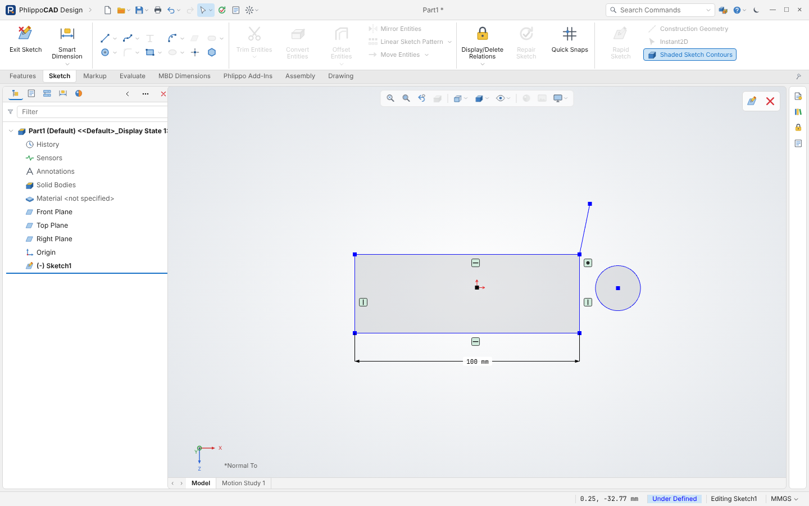

# Phlippo CAD

Phlippo CAD is een onafhankelijk product van Ian Phlippo. Het is niet verbonden met of goedgekeurd door Dassault Systèmes SolidWorks Corp. en bevat geen SOLIDWORKS-code, -bestanden of -artwork; de werkwijze is gemodelleerd naar publiek getoond gedrag van desktop-CAD-software (o.a. referentievideo's). SOLIDWORKS is een merk van Dassault Systèmes en wordt hier alleen ter referentie genoemd. Licentie: `LICENSE.txt`; gebruikte open-sourcepakketten: `THIRD-PARTY-NOTICES.txt`.

Parametrische 3D-CAD-webapplicatie voor werktuigbouwkundig ontwerp (TypeScript, React, three.js), met een interface die het
bekende desktop-CAD-pakket volgt (Command Ribbon, Feature Tree, Property Panel, heads-up werkbalk, bevestigingshoek).



```
npm install
npm run dev        # ontwikkelserver
npm test           # unit tests (vitest)
npm run build      # productiebuild
npm run preview    # serveer de build op :4173
npm run e2e        # Playwright-scenario's tegen de preview
start-app.cmd     # app als eigen venster, schermvullend (Windows, Edge app-modus)
start-desktop.cmd # echte desktop-app (Electron): eigen venster met - [] x, bestandsdialogen
npm run desktop   # desktop-app tegen de dev-server (hot reload)
npm run desktop:build  # installer + portable exe in %LOCALAPPDATA%\PhlippoCAD\release
npm run e2e:desktop    # Playwright-controle van het desktopvenster (na npm run build)
```

Desktop-app: de map `electron/` bevat de shell (main.cjs: randloos venster, native Open/Save As-dialogen; preload.cjs:
de brug `window.phlippoDesktop`). In het venster sturen de knoppen — ☐ ✕ rechtsboven het echte venster, Open/Save/Save As
gebruiken Windows-bestandsdialogen (.kcad, .stl) en Save onthoudt het pad. De installer wordt buiten de OneDrive-map
gebouwd (OneDrive vergrendelt bestanden tijdens de build).

Documentatie:
- `docs/01-research.md` — onderzoek naar workflow en lay-out van parametrische CAD.
- `docs/02-fase1-schetser.md` — architectuur, tests en demo van fase 1 (2D-schetser).
- `docs/03-vergelijking-solidworks.md` — vergelijking met de SOLIDWORKS-handleiding en doorgevoerde aanpassingen.
- `docs/05-vergelijking-video.md` — vergelijking met de YouTube-video (lokale frames) en gevonden verschillen.
- `docs/28-qa-0.5.10.md` — verwerking van het QA-rapport over 0.5.10 (merken, docs, budgetten en splitsplan).
- `docs/06-merken-en-auteursrecht.md` — wat van het origineel vrij is om na te maken en wat vermeden wordt (naam, logo, iconen, merknamen).

Status per fase:
1. 2D-schetser met constraint-solver — **gereed**
2. Feature-modelleren (Extrude met draft en Up To Next/Surface, Cut, Revolve, Sweep, Loft, Rib, Fillet, Chamfer, Mirror, Linear/Circular Pattern, Hole Tool, Shell, Combine; multi-body met materiaal per body; op een mesh-solidkern met booleans) — **gereed**
3. Variabelen en vergelijkingen (Tools ▸ Equations, Σ-maten) en configuraties (Configurations, Modify Configurations, configuratie per component) — **gereed**; ontwerptabellen (Excel) gepland
4. Assemblies (Insert Components, Mates, Move/Rotate, BOM, Interference Detection) — **basis gereed**
5. 2D-tekeningen (Sheet Format/Size, Model View, Projected View, Smart Dimension, Center Mark, Note, titelblok) — **basis gereed**
6. Import/export — STL in/uit en STEP in/uit (B-rep-kernel) **gereed**; tekeningen naar DXF en PDF; IGES niet (de meegeleverde OpenCascade-build heeft geen IGES-writer)
8. Sheet metal (Base Flange/Tab, Edge Flange, Flatten met K-factor) — **basis gereed**; Hem/Jog/Miter/Unfold gepland
7. Massa-eigenschappen en meten — **gereed** (Mass Properties, Measure); materialen en rendering gepland

## Status 0.5.11 (in voorbereiding, 2026-11-02)

Deze release verwerkt het QA-rapport over 0.5.10 (`qa-rapporten/QA-rapport-0.5.10.md`; verslag in
`docs/28-qa-0.5.10.md`). Wat er sinds 0.5.4 bijkwam: zichtbaar resultaat van de plastics-features terwijl het paneel
open is (0.5.5), gekalibreerde belichting en de beginnersworkflow als e2e-script (0.5.6), studiomateriaal en duidelijke
planes (0.5.7), een plane onder de muis alleen in beeld (0.5.8), een uiterlijkcontrole op 1920 x 1080 (0.5.9) en een
testronde op fouten (0.5.10).

In 0.5.11 onder meer:
- Geometrie: een fillet op een gatrand voegt geen volume meer toe (kettingtolerantie en de "Keep features"-hersnede,
  F139); een wrap (Emboss/Deboss) op een exact lichaam houdt het lichaam exact (polyhedrale B-rep-tool); Dome is exact;
  een exacte flens/hem die meer dan 0,5 % van het mesh-resultaat afwijkt, valt terug op mesh met een
  Faceted-waarschuwing; elk lichaam krijgt een kruiscontrole exact tegen facet (F159). De strikte QA-tests met
  gesloten formules staan in `src/qa/` (8 mesh + 13 B-rep) en draaien in `npm test`.
- Assemblies: de nieuwste mate die niet convergeert staat gemarkeerd (`~` in de boom, "Not Converged" in de
  statusbalk).
- Desktop: AutoRecover met één map en één sleutel per document (geen tweede "Part1"), Software OpenGL slaat alleen de
  keuze op; de installer meldt zelf dat hij ongesigneerd is en schrijft `signature-<versie>.txt`.
- Vensters (Two/Four View) tekenen met de hoofdrenderer en vangen een ontbrekende WebGL-context op.
- Namen: het frame-werk heet "Frames" (lint-tab, boom, menu's; oude .kcad-bestanden openen gewoon), de extra
  materiaalbibliotheek "Additional Materials", oude "SW-Density"-vergelijkingen worden "Density"; de merk- en
  neutral-comments-checks scannen ook de e2e-scripts.
- CI: ubuntu-24.04, drie jobs (checks, desktop, regressie als matrix mesh/B-rep/release), één log per pass, skips
  geteld met een budget per script.

Welke platforms getest zijn:
- **Windows 11 (lokaal, commit 0495219):** unit-tests 487/487, typecheck, de tools-checks; regressie mesh 98/98,
  release (B-rep + worker) 98/98, brep-controle 12/12, 0 skips; desktop 12/12 en 9/9 op de release-build;
  geïnstalleerde 0.5.11 19/19. Ruwe logs: `qa-logs/0.5.11/`.
- **Linux (GitHub Actions, ubuntu-24.04):** zie Actions-run <link> (wordt ingevuld zodra de run op deze commit groen is).

Regel voor elke claim in README, docs, TASKS en commitberichten: een getal als "98/98" noemt altijd het **platform**,
de **commit** waarop het draaide en het **ruwe log** (bestand of Actions-run). Een claim zonder die drie telt niet als
groen. Eerdere statussen hieronder noemen meestal alleen Windows-cijfers.

## Status 0.5.4 (2026-10-28)

De rest van het QA-rapport over 0.5.1 is verwerkt (docs/25-qa-rapport-v0.5.1.md).
- Nieuwe features: Dome en Indent (Insert ▸ Features), Mounting Boss, Snap Hook en Lip/Groove (Insert ▸ Fastening Feature).
- Software-OpenGL (SwiftShader) in de desktop-app: Options ▸ Performance, `--software-gl`, of de knop in de melding
  "cannot show 3D graphics". De CI draait de desktopchecks daarmee.
- De statusbalkprompts zijn in eigen woorden herschreven en de neutral-comments-check vangt frame-tags.
- De e2e-scripts slikken geen fouten meer stil in: een optionele stap die faalt, verschijnt als `skip:` in de regressie.

Over de CI: de branch wordt gepusht en de uitslag van GitHub Actions is met `gh run list` te lezen. Tot 0.5.10 was elke
run rood omdat `ubuntu-latest` naar 26.04 ging (geen Playwright-Chromium); sinds 0.5.11 draait de CI op ubuntu-24.04 in
drie jobs (checks, desktop, regressie als matrix). De regressiecijfers hieronder zijn Windows-cijfers; groen op Linux
telt pas met een Actions-run (link bij de status hierboven).

## Status 0.5.1 (2026-10-27)

De laatste 10 playlist-video's (08, 09, 35, 46, 53–58) zijn naast Phlippo gelegd en de verschillen weggewerkt
(docs/24-playlist-video-08-58.md).
- Vergelijkingen in elk maatveld (`=` met Global Variables / Functions / File Properties, Σ), Composite Curve en
  Curve Through XYZ Points als sweeppad, Sketch Fillet in een 3D-schets, Doubled Distance.
- Edit Flange Profile als echte profielschets, Tab1 op plaatwerk, Delete/Keep Body als Property Panel, Rib Type
  Linear/Natural.
- Selection Filter (F5), menu's met uitklapgroepen en beschrijving in de statusbalk, New Document ▸ Advanced,
  contextwerkbalken voor schetsen en vlakken, bodies en vlakken hernoemen.

## Status 0.5.0 (2026-10-27)

De open punten na 0.4.9 zijn afgewerkt (docs/23-open-punten-0.5.0.md).
- Trage parts rebuilden in een eigen worker. Het venster blijft dan vloeiend en de statusbalk toont "Rebuilding…".
- Een mesh-boolean met een opening geeft een gele waarschuwing. What's Wrong toont ook waarschuwingen.
- Vlakken van extrusies hebben een naam. Fillets en chamfers vinden hun rand daardoor terug na een wijziging.
- De PropertyPanel is gesplitst per feature-familie, en een regelbudget in de CI bewaakt de grootte van modules.
- Loft kan naar een vlak van het model lopen, met Tangency To Face, Curvature To Face en Next Face.
- Appearance heeft Basic/Advanced en de tabs Color/Image, Mapping, Illumination en Surface Finish.
- Insert Bends kan afgeschuinde vlakken negeren. Face Fillet kent de methode Hold line.

De regressiecijfers zijn Windows-cijfers. De CI en Linux zijn toen niet gedraaid, omdat er nog niet gepusht werd (sinds 0.5.2 wel; zie Status 0.5.4).

## Status 0.4.9 (2026-10-27)

Het QA-rapport over 0.4.8 is verwerkt (docs/22-qa-rapport-v0.4.8.md).
- Tekeningpicks gebruiken overal 4 px (de Ø-maat faalde op Linux).
- Pack and Go en MBD Dimensions heten nu Package Files en Product Dimensions.
- De statusbalk toont "Faceted n/m" en STEP waarschuwt bij gefacetteerde solids.
- De OpenCascade-oproepen hebben een time-out met herstart, en de ongebruikte solver-worker is weg.
- `Phlippo CAD.exe --self-test` controleert de geïnstalleerde app: app://, WASM, extrude, fillet, STEP en een atomische save.
- De CI draait de desktopchecks en een B-rep-pass.

Eerlijkheidsnoot: de regressiecijfers van 0.3.5 tot en met 0.4.8 zijn Windows-cijfers. Op Linux faalde drawing.

## Status 0.4.8 (2026-10-28)

Elke ribbonknop heeft een tooltip met beschrijving. Een nieuwe weldment krijgt de configuraties Default<As Machined> en Default<As Welded>; As Welded onderdrukt de snedes en gaten na de Weldment-feature.

## Status 0.4.7 (2026-10-28)

Vervolg van de playlist-inventaris:
- **Loft:** profielenlijst met ▲▼, en Apply to all als vinkje.
- **Appearance:** zoals de SOLIDWORKS-PM, met standaardpalet, RGB, ✓/✗ en Remove Appearance.
- **Plaatwerkbochten in de boom:** BaseBend, EdgeBend en MiterBend.
- **Segment:** schetspunten of segmenten.
- **3D-schets:** Insert Line-PM met Orientation Along X/Y/Z en Control Vertex Parameters.

## Status 0.4.6 (2026-10-28)

Playlist-inventaris van video 39 tot 52, en de verschillen weggewerkt:
- **Statusbalk:** prompts per commando, en Total Length, Radius.
- **Contextwerkbalk:** bij een klik op een feature, body of schetsentiteit, met "Make …"-tooltips.
- **Schets-snelmenu:** fly-outs en een maatkop met Link Values, Driven en Mark For Drawing.
- **Modify:** Reverse sense.
- **Equations:** onderdrukking via vergelijkingen.
- **Section View:** Offset perpendicular to.
- **View-menu:** Redraw, Screen Capture, Full Screen, analyses en drie Tangent Edges-keuzes.
- **Evaluate:** Import Diagnostics met Attempt to Heal All.
- **Thread-PM:** zoals in SOLIDWORKS.
- **Kleinere aanpassingen:** Hole Position, ANSI Metric-namen, Fill Pattern, Chamfer-callout, bodies met [n], materiaal als rij en Red Oak/American Cherry.

Zie docs/07 (onderaan).

## Status 0.4.5 (2026-10-28)

Tekening en assembly naast de referentie. Een tekening vult bij het openen weer het hele venster en de bladtabs (Sheet1, Add Sheet) staan onderaan; voorheen bleef het blad op een vaste maat staan. Insert Component in een nieuwe assembly toont het part dat net open was onder Open documents, met de preview meteen aan de cursor (frame 320). Zie docs/21-ontwerpronde-0.4.4.md.

## Status 0.4.4 (2026-10-28)

Ontwerpronde naast de referentievideo (BasePlate). Boss-Extrude (frame 111): de schetsregio is nu donker onder de gele preview, de preview zelf heeft de kleur van de referentie, de schetslijnen blijven effen zwart en de sleeppijl is een gearceerde kegel. Schetsen (frames 70, 82, 95): de contourvulling heeft dezelfde grijswaarden en maten zonder plaatsing komen buiten de schets. De oorsprong staat in partmodus standaard uit, zoals in de referentie. Zie docs/21-ontwerpronde-0.4.4.md.

## Status 0.4.3 (2026-10-27)

Move/Copy Bodies (met kopieën, verschuiving en draaiing, live voorbeeld) en Bodies to Keep (een snede die een lichaam splitst geeft aparte bodies, met de keuzedialoog). Een bugjacht over 54 Property Panels vond één vastloper (Structural Member langs een boog), die is opgelost. Zie docs/20-bodies-bugjacht-0.4.3.md.

## Status 0.4.2 (2026-10-26)

Gemodelleerde schroefdraad langs een echte helix (OpenCascade), en weldment-frames krijgen nu op alle hoeken een verstek. Zie docs/19-brep-schroefdraad-0.4.2.md.

## Status 0.4.1 (2026-10-26)

Ook Miter Flange, Revolve Thin, weldment-frames (Structural Member, Trim/Extend, End Cap), Combine en Intersect, Stud en elk gereedschap met alleen vlakke vlakken bouwen exact met OpenCascade. Zie docs/18-brep-plaatwerk-weldments-0.4.1.md.

## Status 0.4.0 (2026-10-26)

Ook alle extrude-eindcondities (Up To Vertex/Next/Surface/Body, Offset From Surface, From offset, Flip side to cut), Thin Feature en Rib van lijnen, plaatwerk (Base Flange, Tab, Edge Flange, Hem, Jog, Sketched Bend met echte bochtcilinders) en afrondingen met meerdere of variabele radius bouwen exact met OpenCascade. Zie docs/17-brep-eindcondities-0.4.0.md.

## Status 0.3.9 (2026-10-26)

Ook patronen (lineair, cirkelvormig, sketch/curve/table/fill), mirror van features en bodies, loft tussen twee profielen, extrude met draft en de Draft-feature bouwen nu exact met OpenCascade; de mesh-kern blijft de terugval. Zie docs/16-brep-open-stukken-0.3.9.md (met de bevinding over shell naast een afronding).

## Status 0.3.8 (2026-10-26)

De modelleerfeatures bouwen met de B-rep-kern (OpenCascade) en vallen per feature terug op de mesh-kern: extrude en cut, revolve, sweep, Hole Tool, fillet, chamfer en shell geven exacte cilinders, kegels en afrondingen; Mass Properties en STEP-export gebruiken de exacte bodies; de hele Deurkruk (onderdelen en assembly) is exact. Uit te zetten in Tools ▸ Options ▸ Performance. Zie docs/15-brep-features-0.3.8.md.

## Status 0.3.7 (2026-10-26)

STEP in en uit via OpenCascade (File ▸ Open van *.step/*.stp, Save As ▸ STEP AP214), in een eigen worker die pas bij het eerste gebruik laadt. Afrondingen en afschuiningen houden hun rand als een eerdere feature hem verschuift. Geen code signing (besluit): zie docs/14-brep-kern-0.3.7.md, met de metingen van de B-rep-spike en het migratiepad.

## Status 0.3.6 (2026-10-26)

De open punten van het QA-rapport over 0.3.4 die zonder externe beslissing af konden: de hoofdbundel van 2 168 naar 830 kB (dialogen en panelen als eigen chunk, three/CSG/React/kernel apart), de store opgesplitst in negen slices met componenten die alleen hun eigen velden lezen, interne namen zonder programmanamen (bestandsformaat 2 met automatische omzetting van format 1, oude optiesleutels blijven gelden), taakvenster-tabs op referentiemaat en een haalbaarheidsoordeel voor rebuild in een worker. Per punt: docs/13-vervolg-0.3.6.md. Unit tests 346, regressie 81/81.

## Status 0.3.5 (2026-10-26)

Het QA-rapport over 0.3.4 (92 bevindingen, 6/10, NO-GO) is verwerkt, opnieuw zonder nieuwe functies: opslagvraag tijdens Edit Component, half-geldige bestanden geweigerd (verwijzingen, featuretypes, grenzen), What's Wrong bij rebuild-fouten, meldingen bij geweigerde of aangepaste invoer, de laatste programmanamen en "as the original"-commentaren neutraal, Quick Beam Estimate zonder veiligheidskleur, app:// in plaats van file:// (met overzetting van de opgeslagen gegevens), geen debugpoort of permissies in de geïnstalleerde app, testhaken alleen in de e2e-build, één gedeelde e2e-helper, lektest en CI met timeout en git-diff-controle. Per bevinding: docs/12-qa-rapport-v0.3.4.md. Regressie: `npm run build:e2e` en `node e2e/run-regression.mjs`.

## Status 0.3.4 (2026-10-25)

Het externe QA-rapport over 0.3.3 (76 bevindingen, NO-GO) is verwerkt zonder nieuwe functies: de app werkt zonder testhaken (viewport-brug), kapotte documenten worden geweigerd zonder crash of autosave, de Viewer-export is tegen script-injectie beveiligd, undo dekt alle modelwijzigingen, commando's staan grijs zonder body, eigen plaatwerkiconen, vlaklabels zonder overlap, SimulationXpress is een indicatieve Quick Beam Estimate, geen SOLIDWORKS-productnamen meer in de UI, licentie en third-party notices, strengere Electron-instellingen, en elk e2e-script faalt nu ook op een page error. Per bevinding: docs/11-qa-rapport-v0.3.3.md. Unit tests 337, e2e-regressie `npm run e2e:regression` (79 scripts).

## Status 0.3.3 (2026-10-25)

Blokken G-A t/m G-J (docs/10-blokken-g.md): Surfaces compleet, Sheet Metal extra's (Vent, Forming Tool, Gusset, Tab and Slot, Rip, Swept Flange), Evaluate (Performance Evaluation, Symmetry Check, Deviation/Parting Line Analysis, Compare, SimulationXpress-schatting), Customize-dialoog met echte instellingen, Weldments met cut list, Material-velden + MBD Dimensions (DimXpert), Deform, Save As-opties, Publish to Phlippo Viewer (*.html), tekening bend lines. Unit tests 322, e2e-regressie 76 scripts.

## Status 0.3.2 (2026-10-25)

Het externe QA-rapport (52 bevindingen) is verwerkt: dataverlies-routes dicht (rebuild zonder undo-verlies, validatie bij openen, atomaire save met .bak, Save changes?, autosave per document), Electron-beveiliging (paden, CSP, navigatie, testhooks, fuses), invoervalidatie met eenheden, GPU-opruiming, start zoals SW (lege app + Welcome), muisgebaren en Enter-herhaling, exitcodes in alle e2e-scripts en een CI-workflow. Per bevinding: docs/08-qa-rapport.md.
