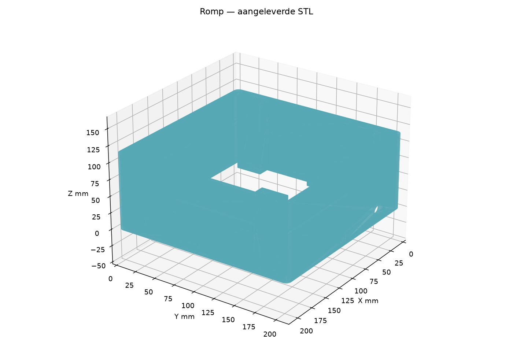
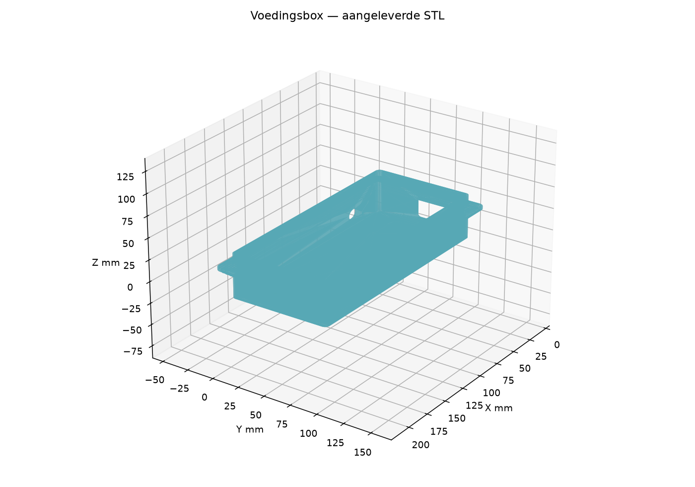
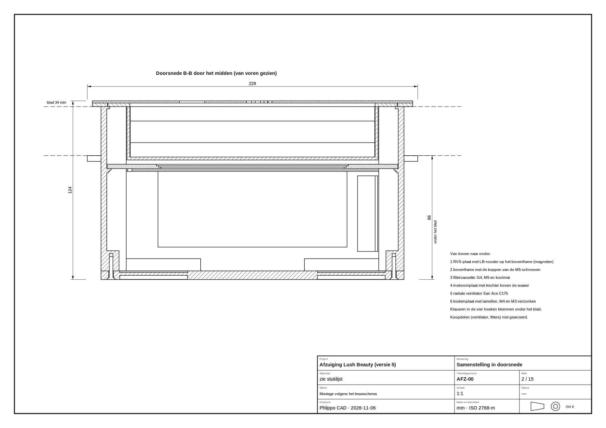
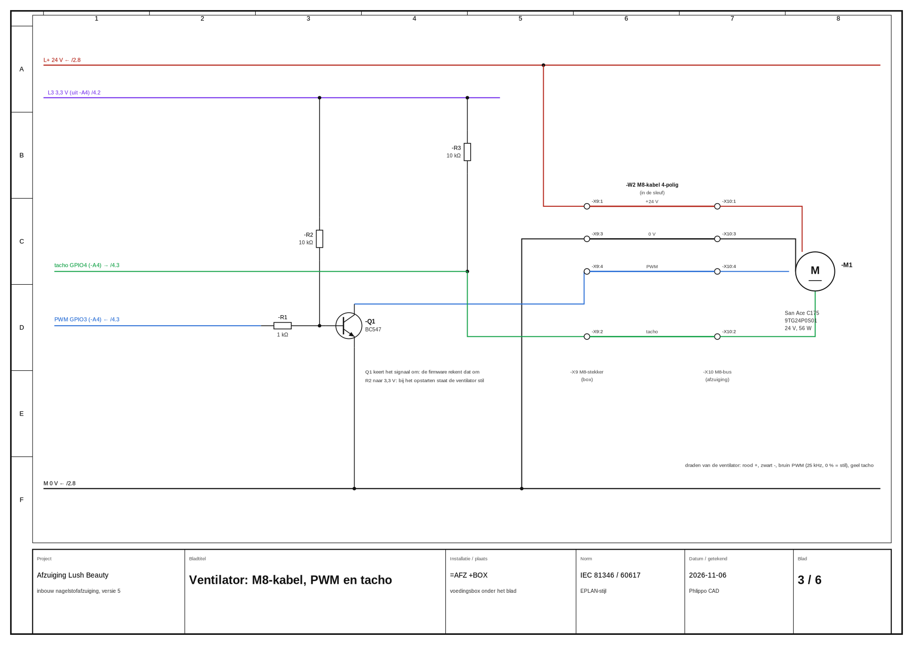

# QA-rapport nageltafelafzuiging — v1

**Datum:** 6 november 2026, Europe/Brussels (CET). **Snapshot op box:** circa 23:07 CET.  
**Beoordeling:** streng technisch bestands-/ontwerponderzoek, geen certificaat of fysieke keuring.  
**Bron:** `C:\Users\ianph\OneDrive\Bureaublad\Phlippo CAD\Claude\voorbeelden\afzuiging`  
**Voor Ian; alleen Ian deelt dit met Claude. Niets aan bronproject gewijzigd. Geen aankoop, betaling of bericht naar Claude.**

## 1. Eindconclusie in gewone taal

**Totaal: 4,3/10. Oordeel: NIET vrijgeven voor productie of salongebruik.**

Dit is een verrassend ver uitgewerkt **zelfbouwontwerp**, geen aantoonbaar afgetest eindproduct: parametermodellen, 77 componenten, ventilator, uitneembare cassette, aparte elektronicabox, AMOLED-draaiknop, draadloze regeling, schema’s, freesmallen, tekeningen en firmware.

Het sterke punt is de samenhang van het concept. Het zwakke punt is de afstand tussen *getekend*, *geëxporteerd* en *veilig bewezen*. Vooral belangrijk:

1. **De enige M5-filtermat is geen bewezen bescherming tegen de fijne nagelstof die je weer de salon in blaast.**
2. **STL’s en tekeningen zijn deels van een oudere uitvoering.** De romp is in CAD 99 mm, maar in STL/tekening 114 mm; de cassette 22 versus 37 mm. Niet mengen of nu laten produceren.
3. **4 van de 9 aangeleverde STL’s zijn niet gesloten solids**, en vier in de handleiding genoemde printbestanden ontbreken helemaal.
4. **Beide firmwarevarianten compileren**, maar dat zegt niets over goed foutgedrag: sensorverlies, ongeldige ijking, laagtoerig uitvallen, stoppen tijdens ijking en radio-koppeling hebben concrete gaten.
5. **500 m³/h en stil/veilig werken zijn nog niet aan het complete apparaat gemeten.** Bevestiging op een hol honingraatblad en warmte/elektrische eindveiligheid missen ook bewijs.

Dit is geen reden om het hele idee weg te gooien. Het is wel een reden om eerst een consistente engineeringrevisie en een veilig prototype af te maken, in plaats van de mooie tekeningen als eindbewijs te behandelen.

**Bevindingen:** 1 Kritiek, 17 Major, 5 Minor, 2 Info. Severity telt unieke oorzaken, niet elke getroffen schroef/bestand apart. Kritiek = blokkade voor veilige vrijgave; dat is niet hetzelfde als bewezen letsel.

## 2. Scores en weging

| Onderdeel | Score | Gewicht |
|---|---:|---:|
| CAD-opzet en nominale maatvoering | 6,5/10 | 15% |
| Productie-export en revisieconsistentie | 2/10 | 15% |
| Luchttechniek en geluid | 4/10 | 20% |
| Fijnstoffiltratie en blootstellingsbeheersing | 2/10 | 15% |
| Elektrisch en thermisch ontwerp | 6/10 | 10% |
| Firmware en foutgedrag | 6/10 | 10% |
| Ergonomie | 6/10 | 5% |
| Onderhoud en reinigbaarheid | 4/10 | 5% |
| Documentatie en reproduceerbaarheid | 4/10 | 5% |
| **Gewogen totaal** | **4,3/10** | **100%** |

Scores beoordelen de huidige *aantoonbaarheid en bruikbaarheid*, niet Claude’s inzet. Onbekend veiligheidsbewijs krijgt geen gratis voldoende. Ook een hoger gemiddelde heft een kritieke blokkade niet op. Dit is nog **geen synthese van de vier nieuwe denkers**; `CASUS.md` is hun neutrale input.

## 3. Wat daadwerkelijk onderzocht is

- Recursieve broninventaris: 27 KCAD, 3 MJS, 5 Python, 9 STL, 3 DXF, 25 SVG, 6 PDF, 5 PNG, 5 HTML, 2 CSV, 2 contour-JSON (`.loops`), firmwarebronnen/headers/configuratie, font en licentie: **102 relevante bestanden**. Grote `.pio`-buildcache/derdepartijlibraries niet gekopieerd.
- Alle 102 originele bestanden geopend/geparseerd op formaat; de 27 KCAD JSON’s en hun feature-/punt-/vlakverwijzingen gecontroleerd. Geen ontbrekende interne sketch-/punt-/vlakverwijzingen gevonden. Alle PDF’s via `pdftotext`; SVG XML; PNG decode; font; drie DXF-parse/audits zonder errors of automatische fixes.
- KCAD-assemblage onderzocht: 77 componenten, **0 mates**. Losse modellen komen inhoudelijk overeen met ingesloten modellen na negeren van `format`/`kind`; tweede adapterklem is bewust 55 mm verschoven in zijn lokale model en is geen zelfstandig aangetoonde fout.
- Negen STL’s op afmetingen, geslotenheid, normals, degeneraties en verbondenheid gecontroleerd met trimesh; extra vertexmerge tot 0,001 mm verandert de vier afkeuringen niet. Geen automatische reparatie als goedkeuring gebruikt.
- Beide firmwaredoelen **schoon op de box gebouwd met PlatformIO**: `knop SUCCESS`, `module SUCCESS`. Geen flash, hardwareaansturing of wijziging op laptop.
- Generatoren alleen op een **wegwerpkopie** uitgevoerd: prijslijst, schema, contour/logo/font werken; hoofd-CAD-generator en freesmallen niet herbouwbaar uit alleen deze map wegens ontbrekende gedeelde `../lib/schets.mjs`. Dat kan normaal in de grotere projectroot staan; geen conclusie dat de laptopgenerator kapot is.
- Hersteller-/referentiebronnen geraadpleegd voor fan, sensor, adapter en normale professionele afzuiging. Marktgetallen zijn claims met verschillende meetmethoden, geen prestatiebewijs voor dit ontwerp.

### Niet uitgevoerd — dus niet als geslaagd verkopen

Geen originele Phlippo CAD-kernelherbouw, SolidWorks-vergelijking, exact B-rep-interferentierapport, CFD, structurele FEM, echte slicer-/printproef, assemblage op tafel, rook-/stof-/blootstellingsproef, geluidsmeting, elektrische eindtest, morsproef of thermische duurtest. Een host-C++ foutinjectieharnas is voorbereid, maar niet uitgevoerd: g++ ontbreekt en de normale pakketinstallatie mislukte. Er is niet om een netwerk-/pakketblokkade heen gewerkt. Firmwarefouten hieronder zijn **statisch navolgbare codepaden**, geen verzonnen hardwaretestuitslagen.

## 4. Wat goed is en behouden mag blijven

- **Doordachte modulaire architectuur:** fan in de module, bediening apart, elektronica bereikbaar in eigen box; weinig eigen 230V-bedrading doordat de gesloten externe-adapterarchitectuur behouden blijft.
- **Echte parametrische opbouw:** 182 sketches + 182 extrusies over de losse KCAD-bestanden; leesbare benoemde features en materialen. Breedte 210 mm rond Ø175mm-fan is in beginsel compact.
- **Goede onderhoudsrichting:** rooster en cassette van boven uitneembaar, magneten verzonken; filterwissel zonder de hele tafel uit elkaar te halen. De reinigingsinstructie moet wel veiliger.
- **Redelijke hardwarebasis:** radiale PWM-fan met tacho, passende nominale 24V/90W-adapter voor de S01, DC-zekering, 3,3V-I²C-pullups en open-collector PWM via NPN. De fanbasisdata zijn geen verzinsel.
- **Firmware is geen lege demo:** toerentalregistratie, druk-CRC, filtering, bewaarde referentie, radio-status, UI met tekst én kleur, boost en ijkprocedure. Beide ESP32-targets compileren zonder bronwijzigingen.
- **Rooster is digitaal netjes onderzocht:** Shapely-contour is geldig; generator opnieuw uitgevoerd geeft één stuk staal, 0 losse eilanden, 218 gaten, 177,8 cm² totaal open en **140,7 cm² boven de cassette** (onafhankelijk opnieuw berekend circa 140,67). Eigen morfologische controle meldt geen vernauwing onder de gekozen 1,5 mm. Dat vervangt nog geen lasersnij-/braam-/belastingstest.
- **Veel leveringsmateriaal:** exploded assembly-/doorsnedetekening, buildstappen, freesmallen met controlemaat, aparte schema’s en BOM. Dat is nuttig, zodra alles dezelfde revisie is.

## 5. Geometrie uit elkaar gehaald

### 5.1 Aangeleverde STL’s — rechtstreeks gemeten

STL-coördinaten zijn naar een printstand verschoven: X/Y is bedvlak, Z is printhoogte; dat is niet het Y-omhoog CAD-assenstelsel. Een andere oriëntatie is geen fout.

| Bestand | Gemeten begrenzing mm | Gesloten | Consistente winding |
|---|---:|---|---|
| Bodemplaat.stl | 210,00 × 210,00 × 6,00 | **NEE** | **NEE** |
| Bovenframe.stl | 222,00 × 222,00 × 2,50 | **NEE** | **NEE** |
| Cassetterand.stl | 200,50 × 200,50 × 2,50 | ja | ja |
| Filtercassette.stl | 174,00 × 194,00 × 37,00 | ja | ja |
| Instroomplaat.stl | 201,40 × 201,40 × 3,00 | ja | ja |
| Knopdeksel.stl | 43,00 × 42,99 × 2,00 | **NEE** | ja |
| Knophouder.stl | 51,60 × 51,60 × 62,00 | **NEE** | **NEE** |
| Romp.stl | 210,00 × 210,00 × 114,00 | ja | ja |
| Voedingsbox.stl | 218,00 × 108,00 × 50,00 | ja | ja |

**Slechts 5/9 voldoen aan deze twee basis-meshchecks.** Ook een gesloten mesh bewijst geen correcte passing, dikte, lekvrijheid of veiligheid. Volumes van de vier ongeldige meshes worden niet als betrouwbare massaberekening gebruikt. Duizenden topologische fragmenten zijn meshdefecten, niet duizenden echte onderdelen.

### 5.2 Nieuwste nominale maatketens uit bron/CAD

| Ketting | Rekenkundig resultaat | Beoordeling |
|---|---|---|
| Romp 210 in uitsparing 212 | 1 mm vrij per zijde | Nominaal aannemelijk; freesradius/blad en FDM werkelijk controleren |
| Frame 222 over uitsparing 212 | 5 mm oplegrand per zijde | Smal; belasting/bladsterkte aantonen |
| Cassette 174×194, wand2 | Binnenmaat 170×190, diepte20 bij bakhoogte22 en bodem2 | Filtermaat sluit nominaal aan; snijtolerantie en dichting ontbreken |
| Cassetterand 200,5 in opening201 | 0,25 mm/zijde | Krappe FDM-passing; géén pakking |
| Cassette onderzijde -22; inlaat bovenzijde -25 | 3 mm nominale tussenruimte | Nominaal geen overlap; niet te bewijzen met de oude 37mm-cassette-STL |
| Inlaat onderzijde -28; fan bovenzijde -30 | 2 mm axiale vrije ruimte | Custom nozzle/nauwe overgang moet aero- én tolerantietechnisch worden getest |
| Fan: -30 - 69 = -99 | Sluit nominaal aan op bovenzijde bodemplaat -99 | Hoogteketting coherent, geen echt fanmodel-/dynamisch-clearancebewijs |
| Bodemplaat onderzijde -105; bladonderzijde -34 | 71 mm onderhang | Klopt voor 34mm-blad, niet voor de oude romp-STL |
| Frame2,5 + staal1,5 | 4 mm boven blad | Klopt; randen ontbramen/polscomfort testen |
| Knopbuis Ø43 in gatØ44 | 0,5 mm radiaal | Nominaal aannemelijk |
| Magneten2 in pocket2,1 bij frame2,5 | 0,4 mm resterende bodem | Printkwaliteit, lijm en uittrekkracht testen |

Vier klauwen, moerkamers en uitschuifsleuven zijn daadwerkelijk gemodelleerd. De gewone componentplaatsing bevat echter geen bewegingsmates of automatische passinggarantie. Bouten/koopdelen zijn vereenvoudigd; draadkernmodellen bewijzen geen werkelijk schroefdraadengagement. Voor alle bladdiktes 10–50mm ontbreken een gevalideerde zwaaibaan, botsingsmatrix en een fysieke montageproef. **Geen harde uitspraak “alles past” gerechtvaardigd.**

### 5.3 Tekeningen zijn bewijs van een revisieprobleem, niet van de nieuwste geometrie

De onderstaande aangeleverde doorsnede toont nog drie filterlagen, 86mm onderhang en breedtemaat229. Dat is niet de nieuwste één-M5/71mm-onderhang-uitvoering. De PDF/BOM mag niet naast nieuwe KCAD als dezelfde revisie naar een maker.

## 6. Lucht, stof en geluid: controleberekeningen

### Catalogus fan versus echt werkpunt

De officiële Sanyo Denki-pagina bevestigt **9TG24P0S01: Ø175×69 mm, 24V, 2,35A, 56,4W, 3900rpm, 11,6m³/min = 696m³/h, 609Pa, 69dB(A)**. Vrijdebiet en maximale statische druk zijn verschillende uitersten; je krijgt **niet 696m³/h bij 609Pa**. Familiecatalogus vermeldt de prestaties met optionele inlaatnozzle. De eigen getrapte instroomplaat is daarmee niet automatisch gelijkwaardig.

Bij de geclaimde **500m³/h = 0,1389m³/s**:

- Filterfront 170×190mm = 0,0323m² → **4,30m/s** gemiddelde frontsnelheid. Voor een vlakke 20mm-mat is dit hoog genoeg om een echte drukval-/efficiëntiecurve onmisbaar te maken.
- Open rooster boven cassette 140,7cm² = 0,01407m² → **9,87m/s** gemiddelde snelheid in die openingen, niet hetzelfde als vangstsnelheid op 5–10cm boven de tafel.
- Nominale kleinste inlaatdiameter circa127mm → **10,96m/s**. Bij luchtdichtheid1,2kg/m³ is de dynamische druk daar circa72Pa; voor het rooster circa58Pa. Dit zijn **geen totale drukverliezen**: die zijn afhankelijk van geometriecoëfficiënten, contractie, filter, uitlaat en montage. Niet optellen als een bewezen systeemcurve.
- Er is **geen afvoerslang/duct** in dit ontwerp; de 3×5mm-slang is uitsluitend een meetslang. Een slangdebietberekening zou dus onjuist zijn. Uitblaas via bodemplaatlamellen, vrij in de ruimte; achterwaartse straal/recirculatie nog niet bewezen.
- Halvering van toerental geeft in een vergelijkbaar systeem vaak circa halve Q en kwart druk, maar **50% PWM is niet bewezen 50% RPM**. “170m³/h op de helft” en “54dB” zijn geen testresultaten.

### Normale professionele vergelijkingspunten — geen gelijke meetbank

| Referentie | Gepubliceerde specificatie | Betekenis |
|---|---|---|
| ÜLKA Premium built-in | circa486m³/h, 52W, HEPA; verkoper beschrijft 20×22,5cm × 3m/s | Marktreferentie, niet onafhankelijke certificatie; andere oppervlakte en meetmethode |
| Holivica Pro2 built-in | circa465m³/h, 48W, HEPA | Verkopersclaim; niet direct vergelijkbaar met fanvrijdebiet |
| SHEMAX Style V-PRO | tot4,4m/s, 60W, HEPA, vangvlak24×17cm | Snelheid is geen volumestroom zonder meetveld; geen eigen m³/h afleiden als prestatiegarantie |
| Dit ontwerp | fanvrijdebiet696; systeembelofte circa500, één M5-mat | Fan is krachtig genoeg als uitgangspunt; filter en werkpunt blijven de doorslaggevende onzekerheid |

De HEPA-aanduiding van een winkel is op zichzelf ook geen volledige systeemcertificatie. Voor dit project is nodig: exact filtertype/klasse, testdocumentatie, lekvrij ingebouwd systeem en aantoonbare bronvangst onder echt werk. **Een deeltjesfilter verwijdert bovendien geen oplosmiddeldampen/VOC’s.** Goede algemene ventilatie blijft nodig; claim geen bescherming tegen dampen door deze M5-mat.

HSE noemt nagelstof als risico op ademhalingsklachten en astma en beveelt bronafzuiging/downdraft en algemene ventilatie aan. Dit is een technische gezondheidsreferentie, **geen verklaring dat Britse COSHH-termijnen automatisch Belgische wetgeving zijn**.

## 7. Elektronica en software

### Wat de build wél bewijst

PlatformIO `espressif32@6.9.0`; Arduino; `knop` en `module` allebei **SUCCESS**. Knop gebruikt44.444/327.680 bytes RAM (13,6%) en884.593/6.553.600 bytes flash (13,5%); module **38.356/327.680 bytes RAM (11,7%)**, **741.870/1.310.720 flash (56,6%)**. De build bewijst compileerbaarheid tegen de vastgelegde libraries; niet dat displaypins, FPC-volgorde, draairichting, ESP-NOW in metaal/tafel of de sensor op echte hardware werken.

De sensoropdracht `0x3615`, adres`0x25`, schaal en CRC-aanpak passen bij de gekozen Sensirion-familie. De foutafhandeling rondom die metingen schiet tekort. Zie AFZ-07 t/m AFZ-14.

### Rekenkundige voeding

S01-fan nominale 56,4W laat op90W nominaal **33,6W** ruimte vóór besturing, regelaarverlies en belastings-/startvariaties. Dat is een redelijke eerste keuze, geen afgeronde stroom-/temperatuurkwalificatie. De zekering3,15A×24V vertegenwoordigt75,6W als simpele nominale productwaarde; een trage zekering is geen nauwkeurige stroomregelaar en de werkelijke tijd-stroomcurve is nodig. Het G01-alternatief past aantoonbaar niet binnen90W.

De 230V blijft binnen de gesloten klasse-I-netadapter met C14 en geschikte geaarde C13-aansluiting; er is **geen bewijs gevonden van zelf aangelegde open 230V-bedrading**. Aarde niet weglaten, adapter niet openmaken, netstekker uit vóór onderhoud. De DC-schakelaar maakt de netadapter **niet** spanningsloos. Laat eindveiligheid door een competente persoon controleren, inclusief de ingebouwde thermische omgeving, kabels en bescherming bij fouten.

## 8. Volledige bevindingenlijst voor Claude

### AFZ-01 — Kritiek: Gezondheidsbescherming door één M5-mat is niet aangetoond

**Status:** Ontbrekend veiligheidsbewijs; M5-keuze vastgesteld.

**Waarom dit telt:** De lucht wordt naar de werkruimte teruggeblazen. M5 is geen HEPA; zonder fijnstofefficiëntie en systeemlektest is niet bewezen dat schadelijke fijne nagelstof wordt tegengehouden. Een hoge volumestroom lost dit niet op.

**Bewijs:** `README.md:5,17,21,80,252; maak-afzuiging.mjs:51-54. Geen filterspecifiek certificaat of emissiemeting in de 102 bestanden.`

**Actie voor Claude:** Kies een exact, getest filter met gedocumenteerde efficiëntie voor de relevante deeltjes, bij voorkeur een passend gecertificeerd HEPA-concept (bijvoorbeeld H13), met afdichting en voldoende plooivlak. Herbereken het werkpunt. Laat recirculatie/bronvangst en blootstelling deskundig valideren; alternatief: geschikte afvoer naar buiten. Tot die tijd geen salongebruik.

### AFZ-02 — Major: Productiebestanden en tekeningen zijn niet dezelfde revisie als de CAD

**Status:** Vastgesteld.

**Waarom dit telt:** Wie de STL en bouwtekeningen volgt, bouwt een andere uitvoering. Onderdelen kunnen niet zonder meer gemengd worden.

**Bewijs:** `Romp.kcad / feature f2: 99 mm, print/Romp.stl: 114 mm; Filtercassette.kcad / f2: 22 mm, STL: 37 mm; Voedingsbox CAD kuip 210×100, STL totale begrenzing 218×108×50 met oude rand. Werktekeningen PDF/AFZ-01 vermeldt 114; AFZ-04 37; doorsnede vermeldt G4/M5/koolmat en totale breedte 229. stuklijst.csv:6-9,14,20,24 heeft oude filters, stalen klauwen en M3×60; actuele assemblage heeft één M5, PETG-klauwen, M4×65. README.md:151 noemt boxfreesmaat 202×92 maar :178 212×102.`

**Actie voor Claude:** Bevries één revisie en regenereer ALLE STL, DXF, SVG, PDF, BOM, freesmallen en README uit die bron. Voeg revisienummer en geometriehash toe; CI moet maatverschillen afvangen. Trek de oude productieset expliciet in.

### AFZ-03 — Major: Vier van de negen STL zijn geen gesloten consistente solids

**Status:** Vastgesteld.

**Waarom dit telt:** De aangeleverde bestanden zijn niet betrouwbaar printklaar. Automatisch herstellen door een slicer kan gaten/kanalen wijzigen.

**Bewijs:** `print/Bodemplaat.stl, Bovenframe.stl, Knophouder.stl: niet watertight én inconsistente winding; Knopdeksel.stl: niet watertight. Audit ook na vertexmerge op 0,001 mm nog onvoldoende. mesh-audit.json en mesh-edge-audit.json.`

**Actie voor Claude:** Herstel de bron/exportbooleans, exporteer opnieuw en eis per onderdeel gesloten manifold, consistente normals en exact één bedoelde solid. Controleer daarna snijlagen in de echte slicer. Niet stilzwijgend auto-repairen.

### AFZ-04 — Major: Vier voorgeschreven printbestanden ontbreken

**Status:** Vastgesteld.

**Waarom dit telt:** Het voorgeschreven bouwpakket is niet compleet.

**Bewijs:** `README.md:138,141-143 noemt print/Deksel-voedingsbox.stl, Klauw.stl, Knopklauw.stl en Adapterklem.stl; alle vier ontbreken in bronbewijs-v1.zip. Er zijn wel KCAD-bestanden.`

**Actie voor Claude:** Exporteer deze vier typen, aantallen respectievelijk 1/4/2/2, uit de vrijgegeven revisie; valideer maten en sliceroriëntatie.

### AFZ-05 — Major: Cassette-oplegging is niet hetzelfde als bewezen luchtdichtheid

**Status:** Vastgesteld.

**Waarom dit telt:** Lekkage langs een filter kan fijne stof ongefilterd naar de ventilator en terug de ruimte in sturen. FDM en lijmnaden voegen lekpaden toe.

**Bewijs:** `README.md:32 beweert luchtdicht; maak-afzuiging.mjs:48-49,139-141,247-264 toont een uitneembare rand op een richel, zonder gespecificeerde pakking/compressie of lekdebiet. De genoemde bemonsteringstest is niet meegeleverd als uitvoerbaar testbestand.`

**Actie voor Claude:** Ontwerp vervangbare gesloten-cel pakking met gecontroleerde compressie en retentie; dicht lijm-/doorvoernaden. Meet bypass met gemonteerd rooster, schone en beladen filter en na herhaald uitnemen. Een geometrische rastertest bewijst geen luchtdichtheid.

### AFZ-06 — Major: 500 m³/h, dagelijks 40–60% en stilte zijn onbewezen systeemprestaties

**Status:** Vastgesteld.

**Waarom dit telt:** Het echte werkpunt kan fors lager zijn; onvoldoende bronvangst terwijl de gebruiker op de claims vertrouwt.

**Bewijs:** `README.md:39-42. Fanwaarden kloppen als catalogusmaxima, maar geen systeemcurve/filterdrukcurve, meetrapport of akoestische meting. De cataloguswaarden gelden met optionele inlaatnozzle; maak-afzuiging.mjs:310-325 gebruikt een eigen getrapte plaat.`

**Actie voor Claude:** Meet Q–Δp op de complete unit, schoon én beladen; leg per PWM de minimale werkstand vast via vangst-/blootstellingsproeven met handen en frees. Meet geluid op oorpositie. Geef gemeten, niet geschatte bedrijfswaarden.

### AFZ-07 — Major: Sensorfout na succesvolle start laat oude meetwaarde geldig staan

**Status:** Statische code-trace; geen fysieke foutinjectie.

**Waarom dit telt:** Filter-/luchtstroombewaking kan stoppen terwijl de status een werkende meter blijft tonen.

**Bewijs:** `firmware/src/module/main.cpp:181-184,219-226: bij status.meter=true en sdpLees=false wordt meter niet false, dp niet ongeldig en geen fouttijd bijgehouden; :239 vereist gemeten, waardoor alarmberekening stilvalt.`

**Actie voor Claude:** Houd laatste geldige meettijd bij; maak waarden ongeldig na timeout, toon sensorstoring, herinitialiseer gecontroleerd en blokkeer ijken met ongeldige data. Voeg disconnect/CRC/NACK/hersteltests toe.

### AFZ-08 — Major: IJking zonder geldige samples wordt toch opgeslagen als geslaagd

**Status:** Statische code-trace; geen fysieke foutinjectie.

**Waarom dit telt:** Een ongeldige referentie kan een onterechte filtermelding of onbetrouwbare bescherming opleveren.

**Bewijs:** `firmware/src/module/main.cpp:145-164: ijkN=0 geeft 0, vervolgens max met 1 en monotone correctie; geijkt wordt zonder kwaliteitscontrole true. Bij vijf lege stappen wordt de referentie [1,1,1,1,1] Pa.`

**Actie voor Claude:** Eis per punt minimum aantal samples, valide sensor/RPM, plausibel positief bereik, herhaalbaarheid en geen clipping; verwerp een foutieve ijking en behoud de vorige geldige referentie.

### AFZ-09 — Major: Uit-opdracht onderbreekt ijkcyclus niet

**Status:** Vastgesteld.

**Waarom dit telt:** De ventilator blijft tijdens de circa 40 seconden ijking doorlopen/opschakelen ondanks softwarematig uitzetten. De fysieke schakelaar blijft wel een uitschakelmogelijkheid.

**Bewijs:** `firmware/src/module/main.cpp:229-237: zolang ijkStap actief is, wordt ijkVerder uitgevoerd; :145-147 zet PWM op de ijkstap zonder opdracht.aan te controleren.`

**Actie voor Claude:** Maak annuleren/stoppen expliciet en prioritair; onderscheid start-ijken van normale uitstand zodat de gewenste gebruikersinteractie ondubbelzinnig is. Test stop op elk ijkpunt.

### AFZ-10 — Major: Bij 20% en 25% ontbreken stilstand- en luchtstroomcontroles

**Status:** Vastgesteld.

**Waarom dit telt:** Dat zijn toegestane werkstanden, maar een losgekoppelde/stilstaande ventilator of ontbrekende stroming wordt daar niet op dezelfde manier bewaakt.

**Bewijs:** `firmware/src/module/main.cpp:232,238-242,251: doel mag vanaf 20, beide bewakingen vereisen doel>=30.`

**Actie voor Claude:** Valideer het bruikbare toerentalbereik, verbied onvoldoende vangststanden en maak alarmdrempels afhankelijk van gemeten RPM/werkpunt in het volledige toegestane bereik.

### AFZ-11 — Major: Iedere gelijksoortige ESP-NOW-zender kan deze module besturen

**Status:** Vastgesteld.

**Waarom dit telt:** Twee tafels kunnen elkaar beïnvloeden; een vreemd bericht met de bekende magic kan aan/uit, snelheid of ijking beïnvloeden. Magic en sessie zijn geen authenticatie.

**Bewijs:** `firmware/src/module/main.cpp:118-126 negeert afzender-MAC; :193-198 broadcast, encrypt=false. firmware/src/knop/main.cpp:81-89 idem status; protocol.h:12-22 geen apparaat-ID of authenticatie.`

**Actie voor Claude:** Koppel uniek knop en module, controleer afzender en apparaat-ID; gebruik passende ESP-NOW-beveiliging, volgnummer/replaybescherming en gevalideerde waarden. Test twee units naast elkaar.

### AFZ-12 — Major: Boost kan na verbindingsverlies onbeperkt op 100% blijven

**Status:** Vastgesteld.

**Waarom dit telt:** De beloofde twee minuten gelden alleen als de knop de terugschakelopdracht nog verstuurt. Vasthouden van laatste stand is bewust gekozen, maar de module kent geen boosttimer.

**Bewijs:** `protocol.h:5-6,16-23 heeft alleen pct/aan/ijk/sessie; knop/main.cpp:40,95-108 bepaalt de timer; module/main.cpp:205-237 houdt laatste opdracht.`

**Actie voor Claude:** Verplaats boost-deadline naar de module of stuur een lease/tijdsduur. Leg expliciet vast welke veilige blijvende zuigstand geldt bij radiostoring; niet blind na timeout de stofvangst uitzetten.

### AFZ-13 — Major: Voorgesteld alternatief 9TG24P0G01 past niet op de 90W-voeding

**Status:** Vastgesteld.

**Waarom dit telt:** Het alternatief is geen uitwisselbare keuze: 93,6 W / 3,9 A nominaal alleen voor de fan overschrijdt 90 W / 3,75 A, nog zonder de besturing.

**Bewijs:** `README.md:55-56; prijslijst.csv:2; officiële San Ace familiecatalogus: G01 93,6 W/3,9 A versus S01 56,4 W/2,35 A.`

**Actie voor Claude:** Schrap het alternatief uit dit ontwerp of kwalificeer voeding, zekering, kabels, connectoren, warmte en werkpunt opnieuw voor die fan. Houd het exacte S01-bestelnummer aan.

### AFZ-14 — Major: Drukmeting en vol-algoritme zijn niet over het hele bereik onderbouwd

**Status:** Ontwerprisico; daadwerkelijke overrange niet gemeten.

**Waarom dit telt:** ±500 Pa kan het volledige mogelijke 609Pa-fanbereik niet gekalibreerd afdekken. Boven 250 Pa schoon zou een verdubbelingsgrens buiten 500 Pa vallen. De meting omvat ook rooster-/inlaatverliezen; handen kunnen die beïnvloeden.

**Bewijs:** `README.md:39,46; module/main.cpp:41-47,239-242; schema/blad-4.svg: referentie kamerdruk, slang onder filters; Sensirion nominale meetrange ±500 Pa.`

**Actie voor Claude:** Kies bereik/resolutie op basis van gemeten schoon/vuil-curve met marge, detecteer overrange en bepaal een gevalideerde onderhoudsgrens op basis van minimale vangst. Gebruik eventueel twee meetpunten werkelijk over het filter; noem de waarde niet zonder bewijs een nauwkeurige volheidsmeting.

### AFZ-15 — Major: Draagkracht op honingraatblad en langdurige PETG-klemkracht niet gevalideerd

**Status:** Vastgesteld.

**Waarom dit telt:** De module kan loskomen of het blad lokaal indeuken; een insert in epoxy in een hol blad heeft geen bekende uittreksterkte zonder uitgewerkt anker.

**Bewijs:** `README.md:33,83,178,184,193; maak-afzuiging.mjs:44-45,68-75. Geen bladopbouw, ankerproef, momentlimiet of kruiptest.`

**Actie voor Claude:** Voorzie aantoonbaar dragende houten/inzetblokken of rug-/verdeelconstructie, definieer lijmvoorbereiding en aandraaimomenten. Proef op werkelijk blad, langdurige belasting, warmte en herhaalde montage. Bereken klauwbuiging en de dunne zone boven de moerkamer.

### AFZ-16 — Major: Elektrische en thermische eindveiligheid niet bewezen

**Status:** Ontbrekend veiligheidsbewijs; geen vastgestelde 230V-bedradingsfout.

**Waarom dit telt:** Een gekeurde adapter maakt de volledige ingebouwde unit niet automatisch veilig. Box, bedrading, USB-bron en foutcondities moeten samen worden getest.

**Bewijs:** `README.md:31,74,77,112,193; schema/maak-schema.mjs:128-136,212-231. Wel DC-zekering en massa; geen draad-/connector-derating, temperatuurmeting, trekontlastingsproef, foutstroom/USB-bronkwalificatie of eindinspectierecord.`

**Actie voor Claude:** Houd C13/C14-aarde intact; laat de adapter gesloten. Controleer exacte M8-stroomrating, zekering-tijd/stroom en foutlus, stroompaden van gaatjesprint, trekontlasting, soldeerisolatie, ompoling en 5V-overbelasting. Kwalificeer USB-C-source (Rp/CC, foutbeveiliging en terugvoeding bij flashen). Meet temperaturen in de ingebouwde box op hoogste last en bij geblokkeerde ventilatie.

### AFZ-17 — Major: Filter uitkloppen als standaardonderhoud verspreidt stof opnieuw

**Status:** Vastgesteld.

**Waarom dit telt:** De gebruiker kan juist tijdens reinigen een geconcentreerde stofwolk inademen; filterprestaties na uitkloppen zijn onbekend.

**Bewijs:** `README.md:27,46,252. Geen gesloten afval-/wisselprocedure of filterfabrikantinstructie.`

**Actie voor Claude:** Schrijf een stofarme wisselprocedure: uitschakelen, gecontroleerd uitnemen, direct verpakken en afvoeren. Niet uitkloppen of uitblazen in de salon. Reinig/hergebruik alleen als de exacte filterfabrikant dat toestaat; bescherm gebruiker en omgeving.

### AFZ-18 — Major: Vinger-, vloeistof- en gebruik-zonder-filterbeveiliging ontbreken als bewijs

**Status:** Ontwerprisico; geen fysieke probe-/morsproef.

**Waarom dit telt:** Magnetisch afneembaar rooster geeft snelle toegang; morsen kan via rooster naar fan, en veilig bereik via de uitblaas is niet aangetoond.

**Bewijs:** `README.md:15,21,27,253; maak-afzuiging.mjs:61,216-225,279-307. Geen interlock, morsproef of bereikbaarheidstest in de set.`

**Actie voor Claude:** Onderzoek bereikbaarheid van bewegende delen met passende testprobes en alle toegankelijke openingen, ook bij onderhoud. Voorzie waar nodig vaste afscherming/interlock, morspad/lekopvang en filteraanwezigheidsdetectie of onderbouwde gelijkwaardige maatregelen. Een sensorreferentie is geen fysieke afscherming.

### AFZ-19 — Minor: Montage-instructies USB-printje en kabelpositie spreken elkaar tegen

**Status:** Vastgesteld.

**Waarom dit telt:** De bouwer kan gaten maken/schroeven plaatsen in een print die juist geen gaten heeft, of een stekkerpositie verkeerd begrijpen.

**Bewijs:** `README.md:60 zegt 12×15 zonder gaten/klemmen; :194 zegt schroeven met 2×M2×5; :195 noemt USB 18–26 mm onder bovenvlak. maak-afzuiging.mjs:93,488-499 zet opening op Y=-55,7..-51,8 vanaf bovenvlak (bij 34mm blad circa 18–22mm onder ONDERVLAK).`

**Actie voor Claude:** Herschrijf instructie volgens de echte uitvoering: klemconstructie en correcte datumvlakken. Voeg doorsnede met stekker, kabelbocht en montagevolgorde toe.

### AFZ-20 — Minor: Passingen zijn nominaal maar niet procesmatig gekwalificeerd

**Status:** Vastgesteld.

**Waarom dit telt:** Krappe FDM-passingen kunnen klemmen; te losse passingen veroorzaken lekken. Ingelijmde magneten hebben maar circa 0,4 mm bodem in 2,5mm-frame.

**Bewijs:** `maak-afzuiging.mjs:38,48-49,87,90,207-212: opening 201 mm en rand 200,5 mm = 0,25 mm speling/zijde; knopbuis Ø43 in gat44 = 0,5 mm radiaal; moerkamers +0,2/+0,3 mm.`

**Actie voor Claude:** Maak passingscoupons voor gekozen PETG/printer, definieer maat- en vlakheidstoleranties, nazorg, lijmspleten en magneetretentie. Bewijs demontage na vervuiling en warmte. Gebruik niet alleen algemene tekeningtolerantie voor lek-/lijmvlakken.

### AFZ-21 — Minor: Materiaal- en reinigbaarheidclaims zijn te algemeen

**Status:** Vastgesteld.

**Waarom dit telt:** FDM-ribbels, poriën en lijmnaden zijn lastig consistent te reinigen; chemische bestendigheid van elk filament/epoxy is niet gegarandeerd door alleen de naam PETG.

**Bewijs:** `README.md:112 noemt PETG bestand tegen aceton en circa 75°C; specifieke filament-/epoxydatasheets en desinfectieproeven ontbreken.`

**Actie voor Claude:** Kies exact materiaal, definieer reinigingsmiddel/contactduur en test coupons en belaste lijmnaden. Werk stof-/contactvlakken glad en bereikbaar; beoordeel kruip/brandgedrag afzonderlijk van temperatuurclaims.

### AFZ-22 — Minor: Ergonomie is niet gevalideerd aan de echte tafel

**Status:** Vastgesteld.

**Waarom dit telt:** 71mm onderhang en de knopplaats kunnen op papier passen, maar knieën, polsen, zuigpositie en achterwaartse luchtstraal zijn nog niet getest.

**Bewijs:** `README.md:25-26,177,242 verwijst naar ../bureau/Bureau.kcad buiten deze set. Nieuwste nominale module onderzijde Y=-105, bladonderzijde=-34 geeft 71 mm; rooster 4 mm boven blad.`

**Actie voor Claude:** Maak een schaal-1:1 mock-up met klant én stylist, echte stoelen, armsteunen en handposities; test vangst met handen 0/5/10 cm boven rooster, tocht, trillingen en achterwaartse uitblaas. Meet vrije kniehoogte op de echte tafel.

### AFZ-23 — Minor: Generatoren zijn niet zelfstandig reproduceerbaar vanuit deze map

**Status:** Scopebeperking vastgesteld; geen bewezen fout in gedeelde projectroot.

**Waarom dit telt:** De meegeleverde set mist een gedeelde afhankelijkheid. Dat bewijst niet dat de generator op de laptop stuk is, maar een reviewer kan hem uit alleen deze map niet draaien.

**Bewijs:** `maak-afzuiging.mjs:29 importeert ../lib/schets.mjs, niet in deze map/het bronbewijs. CAD-generator en maak-mallen.mjs stoppen op ERR_MODULE_NOT_FOUND op de box; maak-schema.mjs werkt.`

**Actie voor Claude:** Lever een gecontroleerde minimale gedeelde library mee of een dependencymanifest plus werkende reproduceeropdracht vanuit de projectroot. Voeg de genoemde lek-/geometrie-/regressietests als bestanden en rapportages toe.

### AFZ-24 — Info: Kostprijs is een rekenindicatie, geen gecontroleerde offerte

**Status:** Vastgesteld.

**Waarom dit telt:** 495,08 euro telt rekenkundig op, maar leveranciers, leverbaarheid, verzendkosten, lijmverlies, iteraties en arbeid zijn niet geverifieerd. CSV laserrijen hebben materiaal/aantal andersom dan kop suggereert.

**Bewijs:** `prijslijst.py:24-36 reproduceert 495,08; prijslijst.csv:43-44 kolom Aantal bevat materiaal/leeg en type bevat 1. README.md:159 verwijst naar winkels in CSV, maar die CSV bevat geen leveranciers-URL-kolom.`

**Actie voor Claude:** Voeg bronlink/datum/BTW/verzending/verpakking en exacte bestelnummers toe, herstel CSV-kolomvolgorde; onderscheid verbruikskosten, volledige inkoop en prototype-iteraties. Geen aankoop uitgevoerd.

### AFZ-25 — Info: Digitale review is geen bedrijfs- of conformiteitskeuring

**Status:** Vastgesteld.

**Waarom dit telt:** Alleen de meegeleverde bestanden zijn beoordeeld. Er is geen fysieke unit, echte SolidWorks-rebuild, rook-/stof-/geluid-/temperatuurproef of gecertificeerde LEV-inbedrijfstelling uitgevoerd.

**Bewijs:** `Afzuiging.kcad bevat 77 geplaatste componenten en 0 mates. De andere bestanden zijn KCAD/mesh, geen STEP/SLDPRT/SLDASM. Host-foutinjectieharnas voorbereid maar niet uitgevoerd: g++ ontbreekt; installatie mislukte. Twee ESP32-builds slagen wel.`

**Actie voor Claude:** Laat na revisie een maat-/botsingscontrole in de daadwerkelijke CAD-kernel, slicercontrole en fysieke veiligheids-/vangstvalidatie doen. Rapporteer onbekend als onbekend; niet presenteren als 100% werkend.

## 9. Top 5 vervolgstappen — in deze volgorde

1. **Gezondheid/filtersysteem vastleggen (AFZ-01/05/06/14/17).** Exacte filterkeuze, pakking, drukcurve en veilige wisselprocedure. Geen retourlucht als veilig verkopen voordat efficiëntie en bypass bewezen zijn.
2. **Eén productierevisie maken (AFZ-02/03/04).** Niet verder bouwen op de huidige STL/PDF-mix. Alle exports inclusief ontbrekende delen opnieuw genereren; geautomatiseerde maat-/mesh-/BOM-checks; eerst vrijgavebewijs.
3. **Firmware foutbestendig maken (AFZ-07 t/m12).** Eerst tijdigheid sensor, ongeldige ijking, prioritaire stop, dekking20–100%, unieke koppeling en boostdeadline aan modulekant; regressietests met foutinjectie.
4. **Dragende en elektrische/thermische uitvoering bewijzen (AFZ-13/15/16/18).** Exact S01-type; bladversterking, klem-/kruiptest, kabel-/zekering-/USB-kwalificatie, guards/morsveiligheid en temperatuurduurtest.
5. **Een meetbaar veilig prototype kwalificeren.** Werkelijke montage, slicerlagen, afmetingen en botsingen, filterwissels, vangst met beide handen/frees, blootstelling, geluid en langdurig gedrag. Meet minimum veilige werkstand en leg acceptatiecriteria vooraf vast. Daarna pas nieuwe score en salonvrijgave.

## 10. Concrete acceptatie-/hertestlijst

| Poort | Verplicht bewijs vóór aftekenen |
|---|---|
| Revisie | Elke CAD/STL/DXF/PDF/BOM dezelfde ID/hash; geen ontbrekende onderdelen of oude G4/kool/M3-uitvoering |
| Geometrie | 13 bedoelde printtypen compleet; gesloten manifold, geldige winding; oude9 opnieuw; maatkettingen en 3D-botsingscontrole op actuele modellen, ook klauwbeweging/alle bedoelde bladdiktes |
| Maakbaarheid | Echte slicerprofielen/lagen zonder ongewenste holtes of supports; proefprint passingen en bout/moerkamers; bruikbare exacte koopdelen nameten |
| Constructie | Aantoonbaar dragend bladanker; onderbouwde lastfactor/aandraaimomenten/kruiptest op echt tafelblad; geen blijvende indeuking of loskomen |
| Lucht | Q–Δp/PWM-RPM en schone/beladen filtercurves; lek-/vangstbewijs met handen, frees en tocht; minimaal veilige stand objectief vastgesteld |
| Filtratie | Exact filter-/efficiëntiebewijs en systeemlektest; uitstoot/blootstelling passend beoordeeld; geen onbewezen dampclaim |
| Firmware | Sensor los/CRC/NACK/stale; 0samples/omgekeerde slang/te hoge druk; stop tijdens elk ijkpunt; RPMverlies alle standen; twee tafels; radioverlies tijdens boost; reboot en herstel |
| Elektrisch | Exacte ratings, gezekerde kabel-/printpaden, polariteit, aarde/isolatie/trekontlasting, USB-CC/terugvoeding/overbelasting; competente eindinspectie |
| Warmte | Ingebouwd op maximumlast, met beladen filter en relevante foutcondities; temperaturen binnen gedocumenteerde materiaal-/componentgrenzen met marge |
| Gebruik | Ergonomische mock-up met twee personen; stofarme filterwissel; bereikbaarheid/guard en morsscenario; eenvoudige gebruikersinstructies en onderhoudslog |

**Geen onveilige tests door Ian:** geen echte nagelstof verspreiden om een voorlopige werking te demonstreren; geen 230V-behuizing open onder spanning, geen rotor blokkeren met vingers of morsproeven op een ingeschakeld ongekwalificeerd prototype. Laat die testopzet deskundig en gecontroleerd uitvoeren.

## 11. Bewijsbestanden en herhaalbaarheid

- `findings-v1.json`: bevindingen/ernst/score/weging.
- `CASUS.md`: neutrale input voor de vier denkers, geen verzonnen teamuitspraak.
- `img/`: negen STL-views en vier gerenderde aangeleverde tekeningen/schema’s. Foto’s van een fysieke unit zijn dit niet.
- `evidence/file-audit.json`: alle102 originele bronbestanden, grootte/SHA256 en parserresultaat; `file-audit.log`.
- `evidence/mesh-audit.json`, `mesh-edge-audit.json`: ruwe meshmetingen; `cad-semantic-consistency.json` + kanttekening over bewust verschoven adapterklem.
- `evidence/firmware-build.log`: echte, schone build van beide omgevingen.
- `evidence/*generator.log`, `rooster-run.log`, `*.py.log`, `prijslijst-run.log`: generatoruitkomsten.
- `bronbewijs-v1.zip` in de toegestane rapportmap op laptop: 102 snapshotbestanden, exclusief .pio. Bronmap alleen gelezen; alle gegenereerde exports/tests uitsluitend op de box-kopie.

## 12. Externe bronnen geraadpleegd op 6 november2026 (CET)

1. [Sanyo Denki officiële9TG24P0S01 specificaties](https://products.sanyodenki.com/en/sanace/dc/centrifugal-fan/9TG24P0S01/) — geopend; fanmaten, nominale waarden, lucht/druk/geluid.
2. [Sanyo Denki familiecatalogus](https://www.sanyodenki.com/america/document/Centrifugal_Fan.pdf) — geïndexeerde fabrikant-PDF; nozzlevoorwaarde, S01/G01-verschil en draadkleuren. Geen formulier ingediend.
3. [Sensirion officiële SDP810-500Pa](https://sensirion.com/products/catalog/SDP810-500Pa) en [digitale SDP8xx datasheet](https://sensirion.com/media/documents/90500156/6167E43B/Sensirion_Differential_Pressure_Datasheet_SDP8xx_Digital.pdf) — meetbereik, adres/commando’s en schaal.
4. [HSE: COSHH and beauticians](https://www.hse.gov.uk/coshh/industry/beauty.htm) — geopend; risico’s en bronafzuiging; [SR13 nail bars](https://www.hse.gov.uk/pubns/guidance/sr13.pdf) en [LEV commissioning](https://www.hse.gov.uk/lev/commissioning.htm) — inbedrijfstellingsprincipes, geen automatische Belgische juridische toepassing.
5. [ÜLKA Premium built-in](https://www.holivica.de/en/products/ulka-premium-built-in) en [Holivica Pro2 built-in](https://www.holivica.de/en/products/holivica-built-in-pro-2) — webindexresultaten, verkopersclaims486/465m³/h; directe ÜLKA-fetch gaf500. Niet stilzwijgend voorgesteld als onafhankelijke test.
6. [SHEMAX Style V-PRO](https://shemax.ua/shemax-style-v-pro-white) — geopend;60W, HEPA, tot4,4m/s, vangvlak24×17cm.
7. [TME GST90A24-P1M](https://www.tme.eu/en/details/gst90a24-p1m/desktop-power-supplies/mean-well/) — geïndexeerde productspecificaties90W/24V/3,75A/145×60×32mm; [GST90A-specificatie](https://shopapi.schukat.com/medias/sys_master/pimassets/h13/h40/10619849277470/GST90A-SPEC/GST90A-SPEC.pdf).
8. [Eurovent filterguide](https://www.eurovent.eu/wp-content/uploads/publications-files/2017-04-03-eurovent-air-filters-guidebook-first-edition-english-web.pdf) en [Trox EN779/ISO16890-overzicht](https://cdn.trox.de/32be543ab9df0c66/e6889666abcb/20200401-Product-overview-ISO16890-EN779.pdf) — M5 is mediumfilterklasse, geen HEPA. Een oude klassebenaming garandeert geen concrete productefficiëntie.

**Slot:** sterk ontwerppotentieel, onvoldoende veilig/consistent eindbewijs. Eerst filterbescherming, productierevisie en foutgedrag oplossen; dan gecontroleerd prototype en hertest. **Nu niet als “alles werkt” of “100% goedgekeurd” doorgeven.**
