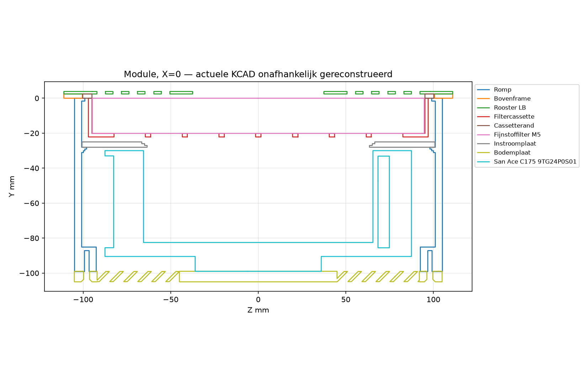
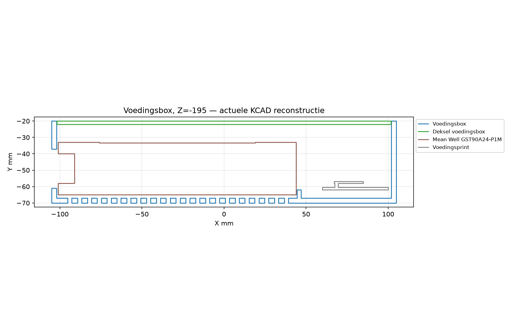
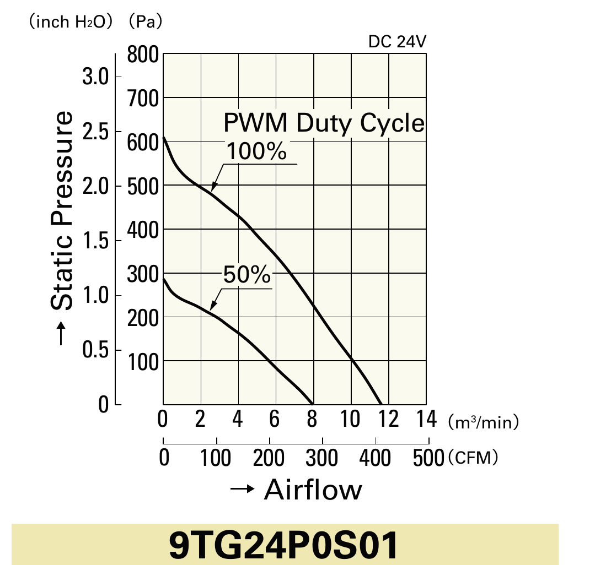
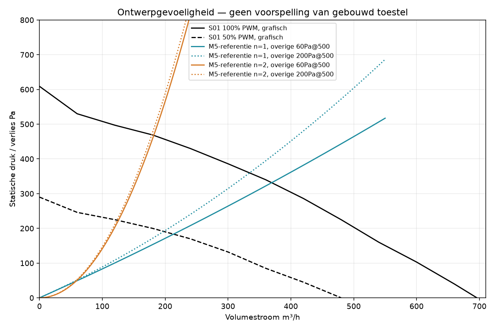

# Afzuiging nageltafel — eindverslag v2
## Ontwerpbeoordeling, niet een keuring van een gebouwd apparaat

**Datum: 6 november 2026, Europe/Brussels (CET).**

**Ian heeft gelijk:** dit project zit in de engineering-/ontwerpfase. V1 beoordeelde te veel alsof een compleet apparaat al voor salongebruik moest worden vrijgegeven. Dat was het verkeerde kader. V2 corrigeert dit, zonder echte ontwerpgebreken te verdoezelen.

## 1. Eindoordeel

**Gewogen ontwerpscore: 5,0/10, tegenover 3,1/10 in v1.**

Een serieuze, grotendeels coherent gemodelleerde ontwerpuitwerking, maar nog geen consistente ontwerpbaseline om te bevriezen. Het actuele CAD-hoofdmodel is beter dan de verouderde exports suggereren. De belangrijke resterende problemen zijn concreet ontwerpwerk: filterkeuze en afdichting, revisiemix, ontbrekende dimensioneringsberekeningen en aanwijsbare firmwarelogica.

**Geen enkel punt wordt afgewaardeerd omdat een prototype nog niet gebouwd of fysiek getest is.** Alle fysieke proeven staan uitsluitend in de laatste, ongescoorde sectie. Een niet gekozen component, niet uitgewerkte passing of ontbrekende belastingsberekening kan wél een ontwerpleemte zijn.

Dezelfde eerder gekopieerde bronsnapshot is beoordeeld. De stijging betekent een eerlijker fasekader en extra digitaal onderzoek, niet dat Claude intussen deze bron heeft verbeterd. V1 blijft intact; v2 vervangt de score en fasegebonden duiding.

## 2. Blinde beoordeling en scores

Dezelfde vier anonieme rapporten zijn gebruikt, eerder gelezen als Gamma → Alpha → Delta → Beta. Geen niet-geanonimiseerde invoer of auteurskoppeling geopend of gezocht. Hun controleerbare feiten blijven staan; hun aftrek voor ontbrekende praktijkproeven vervalt. Bij gelijkwaardig bewijs wint de strengste **ontwerpinhoudelijke** beoordeling, niet automatisch de laagste oude vrijgaverijpheidsscore.

De inhoudelijke matrix blijft: Alpha 5/5/5, Beta 4/4/5, Gamma 5/5/4 en Delta 5/5/4 voor validiteit, bruikbaarheid en complementaire blinde vlekken. Alpha versterkt UI/herstartlogica, Beta stof/dampen en onderhoudsscenario’s, Gamma architectuuralternatieven, Delta controleberekeningen. Geen identiteit of rol is afgeleid.

| Gebied | V1 /10 | V2 /10 | Gewicht | Reden |
|---|---:|---:|---:|---|
| CAD, geometrie en nominale passing | 6 | **8** | 15% | Alle 77 actuele plaatsingen digitaal opgebouwd; hoofdmaatketen coherent. Geen aftrek voor ontbreken proefmontage. Tolerantie-, klem- en detailwerk blijft. |
| Exports en revisieconsistentie | 2 | **2** | 15% | Oude maatvoering, vier ongeldige en vier ontbrekende STL-typen zijn digitale feiten. |
| Luchttechniek en geluidraming | 3 | **5** | 20% | Echte fanplot en referentiemedia doorgerekend; onbekende mediacurve en onvoldoende systeembegroting blijven ontwerpwerk. |
| Filterkeuze en stofbeheersingsconcept | 1 | **2** | 15% | M5 als enige retourlucht-eindtrap blijft een inhoudelijk filterkeuzeprobleem, niet een ontbrekende prototypeproef. |
| Elektrisch en thermisch ontwerp | 4 | **7** | 10% | Laagspanningsarchitectuur en regeling coherent; exacte ratings, zekeringcoördinatie en warmtebudget moeten verder worden uitgewerkt. |
| Firmwarelogica en compileerbaarheid | 3 | **5** | 10% | Beide targets opnieuw succesvol gebouwd; echte statische fouten blijven. Geen aftrek voor ontbrekende hardwaretest. |
| Ergonomie als ontwerp | 4 | **8** | 5% | Compacte onderhang, bovenwissel en losse bediening verdienen krediet. Ontbrekende gebruikersproef telt niet mee. |
| Onderhoudbaarheid als ontwerp | 2 | **6** | 5% | Goede boventoegang; uitklopinstructie, afdichtingsdetails en generieke materiaalkeuze moeten worden aangepast. |
| Ontwerpdocumentatie | 3 | **6** | 5% | Uitgebreid pakket; echte revisieconflicten en ongefundeerd stellige claims blijven. |
| **Gewogen totaal** | **3,1** | **5,0** | **100%** | **Som van score × gewicht, gedeeld door 100.** |

Een ontwerpscore 10 zou een complete, consistente en rekenkundig/code-technisch sluitende ontwerpuitwerking betekenen, niet noodzakelijk een al fysiek gekwalificeerd product.

## 3. De actuele CAD-modellen daadwerkelijk onderzocht

### Aanpak en beperkingen van het digitale onderzoek

Niet alleen de README of oude STL bekeken: de 77 componenten uit `Afzuiging.kcad` onafhankelijk gereconstrueerd met een eigen sketch-/extrusielezer en de vrije solidkernel **Manifold3D**. Daarbij zijn boss/cut, cirkelconussen, tweede extrusierichting en de oorspronkelijke componentposities/quaternionrotaties meegenomen. Alle 77 konden zonder kernelstatusfout worden opgebouwd.

Alle 2.926 mogelijke componentparen zijn eerst op bounding boxes gescreend; relevante paren daarna op solidintersectie. Nieuwe doorsneden tonen de actuele module, voedingsbox en knop. Dit betreft de gemonteerde stand bij 34 mm blad, niet elke klauwstand of tolerantiecombinatie.

**Dit is geen officiële Phlippo CAD-/SolidWorks-kernelherbouw.** Bogen/cirkels zijn gesegmenteerd, doorgaans met circa 0,3–0,5 mm segmentlengte en minstens 32 segmenten voor kleine cirkels. Kleine snijvolumes zijn daarom CAD-controlekandidaten, niet automatisch bewezen interferenties. Onderzoeksmeshes zijn geen vrijgegeven productie-export.

### Hoofdmaatketens

| Maatketen | Uitkomst | Ontwerpoordeel |
|---|---|---|
| Romp 210 in uitsparing 212 mm | 1 mm per zijde | Coherente inbouwspeling. |
| Frame 222 over uitsparing 212 mm | 5 mm oplegrand per zijde | Geometrisch logisch; draagconcept berekenen. |
| Cassette 174 × 194 × 22; wand/bodem 2 mm | Binnen 170 × 190 × 20 mm | Past bij nominale mat. Het ingesloten filtermodel is 169,5 × 189,5 mm: snij-/afdichtingskeuze expliciteren. |
| Rand 200,5 in opening 201 mm | 0,25 mm per zijde | Passingskeuze, geen pakking op zichzelf. |
| Cassetteonderkant Y−22; inlaatbovenkant Y−25 | 3 mm vrij | Geen overlap in hoofdstand. Nieuwe pakking/filter meenemen. |
| Inlaatonderkant Y−28; fantop Y−30 | 2 mm vrij | Positief; tolerantieketen uitwerken. |
| Fan Ø175 tegenover rechte binnenwand 202 mm | 13,5 mm tot vlakke zijwand | Niet overal dezelfde ring door lokale torens; geen grote fan/romp-overlap gevonden. |
| Fan 69 vanaf Y−30 | Onderkant Y−99 | Sluit aan op bodemplaatbovenkant. |
| Bodemplaatonderkant Y−105; bladonderkant Y−34 | 71 mm onderhang | Correct voor 34 mm blad. |
| Frame 2,5 + staal 1,5 mm | 4 mm boven blad | Correct. De losse knop staat circa 16 mm boven blad. |
| Knopbuis Ø43 in gat Ø44 | 0,5 mm radiaal | Nominaal coherent. |

**Conclusie:** het actuele hoofdmodel heeft geen algemene botsingsramp. Nul mates is op zichzelf geen fout: vaste componentplaatsing kan correct zijn.

### Wanddiktes, bouten en draagconcept

Nominaal: rompwand **4 mm**, cassettewand/bodem **2 mm**, voedingsboxwand/bodem **3 mm**, knopbuiswand **2 mm**, frame **2,5 mm**, deksels **2 mm**, moduleklauw **6 mm**, knopklauw **5 mm**. Dit zijn controleerbare ontwerpwaarden.

Gerichte details:

- Magneetpocket 2,1 diep in frame 2,5 laat **0,4 mm bodem**. Geef minimale bodem, lijmspeling en printlagen op tekening.
- M5-moerkamer 4,2 diep in klauw 6 laat lokaal circa **1,8 mm dak**; knopklauw 3,4 in 5 laat circa **1,6 mm**. Neem dit op in de klemkrachtberekening.
- Vier moduleklauwen: **M5×65**. Twee knopklauwen: **M4×65**. De laatste eindigen nominaal op Y−63, tegenover dekselonderkant Y−62: **circa 1 mm puntuitsteek**, door nominale Ø4-gaten. Werk buitendraad, gatspeling en gewenste eindstand uit; het vereenvoudigde boutmodel gebruikt kerndiameter en kan nultolerantie maskeren.
- Fan M4×10 door plaat 6 geeft **4 mm nominale indraaiing**, exact de ondergrens van de OEM-eis 4–6 mm. Maak een volledige tolerantieketen en ontwerp bij voorkeur rond 5 mm; niet blind langere bouten kiezen.
- Honingraatblad en epoxy-inserts zijn beschreven, maar dragend inzetblok/verdeelstuk, belastingsgeval en aandraaimoment niet uitgewerkt. Dat is een **ontwerpleemte**, niet een afkeuring wegens ontbrekende trekproef.

Illustratieve klemcalculatie: bij `T = KFd`, K=0,2 en M5 geeft 1 Nm circa 1.000 N voorspanning. Een grove volle armdoorsnede 8 × 6 mm bij 10 mm hefboom geeft `σ ≈ 6FL/(bh²) = 0,208F MPa`: circa 21 MPa bij 100 N, circa 208 MPa bij 1.000 N. Geen voorspelling van de echte spanning: moerkamer, contactplaats en printoriëntatie moeten juist nauwkeuriger worden gemodelleerd. Alleen “100% infill” is geen draagberekening.

### Vier kleine overlapkandidaten — Minor, niet bewezen Major-botsingen

| Paar | Getesselleerd snijvolume | Gerichte controle |
|---|---:|---|
| Knophouder / tweede M2,5×6-knopschroef | 1,96 mm³ | Vloer-/naafdetail Y−8,4 tot −7,9; verzinking en omgeving. |
| Voedingsbox / voedingsprintmodel | 0,65 mm³ | Kleine rand-/componentzones; exacte PCB-/USB-envelop. |
| Knophouder / USB-C-knopprint | 0,34 mm³ | Palen-/printgebied Y−55,4 tot −55,3; bedoeld klemcontact? |
| Knophouder / VIEWE-knop | 0,038 mm³ | Kan segmentatie-/contactartefact zijn. |

Bedoeld pers-/klemcontact of zelftappend schroefdraad is niet automatisch fout. Controleer deze locaties in de exacte ontwerp-kernel en label bedoelde contacten. Een klauwzwaai- en tolerantiesweep blijft digitaal ontwerpwerk.

## 4. Revisies en exports: echte Major-fouten blijven

- Romp **CAD 99 / STL 114 mm**; cassette **CAD 22 / STL 37 mm**.
- Oude doorsnede/BOM: drie filters, breedtemaat 229, onderhang 86, stalen klauwen en oude M3-knopbouten. Actuele uitvoering: één M5, PETG-klauwen, M4-knopbevestiging.
- **Vier oorspronkelijke STL’s niet gesloten/manifold:** Bodemplaat, Bovenframe, Knophouder en Knopdeksel. Drie hebben bovendien inconsistente winding; Knopdeksel niet ten onrechte ook daarop afkeuren.
- Vier voorgeschreven typen ontbreken: **Deksel-voedingsbox, Klauw, Knopklauw, Adapterklem**. Totaal behoren er 13 printtypen te zijn.

Ook in de ontwerpfase moeten exports dezelfde geometrie voorstellen als de bron. De onafhankelijke actuele reconstructie kon frame/bodemplaat wel geldig opbouwen: een slechte oorspronkelijke export bewijst dus geen algemeen onbruikbare bron-CAD. Herstel de exporter/revisie, niet stilzwijgend de oude mesh laten autorepareren.

## 5. Lucht, filter en geluid: nu op ontwerpniveau doorgerekend

### Werkelijke fanplot

De complete OEM-familiedatasheet is gelezen via een openbare spiegel; nominale S01-gegevens kloppen met de officiële fabrikantpagina. De curve geldt met inlaatnozzle 109-1073; het ontwerp gebruikt een eigen getrapte plaat.

Afgeronde grafische 100%-PWM-punten: 0 m³/h→609 Pa; 240→430; 360→340; 480→225; 540→160; 600→103; 696→0. Afleesonzekerheid grofweg 15–25 Pa; geen originele numerieke fabriekstabel.

**500 m³/h bij circa 200 Pa is een plausibel punt op de losse fanplot.** De ontwerpfout is niet dat dit fanpunt niet bestaat, maar dat de weerstand van de gekozen filter/montage niet onderbouwt dat dit het systeemwerkpunt wordt.

### Referentiefilterdata en verliesgevoeligheid

Nittmanns datasheet van 01-01-2026 noemt voor **V400S, M5, 20 mm**: **47 Pa bij 0,50 m/s**, gemiddeld 40–60% rendement bij 0,4 µm, ePM10 50%. Een ander publiek 20mm-M5-medium vermeldt 60 Pa bij 2.500 m³/h/m² en **geen regeneratie**. Deze zijn referentieproducten, niet de onbekende gekozen rol.

Bij aangenomen 500 m³/h:

- Over 0,170 × 0,190 = 0,0323 m² filterfront: **4,30 m/s**, circa **8,6 maal** de 0,5m/s-referentie.
- Door 140,669 cm² roosteropening boven filter: **9,87 m/s**. Bij luchtdichtheid 1,2 kg/m³ is de dynamische druk circa 58,5 Pa.
- Door Ø127-inlaat: **10,96 m/s**, circa 72 Pa dynamische druk.

Dynamische druk is niet hetzelfde als dissipatief verlies. Rooster, contractie, inlaat, plenum en uitlaat vragen eigen verliescoëfficiënten. De 3×5mm-slang is een **meetslang**, geen afvoerduct.

Gevoeligheidsmodel: `Δp_filter = 47 × (v/0,5)^n`, met n=1 of 2; overige verliezen samen 60 of 200 Pa bij 500 m³/h, kwadratisch met debiet. Die overige waarden zijn **scenario-aannames**, geen vastgestelde ontwerpcoëfficiënten. Snijpunten met de echte fanplot:

| Referentiemodel | 100% PWM | 50% PWM |
|---|---:|---:|
| Lineair filter, overige 60–200 Pa bij 500 | circa 334–370 m³/h | circa 198–213 m³/h |
| Kwadratisch filter, overige 60–200 Pa bij 500 | circa 179–182 m³/h | circa 123–126 m³/h |

**Geen betrouwbare voorspelling of gegarandeerde bandbreedte van dit toestel.** Extrapolatie buiten de mediadata en de eigen nozzle blijven onzeker. Het toont wel dat een vlakke generieke mat geen onderbouwing is voor 500 m³/h: alleen de lineaire filterextrapolatie geeft al circa **404 Pa bij 500**, tegenover circa 200 Pa beschikbare fanplotdruk.

Als 0,5 m/s een gekozen mediadesignpunt wordt, vraagt 500 m³/h circa **0,278 m² mediavlak**, 8,6 maal het huidige vlakke front. Geplooid medium kan helpen, maar netto oppervlak, plooiverdeling en echte drukcurve moeten het ontwerp dragen.

### Kritiek ontwerpbesluit: M5 als enige retourlucht-eindtrap

De M5-keuze blijft een **filterkeuzeprobleem op papier**, niet uitsluitend “nog niet fysiek getest”. Referentiedata tonen aanzienlijke doorgang van fijne testdeeltjes. Voor het bedoelde doel — bescherming tegen fijn nagelstof met lucht terug in de werkruimte — is deze generieke eindtrap onvoldoende gekozen/gespecificeerd. Dit bewijst geen gemeten individuele dosis of wettelijke overschrijding.

**Ontwerpwijziging:** exact eindfilter met passende fijne-deeltjesprestatie en drukcurve, bijvoorbeeld een gedocumenteerd H13-concept, plus pakking/retentie, óf geschikte buitenafvoer ontwerpen. H13 is een aanbevolen ontwerpdoel, geen automatisch wettelijk voorschrift of bewijs voor het hele toestel. Deeltjesfiltering is geen oplosmiddeldampbeheersing; leg die aparte strategie met product-/SDS-context vast. Geen automatische ATEX-eis afleiden uit alleen het bestaan van aceton.

**Major:** een losse cassetterand op richel is geen gespecificeerd afdichtingsontwerp. Benoem pakkingmateriaal, sluitpad, compressie, tolerantie en retentie. Niet wachten tot een prototype lekt om deze keuze te maken.

### Geluid: raming mag, gelijkstelling niet

OEM: 69 dB(A) op 1 m van de inlaat. Eerste fanwetraming bij vergelijkbare werking: `ΔL ≈ 50 log10(n/n_nom)`. **Half werkelijk toerental** geeft circa −15 dB, dus circa **54 dB(A)** onder dezelfde referentiecondities. Dat is als expliciete voorlopige ontwerpaanname verdedigbaar; niet als gegarandeerd ingebouwd toestelniveau.

De 50%-PWM-curve past eerder bij circa **0,7× toerental** dan 0,5×: dezelfde raming geeft ongeveer **61 dB(A)**. Een vrije puntbron op 0,5 m in plaats van 1 m geeft ongeveer +6 dB. Roosterfluit, meubelresonantie, transmissie en kamergalm ontbreken in dit eenvoudige model.

Vervang “40–60% dagelijks genoeg” door een benoemd ontwerpdoel met berekend werkpunt. PWM, RPM, debiet en geluid zijn geen onderling uitwisselbare percentages.

## 6. Elektrisch en thermisch ontwerp

### Wat op schema coherent is

- Gesloten geaarde **GST90A24-P1M: 24 V, 3,75 A, 90 W**; eigen bedrading laagspanning. De primaire 230V-isolatie zit binnen de gesloten adapter, niet op de eigen gatenprint.
- S01-fan 2,35 A / 56,4 W laat nominaal 33,6 W ruimte vóór besturing, verliezen en derating.
- Tacho met 10kΩ-pullup naar 3,3 V; I²C met 4,7kΩ-pullups naar 3,3 V; omgekeerde 25kHz-PWM via BC547 en 1kΩ-basisweerstand zijn logisch. Bij 3,3 V en aangenomen 0,7 V basis-emitter circa 2,6 mA basisstroom; circa 6,8 mW in 1 kΩ, ruim onder 0,25 W.
- DC-zekering 3,15 A traag, schakelaar en USB-C-sourceweerstanden **56 kΩ** zijn aanwezig. Niet als ontbrekend afkeuren. DC-UIT maakt de adapter niet netspanningsloos.

### Ontwerpwerk dat blijft

**Major: fanalternatief fout.** G01 vraagt 93,6 W / 3,9 A, dus meer dan de 90 W / 3,75 A-adapter al zonder besturing. Schrappen of volledige keten herdimensioneren.

**Major: selectie/coördinatie uitwerken.** Exact TR5-partnummer, DC-rating, afschakelcapaciteit en tijd-stroomcurve ontbreken. Bij S01 plus aangenomen 5 W besturing en 90% DC/DC-rendement is bronstroom circa `2,35 + 5/(24×0,9) = 2,58 A`, ongeveer 82% van 3,15 A. Dat is een eerste balans, niet een definitieve zekeringselectie.

Draadvoorbeeld, koper op 20°C, 0,5 m heen plus terug:

| Doorsnede | Lusweerstand | Spanningsval bij 2,35 A | Draadverlies |
|---|---:|---:|---:|
| 0,75 mm² | 0,0233 Ω | 0,055 V | 0,129 W |
| 0,25 mm² | 0,070 Ω | 0,165 V | 0,387 W |

Connectorovergangen, temperatuur en bundeling komen erbij. Kies de **werkelijke M8-kabeladers en connectorrating**, niet alleen de los genoemde montagedraad. Specificeer aftakkingen en foutlussen.

**Geen verzonnen creepage-afkeuring:** een 40×50mm-model met componentblokken is geen koperlayout/netlist. Exacte kruip-/luchtwegen tussen soldeerpunten volgen daar niet uit. Geef een draad-/padplan voor 24/5/3,3 V en vereiste isolatievoorzieningen volgens de gekozen context; plak geen universele 230V-afstand op de geïsoleerde 24V-print. Werk USB-C-source/CC, foutbeveiliging en terugvoeding bij flashen uit; permanente VBUS alleen maakt geen volledig beschermde USB-C-bron.

### Warmtebegroting op papier

De box bevat de adapter, niet de 56,4W-fan. Alle fanvermogen als warmte ín de box rekenen zou fout zijn. Bij circa 59 W afgegeven DC en aangenomen 90% adapterrendement ontstaat circa **6,6 W adapterverlies**. Met lokale C3-/buckverliezen is **7–9 W** een expliciet voorlopig boxbudget; exacte datasheets moeten dit aanscherpen.

CAD: 23 afgeronde bodemsleuven 2,5×50 mm geven circa **28,5 cm²**; 23 achterwandsleuven 2,5×10 geven circa **5,5 cm²**; adapter op 2mm-ribben. Er is dus een ontworpen warmtepad.

Eenvoudig wandmodel, alleen bodem/zijden: A≈0,052 m²; aangenomen h=5–10 W/m²K; `ΔT≈P/(hA)` geeft circa **13–35 K** bij 7–9 W. Geen gegarandeerde temperatuurgrens: houtcontact, straling, natuurlijke stroming en hotspots ontbreken. Maak een reproduceerbare warmte-/deratingbegroting met werkelijke componentdata, omgeving en belaste PETG-/epoxygrenzen. **Geen aftrek omdat nog geen thermokoppel op een prototype zit.**

## 7. Firmware: statische fouten blijven fouten

Opnieuw gebouwd op een aparte kopie van de **originele snapshot**, inclusief oorspronkelijke fontheaders; alle bronbytes gecontroleerd gelijk. **Knop SUCCESS, module SUCCESS.** Log: `v2-evidence/firmware-build-v2.log`; bronidentiteit: `firmware-source-identity.json`.

CRC, tacho, NVS, UI en niet-blokkerende ijkstappen zijn echte functies. De volgende ontwerp-/logicafouten blijven Major:

| Bron | Fout | Digitaal herstelcriterium |
|---|---|---|
| `module/main.cpp:219–226,256–259` | Oude `dp` blijft geldig lijken na leesuitval; radiostatus blijft actueel. | Sampletijd/kwaliteit en onafhankelijke ongeldig-/herstelstatus. |
| `module:145–164` | Nul samples wordt uiteindelijk `[1,1,1,1,1]` Pa met `geijkt=true`. | Alleen plausibele, verse, volledige ijkpunten accepteren; anders vorige geldige referentie behouden. |
| `module:229–253` | IJking blijft PWM sturen ondanks nieuwe UIT; bewaking pas vanaf 30%, terwijl 20/25% selecteerbaar zijn. | Stop-/annuleerprioriteit en bewaking over alle toegestane standen, of ongeschikte standen schrappen. |
| `protocol.h`, ontvangstcallbacks | Geen unieke afzenderkoppeling; ongecodeerde broadcast; boosttimer alleen in knop. | Unieke beveiligde peers/berichten, module-eigen boostlease, gespecificeerde verliesmodus. |
| `knop:319–322,394–396,245–262` | Opgeslagen AAN bij boot; lokale UIT is geen bevestigde rotor-/isolatiestatus. IJKEN heeft eigen schermvoorrang. | Bewust herstartbeleid; opdracht, bevestigd bedrijf en onderhoudsisolatie onderscheiden. |
| `knop:275`, `README:27,46,252` | Actieve instructie “filters uitkloppen”. | Exact filtergebonden, stofarme onderhoudsinstructie in UI én README. |

Drukmeter ±500 Pa met factor-2-alarm: schoonreferentie boven 250 Pa geeft een grens buiten het gekalibreerde positieve bereik. Kamerdruk naar onderfilter meet bovendien rooster-/instroominvloeden en handocclusie. Pas bereik-/alarmmodel aan; claim geen precies filtervolheidspercentage uit deze ratio.

**Geen hardwarefoutinjectie als scorevoorwaarde.** Wel expliciete toestandsmachine, grenswaarden en deterministische code-/hosttests voor de genoemde paden. Die kunnen in deze ontwerpfase worden gecontroleerd.

## 8. Ergonomie en onderhoud zoals ontworpen

**Behouden:** compacte 71mm-onderhang, boventoegang, losse knop, module/box gescheiden en modulaire koppelingen. Een roosteropstand van 4 mm of knop van circa 16 mm is niet automatisch ergonomisch fout. Ontbrekende proefpersoonfeedback verlaagt de ontwerpscore niet.

**Minor-ontwerpdetails:** leg referentietafel, stoel/armsteun, knie-envelop, handpositie, kabelbuigradius, knopbereik en uitblaasrichting vast in CAD. Geef minimumwand-/pocketmaten, normdeelspeling en exacte filament-/epoxy-/reinigingskeuze op. “PETG kan tegen aceton/75°C” is te algemeen voor deze complete combinatie.

**Major-onderhoudskeuze:** generiek uitkloppen schrappen; referentiemedia zijn niet noodzakelijk regenereerbaar. Ontwerp directe verpakking/afvoer en voorkom dat de open cassette bij uitnemen stof laat vallen. Een pakking moet na terugplaatsen geometrisch gecontroleerd sluiten; geen fysieke wisseltest als huidige scorevoorwaarde.

**Documentatie herstellen:** boxfreesmaat 202×92 versus 212×102, schakelaarlocatie, USB-print zonder gaten versus schroeven, USB-datumvlak, TR5 versus oude 5×20-weergave. De ontbrekende `../lib/schets.mjs` in deze snapshot bewijst geen defect in de volledige projectroot; lever wel een reproduceerbare projectroot-/exportopdracht. €495,08 telt op, maar is een onderdelenindicatie, geen geverifieerde totale projectkost.

## 9. Top 5 ontwerpopdrachten voor Claude

### 1 — Filter en afdichting herontwerpen — Kritiek/Major

**Bestanden:** filter/cassette/inlaat in `maak-afzuiging.mjs`, `Filtercassette.kcad`, `Cassetterand.kcad`, BOM/README.

**Digitaal aftekenbaar:** exact filterpartnummer, fijne-deeltjesprestatie, ontwerpdebiet en drukcurve; passend mediavlak; pakkingpad, materiaal, compressie, retentie en toleranties. Of geschikte buitenafvoer uitwerken. Stof- en dampstrategie afzonderlijk beschrijven. Geen generieke M5-eindtrap met gezondheidsbelofte behouden.

### 2 — Eén consistente CAD-/exportrevisie — Major

**Bestanden:** alle KCAD/STL/DXF/SVG/PDF/BOM/mallen/README en generator/dependencies.

**Digitaal aftekenbaar:** alle 13 printtypen compleet, zelfde revisie en maten; geen oude filter-/klauw-/boutvarianten; gesloten/manifold meshes met correcte winding. Exacte kernelcontrole van de vier overlapkandidaten, normdeelspelingen en beweging/toleranties bij bedoelde bladdiktes. Bedoelde pers-/klemcontacten benoemen. Geen oude mesh stilzwijgend autorepareren.

### 3 — Berekeningen sluiten — Major

**Bestanden:** nieuw berekeningsblad, fan-/filterdatasheets, schema, BOM, klauw-/blad-/boxdetails.

**Digitaal aftekenbaar:** echte Q–Δp-curven en verliesposten, schoon/eindweerstand en onzekerheid; geluidraming met RPM/afstand; exacte S01 of volledige andere dimensionering. Zekeringpart/DC-curve, kabel-/M8-ratings, spanningsval, foutlus en 5V-budget; warmte-/deratingmodel. Klem-/ankerbelasting, materiaalwaarden, moment en bladversterking. Fanboutketen in alle maatgrenzen 4–6 mm indraaiing. Geen fysiek testrapport nodig om deze berekeningen af te tekenen.

### 4 — Firmwarelogica herstellen — Major

**Bestanden:** beide `main.cpp`, `protocol.h`, code-/hosttests en UI-tekst.

**Digitaal aftekenbaar:** alle zes foutpaden hierboven afgedekt; ongeldige ijking nooit als geldig opslaan; meetversheid en foutstatus; stopprioriteit; alle toegestane standen bewaakt; unieke koppeling; lokale boostgrens; expliciet herstart-/radioverliesbeleid. Beide vastgelegde builds succesvol en deterministische tests controleerbaar zonder echte fan/sensor.

### 5 — Maak-/onderhoudsdetails en ergonomische envelop afwerken — Minor/Major

**Bestanden:** knop/box/cassette/frame/klauwtekeningen, assemblage, materiaalstaat en onderhoudsinstructie.

**Digitaal aftekenbaar:** minimumdak-/bodemdiktes, lijm-/magneetmaten, echte boutbuitendraad/gatspeling, puntuitsteek, printoriëntatie en exacte materialen. Stofarme wisselroute zonder generiek uitkloppen. Correcte USB-/schakelaar-/freesinstructie. Hand-/knie-/kabel-/armsteunenvelop voor beide werkposities. Een reviewer kan maten en keuzes uit de tekeningen afleiden zonder ze te verzinnen.

Dit zijn ontwerpopdrachten, geen toestemming voor aankopen of betaalde testen. Ian deelt dit verslag zelf met Claude.

## 10. Wat v2 uit v1 corrigeert

- **Blijft meetellen:** echte maat-/exportverschillen, meshproblemen, M5-retourluchtkeuze, ontbrekend pakkingontwerp, verkeerde fanvervanging, onvolledige dimensionering, concrete codepaden en uitklopinstructie.
- **Niet meer als aftrek:** geen thermische duurtest, geen fysieke trek-/kruipproef, geen hardwarefoutinjectie, geen rook-/blootstellings-/geluids-/gebruikersproef. Alleen een later plan.
- **Nuance:** 54 dB bij half werkelijk toerental is een bruikbare expliciete fanwetraming; 500 m³/h bij 200 Pa staat ongeveer op de losse fanplot. Niet de fanpuntmogelijkheid, maar de ongefundeerde systeem-/filterweerstand is het ontwerpbezwaar.
- **Nieuwe CAD-informatie:** hoofdmodel grotendeels coherent; vier kleine detailkandidaten, geen bewezen grote botsingsramp. Dunne pocketbodems, moerkamerdaken, schroefpuntuitsteek en tolerantiegrens bij fanbout zijn gerichte ontwerpdetails.
- **Nog steeds niet overgenomen:** nul mates betekent fout; generiek H13 betekent wettelijk verplicht of automatisch veilig; ontbrekende meetreeks betekent bewezen schade; “schone build” betekent waarschuwingvrij; metadata-verschil betekent geometriefout.

### Bewijs en bronnen

Lokale bron: dezelfde 102 oorspronkelijke bestanden in `/workspace/afzuiging/src/`. V2-bewijs in `v2-evidence/`: reconstructies/index, intersecties, scenario-invoer, nieuwe build en bronhashes. Nieuwe afbeeldingen in `img-v2/`. Eigen onderzoeksmeshes zijn geen officiële productie-export.

Ontwerpbronnen geopend op 6 november 2026 (CET):

1. [Officiële Sanyo Denki S01-specificaties](https://products.sanyodenki.com/en/sanace/dc/centrifugal-fan/9TG24P0S01/).
2. [OEM-familiedatasheet via publieke spiegel](https://www.micro-semiconductor.nl/datasheet/cc-9TG24P0G01.pdf): echte S01/G01-curven, nozzlevoorwaarde en montage 4–6 mm. Officiële PDF-download gaf via onze toegang 403; de openbare spiegel is gelezen, geen blokkade omzeild.
3. [Nittmann filtermatdatasheet, 01-01-2026, v1.1, pagina 2](https://www.nittmann-filter.de/wp-content/uploads/2026/01/26-01_technische-Datenblaetter-Feinstaubfiltermatten-KOR1.pdf): V400S M5, 20 mm, 47 Pa bij 0,5 m/s, 40–60% bij 0,4 µm. Referentiemedium, niet geïdentificeerd als gekozen rol.
4. [RekupeX/Unocel M5 20mm-referentiemedium](https://www.rekupex.cz/gb/filters-and-filter-media/filter-fabric-m5-20-mm-350-g-m2): drukval bij nominale belasting; regeneratie “No”.
5. Eerder geraadpleegde Mean Well/TME- en Sensirion-componentbronnen uit v1: 90 W / 24 V / 3,75 A en SDP810 ±500 Pa. Geen generieke componentcategorie als exacte selectie behandelen.

## 11. Validatieplan voor later (prototypefase) — ongescoord

**Geen enkel nog niet uitgevoerd punt hieronder verlaagt de v2-ontwerpscore.** Dit is de normale volgende fase na een consistente ontwerpbaseline.

1. **Maken en passen:** slicer-/printproef, echte koopdelen nameten, bout-/klauw-/kabelmontage, bouwmallen op 100%, filterwissels en herhaalde montage.
2. **Lucht en stof:** werkelijke Q–Δp/PWM–RPM, bronvangst met handen/frees/zijstroming, systeemlekkage, retouruitstoot en blootstellingsbeoordeling met deskundig veilig protocol. Geen ongecontroleerde nagelstofwolk met personen als demonstratie.
3. **Geluid en ergonomie:** beide oorposities, trillingen, knieën/polsen, bediening en uitblaastocht aan de echte werkplek.
4. **Constructie:** draag-, uittrek-, kruip- en magneetproeven onder de vooraf berekende lasten en momenten.
5. **Elektrisch en warmte:** competente eindinspectie, temperaturen/foutcondities, trekontlasting, USB-/flashgedrag, isolatie en passende probe-/morsbeoordeling. Adapter gesloten houden; geen onveilige netspannings-, rotor- of waterproeven door Ian.
6. **Firmware op hardware:** sensorfouten, stale data, lege ijking, tacho-uitval, stop tijdens ijken, tweede set, radioverlies/boost en stroomherstel vergelijken met de reeds ontworpen/codegeteste toestandsmachine.
7. **Onderhoud en materialen:** echte stofarme wissel/afvalroute, hermontageafdichting en effecten van de exact gekozen reiniging over de gebruiksduur.

**Slot:** 5,0/10 voor het ontwerp. Niet alles hoeft nu fysiek getest. Wél moeten filterkeuze, berekeningen, revisies en codefouten op de ontwerptafel worden opgelost. Daarna volgt een nieuwe ontwerpbeoordeling; prototypevalidatie is een afzonderlijke fase.
