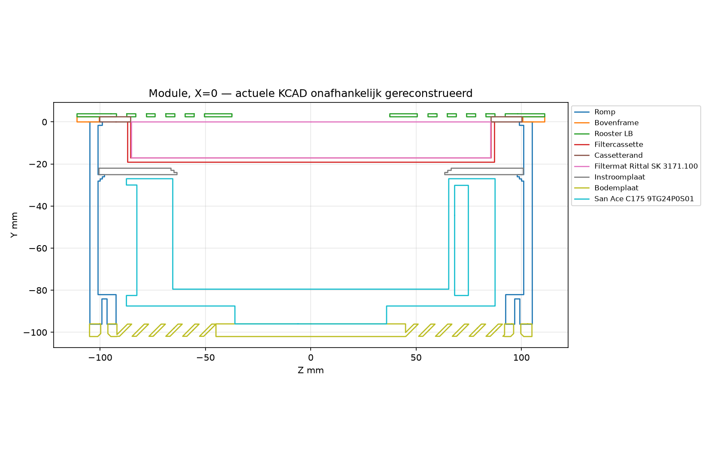
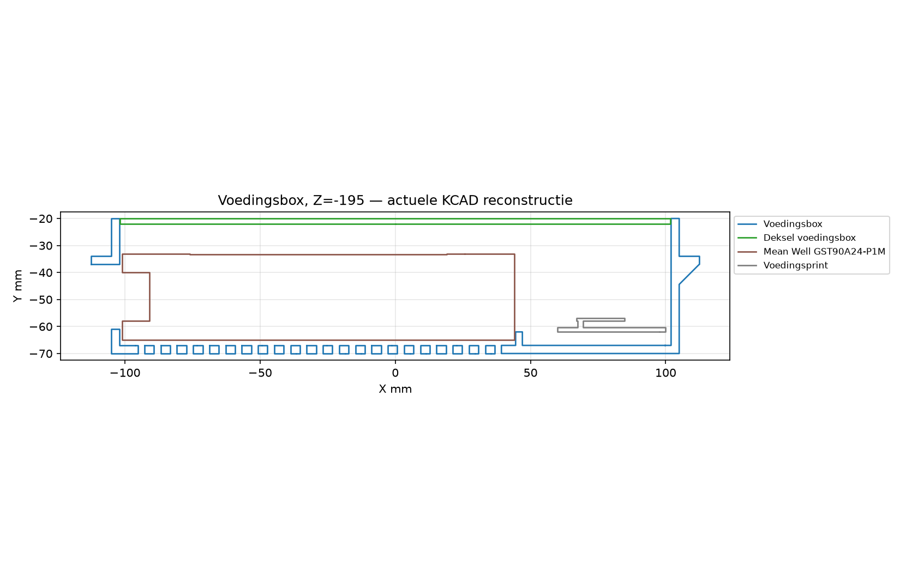

# Afzuiging nageltafel — definitief eindverslag v3

**7 november 2026 — Europe/Brussels (CET). Engineering-/ontwerpbeoordeling, revisie 6.1.**

## 1. Eindoordeel

**Definitieve gewogen ontwerpscore: 5,6/10.** Dat is **−1,0 punt tegenover het voorlopige technische v3-oordeel van 6,6**, en **+0,6 tegenover v2:5,0**. De onafgeronde technische score was 6,55; het definitieve gewogen getal is exact 5,60.

Het project is aantoonbaar verbeterd: complete, gesloten productie-STL’s, consistente actuele hoofdgeometrie, betere firmwarearchitectuur en reproduceerbare berekeningen. De vier onafhankelijke rapporten bevestigen die vooruitgang. Het totaal blijft echter een **uitgewerkt ontwerp in ontwikkeling, nog geen gesloten engineeringbaseline**.

De teamronde maakt concrete gemiste punten zichtbaar: uitkloppen staat nog in het bouwschema; het factor 2-filteralarm kan in het eigen model pas ná verlies van het minimale vangdebiet afgaan; het 3 mm-plenum is niet als verdeelweerstand uitgewerkt; geluid en vangstdoel sluiten niet tegelijk; herhaalboost omzeilt de bedoelde 120 s-beperking. Dat zijn digitale ontwerpfeiten/-gaten, geen straf voor een ontbrekend prototype.

**Geen enkele ontbrekende fysieke proef verlaagt deze score.** Alle proeven voor later staan uitsluitend in het laatste, ongescoorde validatieplan. De lagere score betekent een beter onderbouwde herbeoordeling van dezelfde bron, niet dat Claude de bron tussen deze twee v3-oordelen heeft verslechterd.

## 2. Blinde werkwijze en vonnis-matrix

De vier ontvangen teksten zijn eerst mechanisch ontdaan van rol-/auteursattributie en genummerde onderzoeksmapnamen. Daarna zijn zij met systeemtoeval naar Alpha–Delta verdeeld; geen seed of koppeltabel bewaard. De inhoud is beoordeeld in de volgorde **Gamma → Alpha → Delta → Beta**, zonder auteurs te raden. De originele genummerde invoer is niet als beoordelingslabel gebruikt. Stijl kan herkenbaar blijven; dit is procedurele anonimisering, geen garantie van mathematisch perfecte blindering.

De rapporten staan onder `team-blind/v3/`. De eerdere blinde ronde blijft ongewijzigd. Hun totalen worden **niet gemiddeld**: het beste gecontroleerde bewijs wint per betwist punt; bij gelijkwaardig bewijs geldt de strengste ontwerpinterpretatie. De matrix geeft geen extra stemgewicht.

Schaal 1–5; 5 = sterk. **Blinde vlekken** betekent hier hoe sterk een rapport gaten in andere rapporten aanvult, niet hoeveel eigen fouten het heeft.

| Rapport | Validiteit | Bruikbaarheid | Aanvulling van blinde vlekken |
|---|---|---|---|
| **Alpha** | **5/5** — Sterk OCCT-/document-/modelbewijs: achtergebleven uitklopadvies, smalle pakkingopleg en 3 mm-plenum. Beperkte historische toegang eerlijk benoemd. Prijsconclusie gecorrigeerd met werkelijk opgetelde regels. | **5/5** — Concrete, digitaal aftekenbare acties; beoordeeld met de genoemde beperkingen. | **5/5** — Vult Beta/Gamma/Delta aan op onderhouds-PDF en geometrische luchtverdeling; krijgt historische en elektrische aanvulling van de andere rapporten. |
| **Beta** | **4/5** — Breedste assemblage- en beperkte moduleklauwsweep, build/hosttests en ontwerpalternatieven. Warmte/uitkloppen ten onrechte als opgelost; bereikclaim sterker dan bewijs voor intacte toestand. | **5/5** — Concrete, digitaal aftekenbare acties; beoordeeld met de genoemde beperkingen. | **5/5** — Vult Alpha/Delta aan met 77 plaatsingen/sweep en opties; Alpha corrigeert PDF, Gamma/Alpha warmte en herhaalboost. |
| **Gamma** | **4/5** — Sterke brontraces, druk-/geluid-/herhaalboostanalyse en duidelijke onderzoekslimieten. Claim ijkvoortgang altijd 0 is fout; PDF-uitklopinstructie en prijsregels gemist. | **5/5** — Concrete, digitaal aftekenbare acties; beoordeeld met de genoemde beperkingen. | **5/5** — Vult Alpha/Beta/Delta aan met cumulatieve boost en stabilisatiestatus; Alpha corrigeert onderhoud, eigen C++ verwerpt de voortgangsclaim. |
| **Delta** | **4/5** — Werkelijk uitgevoerde hostkarakterisering en scherp onderscheid model/blootstelling. Sterk op alarmsessies/overrange/detectiegrenzen; mist softstartfout en verklaart warmte/uitkloppen te vroeg opgelost. | **4/5** — Concrete, digitaal aftekenbare acties; beoordeeld met de genoemde beperkingen. | **4/5** — Vult andere rapporten aan met applicatiesessies, onbekende bewaking, matoriëntatie en alternatiefpassing; krijgt geometrie-/warmte-/PDF-aanvulling van Alpha/Beta/Gamma. |

**Onderlinge aanvulling:** Alpha levert het doorslaggevende PDF-onderhouds- en plenumdetail. Beta versterkt het geometrie-/assemblagebewijs en ontwerpalternatieven. Gamma levert de herhaalboost en oude status tijdens stabilisatie. Delta verdiept applicatiesessies, overrange en detectiegrenzen. Eigen bron-/C++-controle corrigeert ook de teamrapporten: met name de vermeende 0%-ijkvoortgang is onjuist.

## 3. Scores en wijzigingen tegenover de technische v3

| Gebied | V2 | Technisch v3 | Definitief v3 | Gewicht | Waarom deze beoordeling |
|---|---:|---:|---:|---:|---|
| CAD / geometrie | 8 | 8 | **7** | 15% | Nominaal sterk, maar pakking-/filtercompressie- en functionele tolerantieketen zijn nog niet ontworpen. |
| Exports / revisies | 2 | 8 | **8** | 15% | 13 goede actuele STL’s; oude laserklauwen en document-/reproduceerbaarheidsrestanten verhinderen volledig gesloten levering. |
| Luchttechniek / geluid | 5 | 6 | **4,5** | 20% | Sterk modelbegin, maar plenum, alarm, media, RPM/duty en het geluids-/vangstdoel sluiten niet samen. |
| Filtratie / beschermingsconcept | 2 | 3 | **3** | 15% | Exacte grove mat en eerlijker functielimiet; aanvullende fijnstof-/ventilatiebeheersing nog niet gedimensioneerd. |
| Elektrisch / thermisch | 7 | 7 | **6** | 10% | Nominale voeding coherent; onvolledige componentcoördinatie, lokale warmte en onbeperkte herhaalboost. |
| Firmware | 5 | 7 | **5** | 10% | Builds/tests slagen, maar originele-code-tegenproeven tonen ramp-, pairing-, bewakings- en limiteringsgaten. |
| Ergonomie als ontwerp | 8 | 8 | **7** | 5% | Compacte module en concrete tafelcontext; volledige gebruikers-/kabelenvelop en bediening/montagegrenzen niet gesloten. |
| Onderhoud als ontwerp | 6 | 7 | **6** | 5% | Boventoegang en zakprocedure goed; PDF-uitklopadvies en isolatie-/serviceprocedure blijven wezenlijke fouten. |
| Documentatie | 6 | 7 | **5** | 5% | Uitgebreid, maar aantoonbare maat-, prijs-, montage- en veiligheidsinstructiemix. |
| **Totaal** | **5,0** | **6,6** | **5,6** | **100%** | **Σ(score×gewicht)/100=5,60; geen gemiddelde van de vier rapportcijfers.** |

De strengere scores volgen specifieke ontwerpgaten, niet alleen een lager rapportcijfer. Zo blijft exports 8 ondanks een lagere teamstem: de 13 geldige actuele meshes zijn sterk gecontroleerd, en ontbreken van een externe library in deze afgebakende snapshot bewijst geen defecte oorspronkelijke projectroot. Lucht4,5 volgt juist de beter onderbouwde gekoppelde modelbezwaren; firmware 5 volgt de echte tegenproeven, niet alleen de 16 groene regressietests.

## 4. Bronmomentopname, wijzigingen en wat goed is

Dezelfde **114-bestandensnapshot** in `/workspace/afzuiging/src-v3/` is gebruikt. Alle114 SHA256-hashes zijn opnieuw gelijk aan de laptopbroninventaris. Bronbestanden zijn niet aangepast. De vergelijking met 102 oorspronkelijke v1/v2-bestanden blijft: **14 toegevoegd,2 verwijderd,81 gewijzigd,19 identiek**; volledige lijsten in `WIJZIGINGEN-v3.md` en `v3-evidence/changes-v3.json`.

Aantoonbaar behouden:

1. **13/13 printtypen** aanwezig, gesloten, consistente winding, positief volume en één component. De vier slechte en vier ontbrekende STL-typen uit v2 zijn echt hersteld.
2. **77 actuele plaatsingen** onafhankelijk gereconstrueerd;2.926 paren gescreend. Alleen de kleine box/print-kandidaat van circa 0,649 mm³ resteert. CAD-/STL-volumes verschillen maximaal circa 0,104%, passend bij tessellatie.
3. Hoofdmaatketen klopt: romp 96, fanbovenkant−27, fanonderkant−96, bodemplaatonderkant−102; **68 mm onderhang** bij 34 mm-blad. Staal222 en romp 210 in gat 212 blijven coherent.
4. Magneetbodem nu 0,9 mm; fanbout nominale indraaiing 5 mm; knopboutpuntgatenØ4,8 in plaats van nominaleØ4-nultolerantie. De1 mm-puntuitsteek zelf is nog een expliciet af te werken detail.
5. Rittal SK3171.100 exact gekozen; schoon/minimumdebietdoel benoemd; S01 en gesloten 24 V-architectuur behouden, G01 uitgesloten.
6. Hardwarevrije regelaar, meetversheid, lege-ijkingsafwijzing, UIT-prioriteit, lage-stand-tacho, statusbevestiging en module-eigen individuele boostlease zijn echte softwareverbeteringen.
7. Beide PlatformIO-targets **SUCCESS**,16 oorspronkelijke Unity-hosttests **PASS** met Zig/Clang. Derdepartij-GFX-waarschuwingen zijn aanwezig; geen waarschuwingvrije build geclaimd.
8. Berekeningsuitvoer reproduceert inhoudelijk exact; verschil alleen CRLF/LF. Prijsgenerator reproduceert **€502,69**, niet de oude README-som.

## 5. Zelfstandig gecontroleerde teamclaims

### Filteralarm: het eigen model geeft tegenvoorbeelden

De sensordruk is rooster+filter+cassettebodem; de verliezen van oog/uitlaat liggen stroomafwaarts. De coördinator heeft dit met exact de bronfuncties opnieuw berekend. Onder die aannames:

| Werkelijk toerental | Schoon Q(m³/h) | Schone sensordruk(Pa) | Q bij 2×sensordruk(m³/h) |
|---|---:|---:|---:|
|20%|57,9|14,33|drempel onbereikbaar binnen het model|
|40%|147,7|43,94|30,7|
|60%|240,7|84,12|103,9|
|70%|287,8|108,15|141,4|
|80%|335,2|134,78|179,1|

Het minimumdoel is 189,54≈190 m³/h. Bij60/70/80% is dat al onderschreden vóór de factor 2-melding. Bij60% passeert het minimum rond 1,42× de schone sensordruk. Dit is een geldig tegenvoorbeeld tegen de **alarmredenering**, geen voorspelling van de feitelijke apparaatdebieten. Werkelijk RPM is nog niet hetzelfde als PWM-duty; de media-/verliesaannames zijn onzeker.

Ongeijkte of buitenbereikmetingen, onbekende filteraanwezigheid en ijken op een vuil filter vragen expliciete detectiegrenzen. Eén drukgetal kan deze toestanden niet uniek bewijzen. Niet iedere uitvoering moet daarom verplicht een extra sensor krijgen; een gekozen borging/procedure en eerlijke UI-grens kunnen onderdeel van het ontwerp zijn.

### Dun plenum en gelijktijdig geluidsdoel

De nominale 3 mm-ruimte onder de cassette ontbreekt als expliciet verdeelmodel. **Als** het filterfront uniform 250 m³/h verwerkt, moet circa 52,5% radiaal naar de rand van het oog. Een ring op r66,5 mm en h3 mm heeft 1253,5 mm² doorsnede: circa 29,1 m/s, met dynamische drukschaal circa 507 Pa. **Niet** als 507 Pa extra drukverlies bij de bestaande 61 Pa optellen: het uniforme-stromingsbeeld is zelf een onbewezen aanname. Het toont dat verwaarloosbaar plenumverlies én uniforme mediabenutting niet zonder onderbouwing samen mogen worden aangenomen.

Het bronmodel voorspelt bij het minimumvangdebiet circa**59,6 dB(A) op 0,5 m**, terwijl het eigen oorcriterium 55 is. Bij250 m³/h is de tabel 64–66. Dit is een voorwaardelijk ontwerpconflict, geen bewezen echte geluidswaarde of fundamentele onmogelijkheid. Leg handgebied, oorafstand, dagwerkpunt, demping/afscherming en eventueel aangepaste eis consequent vast.

### Warmte en herhaalboost

Alleen de in de box aanwezige C3+sensor toevoegen: **0,52 W**, niet de volledige externe knop 1,2 W. Binnen hetzelfde model wordt het boxverlies bij 80% RPM **5,337 W** en bij 100% **9,090 W**. De geschatte adapteromgeving bij 25 °C kamer wordt respectievelijk circa**34,6–42,1 °C** en **40,9–52,9 °C**. Aannames blijven aannames; luchttemperatuur is geen hotspottemperatuur.40 °C geldt bovendien voor vol adaptervermogen, niet als automatische faalgrens bij 58 W.

De originele C++ is aanvullend uitgevoerd: elke 60 s een nieuwe boost geeft na**360 s nog 100% en 120 s resterend**. De individuele lease werkt, maar begrenst totale blootstelling aan 100% niet. Dat sluit niet aan op een thermisch argument dat 100% alleen kort voorkomt.

### Firmware en geometrie: ook teamclaims gecorrigeerd

Nieuwe originele-code-tegenproeven bevestigen oude filterstatus tijdens stabilisatie, overrange zonder aparte protocolreden, en acceptatie van een vroegere applicatiesessie. Zij **verwerpen** de claim dat ijkvoortgang altijd 0 is: na 20 s geeft originele C++ **50%**.

Een eigen beperkte moduleklauwsweep controleert **548 standen**: per klauw 91 hoeken in het onderste zwaaivenster en 46 verticale posities in uitgezwaaide stand, stap 1°/1 mm. Geen snijvolume boven 0,02 mm³ tegen de romp. Dit ondersteunt Beta’s beperkte sweep, maar certificeert geen knopklauw, schroefdraad-/tolerantiepad of officiële CAD-kernel.

Onder intact rooster/cassette is rechte 12 mm-vingerdoorgang niet bewezen: de gemeenschappelijke projectiedoorgang is circa 11,943 mm. Geopend onderhoud is een andere toestand en vereist een ontworpen afscherming/isolatieprocedure. Een optioneel 8 mm-rooster is geen hier bewezen universele normgrens.

Bewijs: `v3-evidence/team-merge/verified-models.json`, `team-regressions.log`, `module-claw-sweep.json`, scripts ernaast; de eerdere technische geometrie-/buildlogs blijven geldig voor dezelfde snapshot.

## 6. Alle oude bevindingen opnieuw afgetekend

| Oude ID | Definitieve status | Onderbouwing |
|---|---|---|
|E01|**deels/open**|Exact G3-product en eerlijke begrenzing toegevoegd; fijnstof-/ventilatieconcept blijft ongesloten. Zie V3-01.|
|E02|**deels**|13 actuele STL’s en bijgewerkte tekeningen/BOM; grove CAD/STL-mix opgelost. README en restteksten blijven afwijkend. Zie V3-09.|
|E03|**opgelost**|Alle13 STL’s gesloten, consistente winding, positief volume, één verbonden component.|
|E04|**open**|EPDM-beschrijving is nog geen gewijzigde CAD-sluitmaat. Zie V3-02.|
|E05|**deels**|Nieuw rekenblad aanwezig; drukalarmtegenvoorbeelden,3 mm-plenum, RPM/duty en gelijktijdig geluidsdoel laten concrete modelgaten zien. Zie V3-03/V3-06.|
|E06|**opgelost**|Versheid1 s, NAN-status, herstelpad en originele hosttest bevestigd.|
|E07|**deels**|Geen lege ijking meer; verse/plausibele samples en RPM. Niet-bewaakbare standen/druktopologie blijven. Zie V3-06.|
|E08|**opgelost**|Oude hoofdfouten opgelost: UIT-prioriteit, lage-standbewaking en gezamenlijke stroomherstart UIT. Selectieve modulereset/hervatten en PWM versus rotorstilstand blijven expliciete beleidsgrenzen.|
|E09|**deels**|MAC/encryptie en module-eigen 120 s-boost toegevoegd. Opstartkoppeling blijft overschrijfbaar. Zie V3-05.|
|E10|**deels**|Klemkracht-/momentberekening toegevoegd; materiaalbron, bladanker en montagegrens nog niet gesloten. Zie V3-07.|
|E11|**deels**|G01 geschrapt; vermogens-, kabel- en thermiekrekenblad toegevoegd; selectie/coördinatie en USB blijven. Zie V3-08/V3-15.|
|E12|**deels/heropend**|README/UI verbeterd, maar bouwschema p.14 stap 13.4 beveelt nog uitkloppen aan; isolatie vóór filterwissel niet expliciet. Zie V3-13.|
|E13|**deels**|Risicoscenario’s en later meetplan aanwezig; CAD-probe-/morsroute niet volledig. Geen fysieke-teststraf. Zie V3-11.|
|E14|**deels**|Freesmaat212×102, TR5, voorwandschakelaar en USB-klemming grotendeels consistent; README-resttekst en gedeelde library ontbreken in snapshot. Zie V3-09.|
|E15|**open**|Exacte filament-/epoxy-/reinigingsspecificatie niet gekozen. Zie V3-10.|
|E16|**deels**|Concrete werkplek en oorposities/doelen beschreven; enkele datumvlak-/kabeldetails en kostenconsistentie blijven. Geen aftrek voor ontbrekende personenproef. Zie V3-09/V3-11.|

**Samengevat: 3 opgelost in de oude hoofdpaden,11 deels,2 open.** E12 is heropend voor het complete pakket: de eerdere aftekening op basis van alleen README/live UI was te ruim. De oude kleine knopoverlaps zijn weg; de box/print-restant is niet als bewezen grote botsing opgevoerd. Geen rij blijft open wegens een ontbrekende fysieke proef.

## 7. Actuele samengevoegde bevindingen

**15 punten:1 Kritiek,9 Major,5 Minor.** Geen dubbeltelling van dezelfde feiten als extra losse bevindingen. De kritieke kwalificatie betreft het niet gesloten primaire beschermingsconcept voor de beoogde salontoepassing; niet “G3 is verboden”, niet een bewezen dosis of onvermijdelijke ramp. Een grove mat kan passend zijn voor uitsluitend ventilatorbescherming, maar dan moet de overige werkplekbeheersing expliciet ontworpen zijn. Het ontbreken van bewezen catastrofaal falen is dus niet voldoende om dit ontwerpdoel als gesloten te markeren.

### V3-01 — Kritiek: Fijnstofbeheersingsconcept niet gesloten

**Bewijs:** `README.md:9,31,85; docs/Vrijgave-en-meetplan.md:25–47; Rittal fabrikantblad SK3171100`.

G3/ISO Coarse 50% is nu exact en eerlijk als ventilatorbescherming gekozen, maar retourlucht met fijn stof blijft in de salon; algemene ventilatie is niet gedimensioneerd. Kritiek voor de beoogde beschermende salontoepassing, niet een bewezen grensoverschrijding.

**Ontwerpactie:** Kies een passende fijne eindtrap met systeemweerstand en afdichting, buitenafvoer, of een afzonderlijk berekend werkplekbeheersingsconcept.

**Digitaal acceptatiecriterium:** Exacte systeemgrens, bronnen/stoffen, opvang-/retour-/buitenluchtbalans en componentprestaties gedocumenteerd; geen ongefundeerde beschermingsclaim.

### V3-02 — Major: EPDM-afdichting beschreven maar niet ingebouwd

**Bewijs:** `docs/Vrijgave-en-meetplan.md:41–43; maak-afzuiging.mjs:49–50,145–147,258–271`.

De voorgestelde EPDM-band 3×9 mm staat alleen in een toekomstbeschrijving. Randonderkant en richelbovenkant liggen beide op Y=0: geen nominale ruimte voor de vereiste 1,5–2,1 mm samengedrukte pakking. De rechte opleg is slechts 100,25−99=1,25 mm breed. Een 9 mm-band vraagt dus ook een ontworpen steunpad, niet alleen een hoogtewijziging. De werkelijke 173 mm-mat en haar compressie zijn niet bewezen door het 170,5 mm-CAD-blok.

**Ontwerpactie:** Integreer de pakking en sluitmaat in de generator/CAD/BOM.

**Digitaal acceptatiecriterium:** Min/max maatketen geeft opgegeven compressie en retentie zonder botsing of bypass; CAD, BOM en tekeningen identiek.

### V3-03 — Major: Luchtmodel, 3 mm-plenum, RPM/duty en geluidsdoel sluiten niet samen

**Bewijs:** `maak-afzuiging.mjs:49,60–62,328–341; docs/Berekeningen.md:18,38,54–56; docs/Vrijgave-en-meetplan.md:83; v3-evidence/team-merge/verified-models.json`.

Er is nu een echte scenario-systeemcurve, maar geen bewezen curve van de gekozen Rittal-mat. RPM-fracties voeden warmte/geluid, terwijl de firmware duty stuurt. Het slechts 3 mm-hoge plenum en niet-uniforme filterbenutting zijn niet expliciet gemodelleerd. Onder het eigen model vraagt het minimum 189,54 m³/h circa 59,6 dB(A) op 0,5 m, boven het gestelde 55 dB(A)-oorbudget. De vuilefilterfunctie geeft bij 250 m³/h circa 396 Pa, zodat de 250 Pa-eindgrens een expliciete referentiedefinitie nodig heeft. Dit zijn ontwerp-/modelconflicten, geen gemeten toestelprestaties.

**Ontwerpactie:** Kies één gekoppeld dagwerkpunt met echte of expliciet begrensde mediadata, RPM/duty-brug, filterbelading, plenumverdeling en oorafstand; ontwerp of specificeer de eisen vervolgens consistent.

**Digitaal acceptatiecriterium:** Reproduceerbare nominale en ongunstige modelscenario’s dekken geometrie, mediainvoer, vervanggrens, minimumvangst, geluid en thermiek bij dezelfde implementeerbare stand; een dynamische drukschaal is geen automatisch toe te voegen verlies.

### V3-04 — Major: Zachte start is bij de werkelijke lus viermaal te snel

**Bewijs:** `firmware/include/regel.h:120–125; firmware/src/module/main.cpp:212,233; firmware/test/test_regel/test_regel.cpp:24–30,208–218; v3-evidence/regression-v3.log`.

Afronden naar boven per regelstap: bij dt=5 ms telkens +1 procentpunt. De originele regelaar bereikt 80% na 400 ms in plaats van minstens 1600 ms. De meegeleverde test gebruikt 250 ms-stappen.

**Ontwerpactie:** Gebruik tijdgebaseerde fractionele accumulatie of een vaste hellingreferentie; trek de ongefundeerde zekeringclaim in.

**Digitaal acceptatiecriterium:** Tests bij 1/5/10/20/250 ms en jitter respecteren 50 procentpunten/s (met expliciete afrondmarge), UIT direct; stroomcoördinatie afzonderlijk berekend.

### V3-05 — Major: Koppelvenster kan een bestaande set overschrijven

**Bewijs:** `firmware/include/regel.h:234–265; firmware/src/module/main.cpp:160–175; firmware/src/knop/main.cpp:101–108,436–452; v3-evidence/regression-v3.log`.

Versleutelde unicast en MAC-controle zijn toegevoegd, maar iedere opstart opent 60 s waarin een andere koppelvraag direct de bestaande peer overschrijft. De ongerichte bevestiging bevat geen unieke uitdagings-/doelbinding. De applicatielaag accepteert ook een eerder gebruikte sessie nadat een andere sessie is gezien. Dat is op de originele C++ aangetoond, maar bewijst geen end-to-end radioreplay door ESP-NOW/CCMP heen. Selectieve MCU-resets krijgen een expliciet hervat-/bevestigingsbeleid.

**Ontwerpactie:** Alleen expliciet herpairen toestaan; bevestig unieke module/knop-uitdaging; controleer peerfouten en sessie/replaybeleid.

**Digitaal acceptatiecriterium:** Twee gelijktijdige sets en herstarts behouden hun koppeling; geen vervanging zonder expliciete handeling; host-/protocoltests voor concurrerende vragen en verkeerd bevestigingsbericht.

### V3-06 — Major: Filteralarm borgt het minimumdebiet niet; onbekende bewaking is onvoldoende expliciet

**Bewijs:** `firmware/include/regel.h:79–117,128–144; firmware/src/knop/main.cpp:298–333; v3-evidence/team-merge/verified-models.json; team-regressions.log`.

Het drukpunt meet rooster+filter+cassetteverlies, niet pure filterdruk bij constant debiet. Met precies het bronmodel geeft 2× de schone sensordruk bij 60% werkelijk RPM pas alarm rond 103,9 m³/h en bij 80% rond 179,1, onder het eigen minimum 189,54. Dit bewijst een tekort in de alarmredenering, niet de werkelijke apparaatdebieten. Met referenties boven 225 Pa wordt de factor 2-grens 450 Pa onbewaakbaar zonder duidelijke status; aanhoudende overrange heeft evenmin een eigen protocolstatus. Ontbrekend/vuil filter en ongeijkt bedrijf zijn met één druksignaal niet uniek herkenbaar.

**Ontwerpactie:** Ontwerp de gemeten-grootheid/onderhouds-/minimumvangstlogica samen; sluit ongeschikte standen uit of label ze ondubbelzinnig. Toon onbekend, stabiliseren en overrange apart; documenteer detectiegrenzen en schone-filterijkprocedure.

**Digitaal acceptatiecriterium:** Sweep van standen/filterweerstand/onzekerheden toont een waarschuwing vóór Q(model)<Qmin voor beschermende werkstanden; onbereikbare drempels en niet-bewaakte toestanden worden zichtbaar. Een normale UI mag geen gegarandeerde filteraanwezigheid, schone ijking of beladingsmassa suggereren.

### V3-07 — Major: Klem-/bladberekening bevat nog ongefundeerde belastingsgrenzen

**Bewijs:** `docs/berekeningen.py:167–178; docs/Berekeningen.md:94–98; README.md:190,197; maak-afzuiging.mjs:44,96`.

Berekeningen48 N/31 N en 0,05/0,03 Nm zijn toegevoegd, maar 10 MPa-kruipgrens en 25 MPa interlaagschuif zijn generieke invoer zonder exacte materiaal-/temperatuur-/tijdbron. Twee vingers is geen 0,05 Nm-momentbegrenzing. Huidankers blijven generiek.

**Ontwerpactie:** Kies werkelijk filament/printoriëntatie, belastingsgevallen en bladanker; begrens montagebelasting reproduceerbaar.

**Digitaal acceptatiecriterium:** Rekenblad met materiaalbron, veiligheidsfactoren, contact- en netto doorsneden, lokale bladdruk, exacte ankerdata en controleerbare montagegrens.

### V3-08 — Major: Elektrische selectie en warmtebegroting nog niet volledig sluitend

**Bewijs:** `README.md:74,79,82; docs/Berekeningen.md:58–90; docs/berekeningen.py:139–151,282–290; schema/maak-schema.mjs:129,217–218`.

Juiste S01 en 24 V-basis zijn behouden. Zekering en schakelaar missen exact DC-rated part/coördinatie. Lokale C3+sensor 0,52 W ontbreken in het boxverlies. RPM/duty-mix beperkt de thermische standclaim; USB-pad-/fout-/terugvoedingsontwerp niet uitgewerkt. De correctie van 0,52 W geeft binnen hetzelfde model circa 5,337 W bij 80% RPM en 9,090 W bij 100%. De40 °C-volbelastingsgrens mag niet als universele uitvalgrens bij 58 W worden voorgesteld: gebruik de echte lastafhankelijke derating. De piekstroom van de C3 is daarnaast niet consistent tussen schema en rekenblad.

**Ontwerpactie:** Selecteer exacte DC-delen; sluit fout-/startstroom, kabel/connector/USB en lokaal warmtepad rekenkundig.

**Digitaal acceptatiecriterium:** Datasheets/bedradingsplan, tijd-stroomcoördinatie, lokale verliesbalans en temperatuur-/deratingmarges uit dezelfde bedrijfsstanden; geen fictieve 230 V-printafstandseis.

### V3-09 — Minor: README en afgeleide teksten zijn nog niet consistent

**Bewijs:** `README.md:65,102,137–146,174,200–201; docs/Vrijgave-en-meetplan.md:3; tekeningen/prijslijst.csv; maak-afzuiging.mjs:40,99,561`.

Romp staat nog 99 mm in README, actuele CAD/STL96 mm. Filter/M5-verbruikstekst en USB-schroefmontage zijn oud. README495,48 versus reproduceerbare CSV502,69; koperijtotaal 387,69 versus 380,48. Ook het effectieve roosteroppervlak is 125,595 cm², niet 141; het bouwschema gebruikt nog de oude USB-schroefmontage. De gewijzigde 229 mm-totaalmaat is daarentegen verklaarbaar door uitgezwaaide klauwen, niet opnieuw als verkeerde staalbreedte afkeuren.

**Ontwerpactie:** Genereer tabellen en montageproza uit dezelfde gevalideerde gegevens; verwijder oude laserklauwen of label obsolete.

**Digitaal acceptatiecriterium:** Geautomatiseerde controle van alle maat-/prijs-/revisie-/montagevelden; juiste filterprijs en USB-klemming.

### V3-10 — Minor: Materiaal- en reinigingsspecificatie blijft generiek

**Bewijs:** `README.md:118–133; maak-afzuiging.mjs:102–108; docs/berekeningen.py:170`.

Algemene PETG/aceton/75 °C-claims onderbouwen exacte voorgespannen print, epoxy, magneten en reinigingsmiddel niet.

**Ontwerpactie:** Kies filament, lijm en schoonmaakproducten met brongegevens en ontwerpgrenzen.

**Digitaal acceptatiecriterium:** Materiaalstaat met product-/datasheetreferenties, temperatuur-/chemische gebruiksgrenzen en printoriëntatie; latere duurproeven apart.

### V3-11 — Minor: Bereikbaarheid, morsroute en werkplek-envelop nog niet volledig op papier

**Bewijs:** `docs/Vrijgave-en-meetplan.md:48–70; laser/rooster.loops; v3-evidence/aligned-probe-clearance.json`.

Onder intacte afscherming laat een LB-opening lokaal 18,28 mm toe, maar de gemeenschappelijke rechte doorgang door rooster, cassettebodem en inlaat maximaal circa 11,943 mm. Een normale rechte 12 mm-doorgang is daarmee niet bewezen. Een volledige gelede probe-/tolerantieanalyse blijft ontwerpwerk, zonder een universele 8 mm-openingsnorm te verzinnen. De geopende onderhoudstoestand en isolatie vallen onderV3-13. Morsroute en werkplek-/kabelenvelop zijn nog niet volledig uitgewerkt.

**Ontwerpactie:** Voer CAD-probeenvelop en tolerantie-/servicetoestanden uit; teken mors-/afvoerroute en echte kabel-/knie-envelop.

**Digitaal acceptatiecriterium:** CAD-probeenvelop met expliciet benoemde bedrijfs-, service- en tolerantietoestanden; geen ononderbouwde bereikclaim. Mors-/afvoerroute, kabel-/stekker- en gebruikersruimte expliciet vastgelegd; fysieke validatie later.

### V3-12 — Minor: Eén kleine print/box-overlapkandidaat resteert

**Bewijs:** `v3-evidence/interferences.json; Voedingsbox/Voedingsprint`.

Onafhankelijke reconstructie vindt 0,649 mm³ snijvolume. Drie eerdere knopkandidaten zijn verdwenen. Kleine waarde kan bedoeld contact of segmentatie zijn, geen bewezen grote botsing.

**Ontwerpactie:** Controleer exacte kernel ter plaatse en geef bedoelde contact-/spelingstoestand op.

**Digitaal acceptatiecriterium:** Exacte-kerneldoorsnede en maatketen tonen geen ongewenste overlap; bedoelde passing expliciet gelabeld.

### V3-13 — Major: Bouwschema beveelt nog uitkloppen aan; onderhoudsisolatie ontbreekt

**Bewijs:** `tekeningen/Bouwschema-afzuiging.pdf p.14 stap13.4; v3-evidence/pdf-text/Bouwschema-afzuiging.txt:340; README.md:31,198,258–260`.

README en actieve UI zeggen niet uitkloppen, maar het geleverde bouwschema zegt letterlijk: “klop het filter uit of vervang het”. De filterwissel verwijdert rooster/cassette zonder expliciete voorafgaande voedingsisolatie en uitloopvoorwaarde. De netstekkerinstructie geldt nu alleen voor openen van de box. Een bevestigde PWM-UIT is geen mechanische stilstand of onderhoudsisolatie.

**Ontwerpactie:** Eén consistente stofarme wisselprocedure met isolatie/uitloop vóór openen; kies vaste afscherming/interlock waar nodig en documenteer onderhoudstoestand. Benoem matoriëntatie volgens het progressieve medium en reiniging van downstream-delen; alternatieve 171 mm-mat niet zonder compressieketen veilig verklaren.

**Digitaal acceptatiecriterium:** Alle PDF/SVG/HTML/README/UI-controles vinden geen positieve uitklopinstructie; complete onderhoudsprocedure begint met dezelfde fysieke isolatie en stilstandvoorwaarde. CAD/schema/procedure beschrijven afscherming en stoftransfer; matoriëntatie en eventuele alternatiefpassing staan vast.

### V3-14 — Minor: Oud filteroordeel blijft staan tijdens stabilisatie na standwisseling

**Bewijs:** `firmware/include/regel.h:108–117; v3-evidence/team-merge/team-regressions.log`.

Bij een verse meting en geldige ijking maar nog niet verstreken stabilisatietijd valt de code door zonder vol/geenLucht te wissen. Een voorafgaande vol=1,20 blijft na 40→80% dus aan de nieuwe stand gekoppeld. De andere teamclaim dat ijkvoortgang altijd 0% is, is juist verworpen: originele C++ geeft 50% na 20 s.

**Ontwerpactie:** Stabiliseren/onbekend expliciet maken en oude afgeleide alarmstatus bij referentiewisseling niet als actueel tonen.

**Digitaal acceptatiecriterium:** Hosttests voor standwissels, oude vervang-/geen-luchtmelding en verse druk tonen onbekende afgeleide status tot de nieuwe berekening stabiel is; correcte ijkvoortgang behouden.

### V3-15 — Major: Herhaalboost omzeilt de beoogde beperking tot 120 seconden

**Bewijs:** `firmware/include/regel.h:68–71,100–106; docs/Berekeningen.md:88–90; v3-evidence/team-merge/team-regressions.log`.

Elke nieuwe boostvraag schuift de deadline opnieuw 120 s vooruit. Een originele-codeproef met elke 60 s opnieuw boost houdt na 360 s nog 100% en 120 s resterend over. Er is geen cumulatieve limiet of afkoelbeleid. Een individuele lokale lease bestaat dus wel, maar een thermisch beperkte totale 100%-duur niet. Werkelijke oververhitting is hiermee niet aangetoond.

**Ontwerpactie:** Dimensioneer conservatief voor continu herhaalbaar 100%, óf ontwerp een expliciet begrensd cumulatief boost-/afkoelbeleid op een passend stationair/transiëntmodel.

**Digitaal acceptatiecriterium:** Deterministische tests voor herhaalde boost, warme start, radioverlies en reset respecteren het gekozen thermische budget; model, maximale duty en UI zijn consistent. De volledige adapterderating en lokale vermogensbalans zijn meegenomen.

## 8. Verworpen en begrensde claims uit de rapporten

| Claim | Vonnis en reden |
|---|---|
|Gamma: ijkvoortgang is altijd 0%|**verworpen** — Originele C++ bij 20 s: stap 3,50%. minu begrenst het berekende percentage; verkeerde lezing van haakjes.|
|Beta/Delta en technisch voorrapport: uitklopinstructie opgelost|**verworpen voor het complete pakket** — Bouwschema p.14 stap 13.4 bevat positieve uitklopinstructie; alleen README/live UI zijn verbeterd.|
|Beta/Delta: warmtebegroting opgelost/conservatief genoeg|**verworpen als gesloten ontwerp** — 0,52 W lokale dissipatie mist, duty/RPM onbekend en herhaalboost niet cumulatief beperkt.|
|Beta: vingerbereik aangetoond met intact rooster en cassette|**niet aangetoond; onderhoudsrisico wel behouden** — Losse roostergaten groot, maar gemeenschappelijke rechte doorgang circa 11,943 mm; geen volledige gelede normproef. Na wegnemen afneembare delen is de route anders.|
|507 Pa plenumverlies of bewezen onhaalbaar 250 m³/h|**niet overgenomen** — 507 Pa is slechts dynamische schaal onder uniforme aanstromingsaanname; geen berekende irreversibele verliespost.|
|Applicatiesessie-test bewijst replay van opgevangen radiopakket|**niet overgenomen** — Applicatielogica accepteert oude sessie; ESP-NOW/CCMP-transportbeveiliging niet end-to-end getest.|
|Universele75%-zekeringregel,4A-fuse of 8 mm-rooster als verplichte norm|**niet overgenomen** — Exacte component-/productnormselectie ontbreekt; zulke getallen zijn hooguit te onderbouwen ontwerpopties.|
|229 mm in nieuwe doorsnede is automatisch een oude verkeerde staalbreedte|**verworpen** — Uitgezwentelde moduleklauwen tot±114,5 mm; actuele staalplaat 222 mm blijft correct.|
|Alleen ontbreken van officiële kernel, g++ of fysieke test maakt ontwerp fout|**verworpen** — Onderzoekslimiet is geen bronfout; geteste digitale ontwerpgebreken blijven wel meewegen.|

Verder niet als bewijs overgenomen: een generieke G4-datasheet is geen conservatieve grens voor iedere G3-mat; een H13-label is geen automatisch veilige totaalinstallatie; “vanaf 10 µm” is geen harde 0%-afvang beneden 10 µm; blijvende laagspanningsvoeding bewijst geen netisolatie; tool-/scopebeperkingen bewijzen geen broncorruptie. Alpha’s oude samenvattende€495,48-som is niet de optelling van de actuele koopregels: script/CSV winnen met€502,69. Beta’s blanket “moerkamerdak opgelost” sluit de materiaal-/buig-/kruipkeuze niet af. Gamma/Delta’s niet uitgevoerde of beperkte onderzoeken zijn juist als grenzen behandeld, niet verzonnen als volledige keuring.

## 9. Top 5 voor Claude — alleen ontwerpacties

1. **Sluit de lucht-/beschermingsarchitectuur en alarmredenering** (`docs/berekeningen.py`, `regel.h`, UI, beschermingsconcept; V3-01/03/06). Kies fijne eindtrap, buitenafvoer of expliciet gedimensioneerde aanvullende werkplekbeheersing. Neem de 3 mm-kamer, media-onzekerheid, RPM/duty en oorposities mee. **Acceptatie:** één reproduceerbare toestands-/modelmatrix toont voor elke als beschermend toegelaten werkstand het gekozen minimumvangstdoel én geluids-/thermische grens; vroegtijdige onderhoudsmelding en onbekende toestanden zijn correct. Geen schijnbare Q-garantie uit onzekere invoer.
2. **Maak afdichting en matpassing echt CAD/BOM** (`maak-afzuiging.mjs`, cassette/rand/richel/rooster; V3-02/07/11). Ontwerp steunpad voor 3×9 mm EPDM,1,5–2,1 mm gemonteerde dikte en retentie; leg matoriëntatie, alternatiefmaten en functionele toleranties vast. **Acceptatie:** min/max maatketen en doorsneden sluiten rondom zonder roosteroplichting, ongedefinieerde botsing of bypasspad; kritieke clip-/schroef-/beweegdetails exact verklaard.
3. **Corrigeer de onderhoudsdocumentatie vóór verdere verspreiding** (`Bouwschema-afzuiging.pdf`/generator, README, UI; V3-13). Verwijder de positieve uitklopzin, ontwerp isolatie/uitloop en serviceafscherming vóór rooster/cassette uitnemen, plus stofarme zak-/downstreamreinigingsroute. **Acceptatie:** automatische tekstcontrole over alle uitvoer en een volledig getekende/beschreven servicevolgorde zijn consistent; procedure-/interlockkeuze expliciet, geen verplichte fysieke proef om dit papierwerk af te tekenen.
4. **Herstel de regeling met adversariële regressietests** (`regel.h`, protocol, beide `main.cpp`; V3-04/05/06/14/15). Tijdonafhankelijke50-procentpunten/s-ramp; exclusieve bevestigde pairing/sessiebeleid; cumulatief boostbudget of continu 100%-dimensionering; stabiliseren/overrange/onbekend zichtbaar. **Acceptatie:**16 oorspronkelijke tests blijven groen plus 1/5/10/20/250 ms/jitter, twee gelijktijdige sets, resets, oude applicatiesessies, herhaalboost en druk-/standwisselgevallen; behoud de bewezen correcte ijkvoortgang.
5. **Sluit component-/sterktebegroting en één reproduceerbare baseline** (schema, BOM, materiaalstaat, klauw-/boxberekening en README; V3-07/08/09/10/12). Exact DC-rated fuse/schakelaar/kabel/USB-pad, fout-/startcoördinatie, lokale warmte en werkelijke derating. Exact materiaal/anker en controleerbare montagekracht, geen “twee vingers” als 0,05 Nm-borging. **Acceptatie:** onderbouwde limieten en veiligheidsmarges, één werkende generatorroot-/exportopdracht,13 geldige actuele STL’s, geen strijdige maat/prijs/montagevelden;€502,69 zolang de actuele prijsinvoer ongewijzigd blijft.

Niets is naar Claude gestuurd. Ian deelt dit verslag zelf.

## 10. Bewijs, grenzen en bronverwijzingen

De eerdere technische v3 staat als historisch boxbestand `AFZUIGING-technisch-v3-voor-team.md`; **dit eindverslag en findings-v3.json gaan voor**. V1/v2 en de oudere blinde ronde blijven behouden. Nieuwe vier rapporten: `team-blind/v3/Rapport-{Alpha,Beta,Gamma,Delta}.md`. Geen auteursnamen, rolwoorden of koppeltabel opgenomen.

Geen fysieke unit, debiet, blootstelling, geluid of temperatuur gemeten. Geen volledige officiële Phlippo-kernelherbouw, CFD/FEM, PCB-koperlayout-/netlist- of productconformiteitskeuring. Eigen meshes en beperkte sweeps zijn onderzoeksgeometrie, geen productie-exportcertificaat. De gedeelde `../lib/schets.mjs` ontbreekt binnen de gevraagde snapshot, niet noodzakelijk binnen de oorspronkelijke volledige projectroot. Invoerclaims over exact filament, fuse, switch en kabel blijven af te ronden componentselectie.

Bronnen: primaire `src-v3`-bestanden met bovenvermelde regels/parts; [Rittal SK3171100 fabrikant](https://www.rittal.com/com-en/products/PG20231215KLI101/PG20231215KLI1008/PG20240123KLI201/PRO0303?variantId=3171100), geopend in de v3-ronde op 7 november 2026(CET), en het eerder opgeslagen v2-OEM-fan-/referentiemediabewijs. Een referentiemedium is geen Rittal-certificaat. De30–50%-pakkingcompressie en 55 dB-oorgrens zijn **eigen projectdoelen**, geen hier vastgestelde universele normgrenzen.

## 11. Validatieplan voor later — prototypefase, ongescoord

**Geen van deze nog niet uitgevoerde proeven verlaagt 5,6/10.** Eerst de digitale ontwerpacties sluiten, daarna één vastgelegde revisie valideren.

- **Maken/passen:** slicer/print, echte koopdelen, klauw-/bout-/kabelmontage, pakkingcompressie en herhaalde filterwissels aan de vooraf gespecificeerde toleranties.
- **Lucht/stof:** werkelijke Q–Δp/PWM–RPM en vermogen, hand-/freesgebied en zijstroming, schoon/beladen, alarmmoment, bypass en retour-/ademzone. Deskundige veilige blootstellingsbeoordeling; geen ongecontroleerde stofwolk met personen als proef.
- **Geluid/ergonomie:** beide oorposities, tafeltrillingen, stoel/knie/pols, knopbereik en uitblaasroute bij dezelfde als beschermend gekozen stand.
- **Elektrisch/warmte:** competente eindinspectie en gecontroleerde fout-/warmte-/trekontlastings-/USB-controles binnen het gekozen dutyconcept, inclusief herhaalboost. Adapter gesloten houden; geen geïmproviseerde netspannings-, water- of rotorproeven door Ian.
- **Constructie/materialen:** vooraf berekende lasten, optillen/kabeltrek, ankeruittrek/kruip, magneten/lijm en effecten van exacte reiniging over gebruiksduur.
- **Firmware op hardware:** sensor-/tacho-/radio-/reset-/tijdgedrag vergelijken met reeds afgeronde digitale tests; benoemde onbekende toestanden en isolatie-/uitloopprocedure bevestigen.
- **Bereikbaarheid/onderhoud:** passende deskundige normprobe-/morsbeoordeling met veilig protocol en afgeschakelde of anders deskundig beveiligde toestand; stofarme transfer en hermontageafdichting. “Stofwolk bij wisselen” is te voorkomen/toetsen, geen instructie om blootstelling te veroorzaken.

**Slot:** duidelijke engineeringvooruitgang sinds v2, maar een nog niet gesloten ontwerp. Definitieve blinde synthese: **5,6/10**; verbeter vooral de gekoppelde lucht-/alarmlogica, afdichting, onderhoudsprocedure en regelgrenzen. Fysieke validatie komt daarna en blijft buiten deze ontwerpscore.
