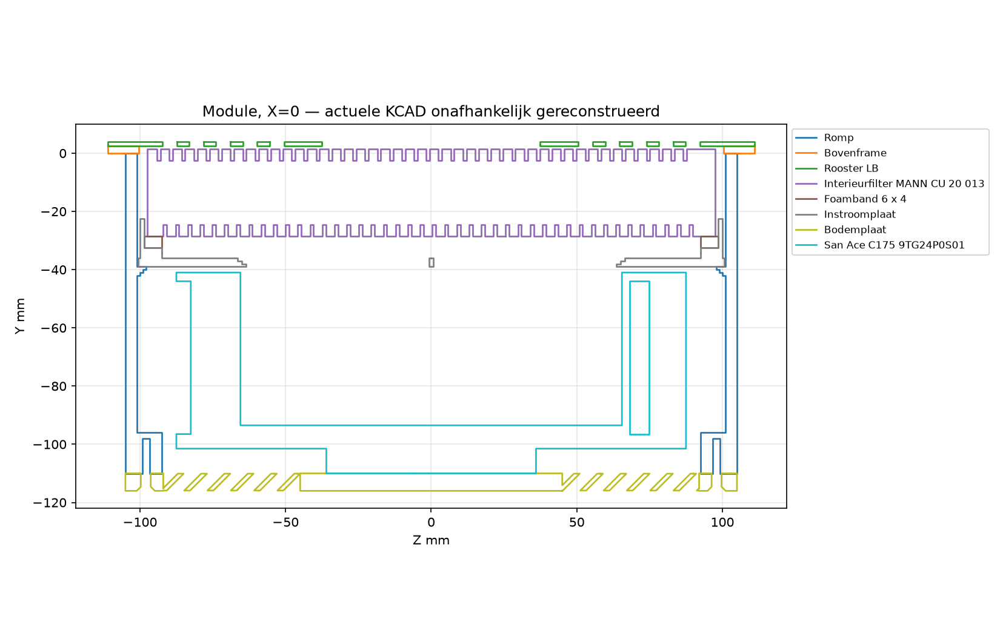
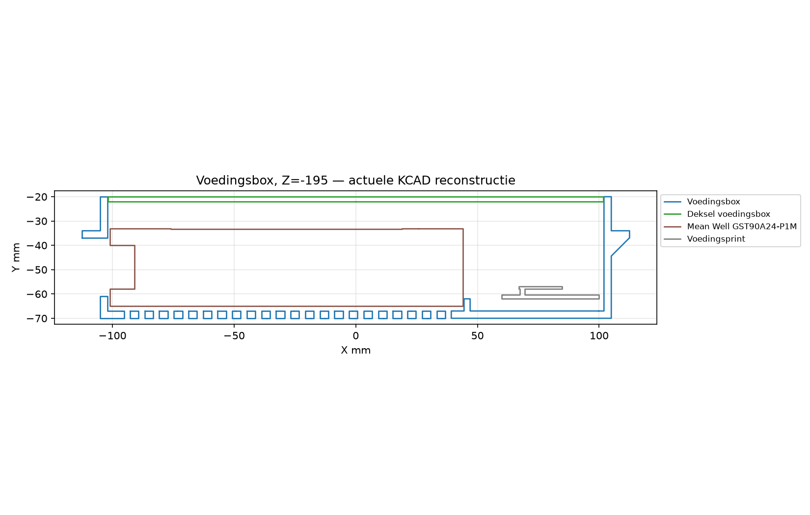

# Afzuiging nageltafel — definitief eindverslag v4

**8 november 2026 — Europe/Brussels (CET). Bronrevisie7.0. Definitieve blinde ontwerpsynthese.**

## Eindoordeel

**6,4/10 gewogen**: **−0,6 tegenover voorlopig v4 (7,0)** en **+0,8 tegenover definitief v3 (5,6)**. Dit is dezelfde 111-bestandensnapshot, geen nieuwe verslechtering door wijzigingen na de technische ronde. De lagere score volgt nu beter onderbouwde ontwerp-/toestandsconflicten. Geen ontbrekende fysieke proef verlaagt de score; prototypevalidatie staat alleen in het laatste, ongescoorde deel.

Het is een aanzienlijk verbeterd, werkelijk inspecteerbaar digitaal bouwontwerp, maar nog geen gesloten beschermings-/bedrijfsontwerp. Elf bruikbare productie-STL’s, passende nominale onderdelen, een permanent rooster, stofarm onderhoud, betere regeling en echte groene builds/tests zijn sterke resultaten. Doorslaggevend blijven afdichting en filterinvoer, een consistent onderhoudseindpunt, betrouwbaar geïnterpreteerde bewaking, elektrische fouten en mors-/herstelgedrag.

## Blinde ronde en vonnis-matrix

De vier teksten zijn eerst mechanisch ontdaan van auteurs-/rolattributie en herkenbare onderzoeksmapnamen. Daarna systeemwillekeurig verdeeld over Alpha–Delta, zonder seed/koppeltabel te bewaren. Beoordeeld in volgorde **Gamma → Alpha → Delta → Beta**, zonder auteurs te raden. De originelen zijn niet als inhoudelijke beoordelingslabels gebruikt. Eén rapport meldt eerlijk dat een toegestaan ruw evidencebestand onverwacht voorlopige beoordelingsmetadata bevatte; dat beperkt perfecte onafhankelijkheid. Die metadata is geen beoordelingsbewijs en de vier cijfers worden niet gemiddeld.

**Beste gecontroleerde bewijs wint; bij gelijkwaardig bewijs de strengste ontwerpinterpretatie.** Ernst volgt het aangetoonde ontwerpgat, niet het meest alarmerende woord. Matrix 1–5: 5=sterk. “Blinde vlekken” betekent aanvulling van hiaten in andere rapporten, niet het aantal eigen fouten.

| Rapport | Validiteit | Bruikbaarheid | Aanvulling blinde vlekken | Reden |
|---|---:|---:|---:|---|
| **Alpha** | 4/5 | 5/5 | 5/5 | Sterke onafhankelijke rekencontrole, volfiltereindpunt, morsroute, Pololu en documentdatums. Geen hosttests uitgevoerd; historische IDs niet volledig afgetekend. Klemkrachtvergelijking vereist gekoppelde arm-/rubberherberekening. |
| **Beta** | 5/5 | 5/5 | 5/5 | Eigen builds/22 hosttests en negatieve codeproeven; doorslaggevend op selectieve boot, onbevestigde UIT, onderhoudsbediening en schadeherstel. Geometrie deels herhaalde methode, eerlijk aangegeven. |
| **Gamma** | 3/5 | 4/5 | 4/5 | Nuttige bypass-/vuil-ijk-/plenumtegenvoorbeelden en echte tests. Kritiek-classificatie ontbrekend filter te stellig; gegarandeerd foamlek, verplichte drempels/hoogtes en conclusie dat dagstand vanafζ1 faalt niet gedragen. |
| **Delta** | 5/5 | 5/5 | 5/5 | Breed herhaald geometrie-/buildbewijs met onafhankelijke aanvullende tests; NVS-validatie, resetbudget, primaire sensor/buckdata en knopklauwsweep vullen andere rapporten aan. Metadata-blootstelling eerlijk gemeld, geen perfecte-blindheidsclaim. |

**Aanvulling:** Alpha sluit de volfilter-/eisinterpretatie aan op het rekenblad en corrigeert hardware-/datumdetails. Beta vult de andere drie vooral aan op gebruikersstatus, selectieve resets, herijken en schadeherstel. Gamma levert concrete druk-/bypass- en vervuilde-ijktegenvoorbeelden, maar Alpha/Delta en eigen rekenwerk begrenzen zijn hardste claims. Delta versterkt de geometrie, beide klauwtypen en NVS-/resetvalidatie. Eigen originele-code-tegenproeven bevestigen of corrigeren deze bijdragen. De rapporten staan onder `team-blind/v4/`; geen auteurkoppeling geleverd.

## 1. Momentopname en echte veranderingen

111 bronbestanden zijn read-only uit de laptopbron geëxporteerd en op de box stuk voor stuk SHA256-geverifieerd. De stagingzip is alleen in de eerder toegestane QA-map op de laptop gemaakt; de bronmap is niet gewijzigd. Dit definitieve verslag, JSON en de vier geanonimiseerde rapporten worden uitsluitend naar de afgesproken QA-map gekopieerd; de bronmap blijft ongemoeid.

Vergelijking met `src-v3`: **16 toegevoegd, 19 verwijderd, 58 gewijzigd, 37 identiek**. Detail: `WIJZIGINGEN-v4.md`, `v4-evidence/changes-v4.json` en tekstuele diffs eronder.

- Filtercassette/rand/Rittal-mat vervallen; CU20013, 6×4 mm-foam en steun-/geleiderand toegevoegd. Elf printtypen in plaats van dertien: het nieuwe filter en foam zijn koopdelen.
- Romp 96→110 mm; fan 14 mm lager. Onderkant module nu Y=−116: **82 mm onder de onderkant van een 34mm-blad**, tegenover 68 mm in v3. Bij tafelbovenkant 734 mm is de onderkant 618 mm boven de vloer. Grotere filterdiepte kost dus beenruimte; dat is een ontwerpafweging, niet automatisch een afkeur.
- Vingerrooster geïntegreerd; sleuven nominaal 10,4 mm, ribhoogte 2,9 mm, rotorafstand ongeveer 2,05 mm. Klauwrubber en vergroot zwaaivenster toegevoegd.
- Exact C&K D502 en Bel 0697W-fuse, diode tegen een terugvoedingsroute, lokale warmte en lastafhankelijke adapterderating opgenomen.
- Tijdgebaseerde softstart, RPM-ijktabel/bijregeling, expliciete bewakingsstatus, vervangfactoren 1,08/1,19/1,44, cumulatief boosttegoed en bewuste herkoppeling toegevoegd.
- Onderhoud uit één procedurebron: schakelaar UIT, uitloop, zak en niet uitkloppen; het oude positieve PDF-advies is echt weg.
- Oude laserklauwen verwijderd; materiaalstaat en gecombineerde afdruk-PDF toegevoegd. Kostensom **€530,88** (kopen €415,88 + laser €55 + filament €60), tegenover €502,69 in v3. Geen winkelprijscontrole of aankoopadvies.
- Geluidscomforteis **55→70 dB(A)** op oorpositie: een versoepeling, geen aangetoonde geluidsreductie. Roostergeometrie zelf is gelijk; gewijzigde loopfile bevat onder andere nieuw filteroppervlakrapport.

## 2. Uitgevoerde controles en sterke punten

- Alle 111 bestanden geopend/geparseerd naar hun formaat; geen gebroken KCAD-sketch/plane/point-referenties. Zeven PDF’s naar tekst omgezet, SVG/XML, DXF, PNG en font gecontroleerd.
- **11/11 productie-STL’s gesloten**, consistente winding, positief volume en één verbonden component; maatvoering past op het opgegeven 256mm-bed. Elf CAD/STL-volumes verschillen maximaal **0,104%**, passend bij tessellatie.
- **80 plaatsingen** onafhankelijk met vrije Manifold/trimesh-tools gereconstrueerd, **3160 paren** gescreend. De oude box/print-botsing is verdwenen. Alleen circa 0,042 mm³ print/schroefcontact resteert; niet als bewezen ongewenste botsing opgevoerd.
- **548 nominale moduleklauwstanden mét nieuw rubber** tegen de romp gecontroleerd: geen overlap >0,02 mm³. De nieuwe 274 nominale knopklauwstanden staan in §5; samen is dit nog geen volledige montage-/tolerantiesweep of officiële kernelcertificering.
- De ruwe reconstructie meldt vrijwel nulvolume-splinters bij het vingerrooster en twee circa 48,8mm³-deeltjes bij de box. De geleverde STL’s zijn één body; zonder exacte-kernelbevestiging wordt dit niet als losse productieonderdelen afgekeurd. Het tweede adapterklemdeel wijkt intern af door een zuivere 55mm-verplaatsing, niet door een andere maat/revisie.
- **Beide PlatformIO-targets SUCCESS**. **22 originele hosttests PASS** met onafhankelijke Zig/Clang-compiler. Geen waarschuwingvrije build geclaimd. Testbronnen in de snapshot niet gewijzigd.
- Berekeningen reproduceren genormaliseerd exact. Prijsgenerator reproduceert README-totalen en alle niet-lege CSV-inhoud; de aangeleverde CSV bevat extra lege regels (Windows-newlineverschil), geen andere bedragen.
- Eigen C++-tegenproef vindt wel een nieuwe relevante grens: blijvend onvoldoende toerental kan toch een normale bewakingsstatus geven; zie V4-04. Een groene testset is geen bewijs van volledige correctheid.

## 3. Definitieve gebiedsscores

| Gebied | Gewicht | Definitief v3 | Voorlopig v4 | Definitief v4 | Reden voor wijziging |
|---|---:|---:|---:|---:|---|
| CAD / geometrie | 15% | 7 | 8 | **7,5** | Pakking- en afschermingsmarges blijven open, ook bij sterke nominale passing. |
| Exports / revisies | 15% | 8 | 9 | **8,5** | Controleerbare goede exports, maar schema-/envelopreferenties spreken geleverde teksten tegen. |
| Luchttechniek / geluid | 20% | 4,5 | 6 | **5,5** | Volfiltereis en vervangendpoint zijn verschillend; huidige dagstand haalt bron-einddrukmodel niet. |
| Filtratie / beschermingsconcept | 15% | 3 | 5 | **4,5** | Beperkte productonderbouwing plus kennisgrenzen bij ontbrekend/vuil/omzeild filter. |
| Elektrisch / thermisch | 10% | 6 | 7 | **6** | Sterker onderbouwde rail-/USB-/LC-/vloeistof-foutanalyse ontbreekt. |
| Firmware | 10% | 5 | 7 | **6** | Nieuwe echte tegenproeven voor boot, UIT-status, ijking en NVS; bestaande reparaties blijven erkend. |
| Ergonomie als ontwerp | 5% | 7 | 7 | **7** | Concrete werkplek blijft waardevol; geen verzonnen minimumkniehoogte of fysieke-teststraf. |
| Onderhoud als ontwerp | 5% | 6 | 8 | **7** | Hoofdprocedure goed, maar mors-/inspectie-/afkeur-/herstartketen ongesloten. |
| Documentatie | 5% | 5 | 7 | **6,5** | Meer verifieerbare verschillen en een onjuist geclaimde header/model-zelfcontrole. |
| **Totaal** | **100%** | **5,6** | **7,0** | **6,4** | **Σ(score×gewicht)/100=6,40** |

Geen gemiddelde van vier rapporttotalen en geen “laagste rapportcijfer wint”-regel. De score weegt de gezamenlijk gecontroleerde ontwerppunten. Dezelfde goede export blijft een goede export; een niet-uitgevoerde fysieke proef of ontbrekende lokale tool wordt nergens als bronfout opgeteld.

## 4. Hercontrole van alle vijftien v3-punten

| Oude ID | Definitieve aftekening | Bewijs / restant |
|---|---|---|
| V3-01 | **deels** | G3 vervangen door CU20013; kritieke grove-filterkeuze vervallen, exacte rendement-/retourluchtclaims blijven Major V4-01. |
| V3-02 | **deels** | Foam en steunpad werkelijk CAD; kracht/curve/tolerantie nog V4-02. |
| V3-03 | **deels** | Meer plenum, RPM-regeling, gekoppeld model, gewijzigd geluidsdoel; resterende bandonderbouwing V4-03. |
| V3-04 | **opgelost** | Fractionele tijdramp; originele tests met 1/5/10/20/250ms en jitter slagen. |
| V3-05 | **deels** | Bewuste herkoppeling, challenge en sessievolgorde toegevoegd; commissioning/peerbeleid V4-11. |
| V3-06 | **deels** | Factor2 vervangen door modelspecifieke factoren, lage stand en overrange expliciet; aannames en RPM-volgfout V4-03/04. |
| V3-07 | **deels** | Rubber, materiaalbron en slagprocedure toegevoegd; actuele contact-/ankerketen V4-06. |
| V3-08 | **deels** | Exact DC-fuse/schakelaar, diode, lokale warmte en derating toegevoegd; besturingsvoedingsfout V4-05. |
| V3-09 | **deels** | Prijs en hoofdmaat herleidbaar; staal/koppel-/modelteksten V4-08. |
| V3-10 | **opgelost voor oorspronkelijke specificatiekeuze** | Prusament, UHU, N42 en exact reinigingsmiddel benoemd; foam en staalconflict apart V4-02/08, niet dubbel als oude generieke keuze tellen. |
| V3-11 | **deels** | Vast rooster en werkplek-/morsroute toegevoegd; structurele afschermingscontrole V4-07. |
| V3-12 | **opgelost** | Box/print-overlap verdwenen na verplaatsing; nieuwe 0,042mm³ print/schroefkandidaat is geen bewezen ongewenste botsing. |
| V3-13 | **deels** | Positief uitklopadvies en ontbrekende isolatie opgelost; downstream-service nog V4-09. |
| V3-14 | **opgelost** | Oude vol-status wordt NAN tijdens stabiliseren; originele hosttest slaagt. |
| V3-15 | **deels** | Herhaalboost tijdens run echt begrensd; reset-/thermische modelscope V4-10. |

**Vier oorspronkelijke hoofdfouten opgelost (V3-04/10/12/14), elf gedeeltelijk.** De kern van positief uitklopadvies en ontbrekende filterwisselisolatie is ook echt opgelost; V3-13 blijft alleen deels wegens de oorspronkelijke bredere downstream-serviceopdracht. V3-05 is niet meer overschrijfbaar bij iedere gewone boot, maar volledig commissioning-/herstelbeleid blijft apart te sluiten. Bij V3-15 werkt het krediet in één run; reset maakt de claim niet onvoorwaardelijk. Materiaalconflicten blijven in V4-02/08 staan zonder de oude generieke specificatiekeuze opnieuw als onopgelost te tellen.

## 5. Zelfstandig beslissend gecontroleerd teambewijs

1. **Volfilter versus waarschuwing:** met exact de bronfuncties is het ongunstige volle-filterdebiet op 75/80/100% **141,11 /155,91 /217,88m³/h**, tegenover Qmin 189,54. De huidige dagstand80% haalt de geformuleerde volfiltereis dus niet. Vroeger vervangen kan legitiem zijn, maar vereist een ander expliciet eindpunt/bedrijfscontract. Dit is een rekenkundig ontwerpconflict, geen gemeten toesteldebiet.
2. **UI en selectieve boot:** een nieuwe regelaar begint UIT maar accepteert de bestaande herhaalvraag AAN van de nog gevoede knop; eigen C++ bereikt weerPWM 80. De UI toont zonder verbinding bij gevraagde UIT groot UIT, wél met oranje “geen verbinding”; alleen AAN krijgt het expliciete vraagteken/niet-bevestigd. Dit is geen bewijs dat een werkende onderhoudsschakelaar faalt.
3. **NVS:** originele C++ laadt dalende druk en oneindige laatste RPM als geijkt. Geen werkelijke opslagcorruptie, radioreplay of crash geclaimd.
4. **Drukkennis:**0,6× de schone druk geeft BEW_OK en vol 0. Het eigen model zonder filter geeft circa 0,271–0,541× (18 scenario’s met/zonder de bestaande plenumtoeslag) bij beschermende standen, boven de 0,25-foutgrens. Dit weerlegt gegarandeerde aanwezigheid/belading uit één drukwaarde; het bewijst niet dat iedere filterwissel onveilig is.
5. **Echte header-mutatie:** op een aparte kopie factoren 9/9/9 gezet; het rekenblad eindigt nog steeds met exit0. Huidige waarden zijn gelijk, de geclaimde automatische koppeling ontbreekt werkelijk.
6. **Knopklauwen:** aanvullend274 nominale standen zelfstandig met dezelfde vrije reconstructiemethode herhaald, geen snijvolume >0,02mm³. Met de548 moduleklauwstanden is er sterk nominaal bewegingsbewijs, geen volledige assemblage-/tolerantievrijgave.

Bewijs: `v4-evidence/team-merge/` met C++, logs, modelwaarden, scripts en sweeps. Eerdere twee builds en22 originele tests blijven geldig voor dezelfde hash-identieke bron. De Pololu-fabrikantpagina is opnieuw geopend: bij meer dan 20 V adviseert zij minstens 33 µF/50 V dicht bij VIN, en1A is thermisch afhankelijke typische continue capaciteit. Dit wordt een concrete ontwerpacceptatie, geen bewezen defect of automatische verplichte hele voedingsvervanging.

## 6. Definitieve samengevoegde bevindingen

**14 gededupliceerde punten:0 Kritiek,10 Major,4 Minor.** Ontbrekend prototype levert nul puntenaftrek. Kritiek wordt niet automatisch toegekend omdat een diagnose iets niet uniek kan herkennen; de gevolgen, beoogde statusbetekenis en gekozen borging moeten onderbouwd zijn. Wel blijven die kennis-/gebruikscontracten Major ontwerpwerk.

### V4-01 — Major: CU 20 013-rendement en retourluchtconcept nog niet productspecifiek onderbouwd

**Bewijs:** `README.md:9`; `docs/Vrijgave-en-meetplan.md:27–40,50–51`; `docs/berekeningen.py:65–71`; `v4-evidence/Johansson-1999.txt:118–122`.

De keuze is wezenlijk verbeterd: een echt geplooid interieur-deeltjesfilter vervangt de grove ventilatormat. OEM MANN bevestigt 195×145×30 mm en de toepassing. De exacte claims 50–70% bij 0,3 µm en >90% vanaf 3 µm volgen echter niet uit een CU 20 013-fractierendementcurve. De aangehaalde studie uit 1999 noemt circa 55% penetratie bij betere filters in 0,1–0,35 µm, dus circa 45% afvang; dat bewijst niet dat de moderne MANN slecht is, maar evenmin de gekozen cijfers. Algemene salonventilatie is nog niet gedimensioneerd.

**Ontwerpactie:** Koppel beschermingsclaim aan exacte media-/productgegevens, een aantoonbaar passende conservatieve specificatie of een anders afgebakend werkplekconcept. Benoem retourlucht, dampen en aanvullende ventilatie expliciet.

**Digitaal acceptatiecriterium:** Een bron-/eisenmatrix onderscheidt OEM-gegevens, andere literatuur en aannames; het berekende afvang-/retourluchtconcept sluit op de beoogde stoffen aan. Geen HEPA-verplichting of onbewezen medische garantie.

### V4-02 — Major: Zelfaanzuigende foamafdichting is geometrisch aanwezig, maar de compressieketen is ongesloten

**Bewijs:** `maak-afzuiging.mjs:58–65,223–230,311–316`; `docs/Materiaalstaat.md:55–58`; `README.md:36`.

Er is nu werkelijk een 6×4 mm-foamband met steun- en geleiderand. Het filter ligt nominaal 1 mm onder de staalplaat, dus er is geen gedwongen voorspanning van boven. De gekozen generieke tochtband moet al rond 1 kPa contactdruk inveren. Een exacte compressie-/hersteldrukcurve, filterrandvlakheid en tolerantieketen ontbreken. De nominale CAD-aanwezigheid bewijst niet de absolute claim dat er geen bypass kan zijn.

**Ontwerpactie:** Specificeer één exact foamtype en modelleer belasting, vervorming, herstel, randaansluiting en filtervarianten; voeg indien nodig geometrisch beheerste voorspanning/retentie toe.

**Digitaal acceptatiecriterium:** Min/max CAD-maatketen en kracht-vervormingsberekening tonen rondom contact en voldoende resterende plenumhoogte, bij de laagste toegelaten stand én ongunstige filtermaten; geen ongedefinieerde botsing of bypass.

### V4-03 — Major: Lucht-/plenum-/alarmmodel is nu gekoppeld, maar de grenzen zijn nog scenario’s, geen bewezen bovengrenzen

**Bewijs:** `docs/berekeningen.py:14–16,65–71,248–255,273–337`; `docs/Berekeningen.md:58–101`; `v4-evidence/independent-checks.json`; `docs/Berekeningen.md:18,34–38,75,89`; `v4-evidence/team-merge/full-filter-contract.json`; `v4-evidence/team-merge/header-mutation.log`.

De oude factor2-fout is binnen het nieuwe model werkelijk hersteld: de laagste beschermende stand is 75%, met factoren 1,08/1,19/1,44. Zelf nagerekende minimumverhoudingen zijn 1,205/1,330/1,633 bij 75/80/100%. Maar 115 Pa uit andere filters en ζ=0,5 als plenum-bovengrens zijn niet aangetoond voor deze geometrie/media. De fan-afleesonzekerheid en ruimtelijke mediabenutting zijn niet volledig gepropageerd. Het comfortdoel is versoepeld van 55 naar 70 dB(A), niet akoestisch verbeterd. De ongeronde puntbronuitkomst bij 80% op 0,5 m is circa 70,18 dB(A), zonder marge voor rooster, galm of modelonzekerheid. Nieuw bevestigd: de eis “190 m³/h ook met vol filter” is niet hetzelfde als vroeg waarschuwen. Met het in de bron gedefinieerde volle filter en de ongunstige bestaande verlies-/plenuminstelling geeft het model bij 75/80/100% circa 141,1/155,9/217,9 m³/h. Alleen 100% haalt dan Qmin, maar dat is tijdelijk. Een vervangmelding kan een goed gekozen eerder eindpunt zijn, niet een bewijs dat de huidige volfiltereis is gehaald.

**Ontwerpactie:** Benoem aannames als scenario in plaats van gegarandeerde grens; onderbouw of verruim de weerstand-/verdeelband en voeg fan-, media-, RPM- en akoestische onzekerheden toe. Lees firmwaregrenzen automatisch uit in plaats van ze in Python te dupliceren. Kies expliciet of het onderhoudseindpunt de vroege bewakingsgrens of de bron-einddruk is; maak gebruiksbeperking, vervangactie en minimumdebiet tot dat punt consistent.

**Digitaal acceptatiecriterium:** Een reproduceerbare sweep over de onderbouwde invoerbanden en alle implementeerbare beschermende standen toont tijdig alarm en de gekozen vangst-/geluidscriteria met expliciete marge. Een gewijzigde headerfactor laat de controle aantoonbaar falen. Het gekozen eindpunt haalt Qmin binnen dezelfde onderbouwde envelop; “ook met vol filter” wordt niet behouden voor een ander of later eindpunt.

### V4-04 — Major: Toerentaldoel niet gehaald, toch bewaking OK en filterbalk leeg

**Bewijs:** `firmware/include/regel.h:143–167,235–251`; `v4-evidence/regression-v4.cpp`; `v4-evidence/regression-v4.log:1`.

Nieuw en op de originele C++ gereproduceerd: bij doel 80% van 3900 rpm en geïnjecteerd werkelijk toerental 1950 rpm loopt de PWM op tot 95%, maar status blijft BEW_OK, storing=0, vol=0. De regelaar bewaakt stilstand (<300 rpm), niet blijvende afwijking/saturatie. In het eigen nominale bronmodel hoort bij 50% werkelijk toerental circa 145,2 m³/h, onder Qmin 189,54. Dit is een adversariële toestandinjectie, geen voorspelling dat de echte motor bij 95% PWM op 1950 rpm loopt.

**Ontwerpactie:** Ontwerp een tijdgebonden toerentalvolg-/saturatiebewaking en maak de beschermings-/filterstatus ongeldig wanneer het werkelijke toerental buiten de modelband valt.

**Digitaal acceptatiecriterium:** Hosttests voor achterblijvend/te hoog toerental, ontbrekende tacho, verzadigde PWM, opstart en herstel tonen geen normale beschermingsstatus buiten de toegelaten RPM-band. Tijd/marges zijn op het model en de gewenste foutreactie afgestemd.

### V4-05 — Major: Uitval van de besturingsvoeding is elektrisch nog geen gesloten fouttoestand

**Bewijs:** `schema/maak-schema.mjs:147–153,194–220`; `firmware/src/module/main.cpp:13–17,61–65`; `docs/Berekeningen.md:119–120`; `docs/Vrijgave-en-meetplan.md:107`.

De 3,3V-pull-up houdt Q1 tijdens een normale MCU-boot terecht aan: geen opstartfout geclaimd. Valt echter 5V/3,3V weg terwijl 24V aanwezig blijft (bijvoorbeeld kortsluiting in de knopkabel), dan verdwijnt ook die basisaandrijving en wordt de open-collector-PWM ongedreven. Sanyo beschrijft open PWM algemeen als 100%, met modelvoorbehoud. De bron schuift de reactie door naar een latere proef. Een voedings-/PWM-fouttoestand en continu-volbedrijf moeten al op schema/modelniveau gekozen worden. De precieze SuperMini-boardrevisie en de USB-VBUS-route zijn niet gespecificeerd: één diode bewijst niet elke terugvoedingsrichting. Pololu adviseert bij meer dan 20 V een lokale elco van minstens 33 µF/50 V; de aanwezige 470 µF/35 V is niet zonder plaatsings-/transiëntanalyse gelijkwaardig. Nominale 2,35 A is geen aangetoonde universele start-/foutstroomgrens.

**Ontwerpactie:** Maak een voeding/fout/PWM-waarheidstabel. Borg de gekozen veilige toestand hardwarematig of dimensioneer en documenteer het plausibele continue-volscenario; controleer ook de exacte variant en USB-/diodepaden.

**Digitaal acceptatiecriterium:** Schema-/componentanalyse dekt 24V aan met 5V/3,3V afwezig, MCU-reset/flash, USB-kortsluiting en normale UIT. De gekozen reactie past bij afscherming, thermiek en onderhoud; geen ongefundeerde garantie uit alleen werkende firmware. Exact board-powerpath en inputtransiënten bij VIN van de buck zijn uitgewerkt; component-/kabel-/zekeringcoördinatie gebruikt relevante nominale én fout-/piekgevallen.

### V4-06 — Major: Klauw-/rubberberekening is beter, maar maat- en belastingsgrenzen sluiten niet volledig

**Bewijs:** `maak-afzuiging.mjs:42–45`; `docs/berekeningen.py:205–237`; `docs/Berekeningen.md:149–155`.

Neopreen en contact+één slag maken de montage veel reproduceerbaarder dan “twee vingers”. Het model gebruikt echter een hefboom van 10 mm terwijl het gemodelleerde rubber van 9,5 tot 17 mm vanaf de as ligt (midden 13,25). Kracht én armvervorming moeten gekoppeld over de werkelijke contactzone worden doorgerekend; niet simpelweg de oude kracht maal een andere arm nemen. De kruipgrens blijft expliciet een vijfde van de vloeigrens, geen gepubliceerde duurwaarde. Het bladanker is nog een generieke holledeurplug zonder exact type/draagwaarde in 3 mm vezelhuid.

**Ontwerpactie:** Gebruik de actuele contactzone, materiaal-/temperatuurbanden en realistische montageafwijking. Selecteer het echte bladanker en beoordeel de knopklauw/montageregio’s afzonderlijk.

**Digitaal acceptatiecriterium:** Herleidbare min/max-berekening omvat rubber en PETG in serie, contactresultante, lokale huiddruk, dak/buiging/kruip en anker. De montage-instructie begrenst het berekende geval; aangenomen langetermijngrenzen worden niet als datasheetfeit gepresenteerd.

### V4-07 — Major: Nieuw vast vingerrooster: nominale opening gecontroleerd, structurele rotorafstand nog niet

**Bewijs:** `maak-afzuiging.mjs:327–336`; `docs/Vrijgave-en-meetplan.md:54–62`; `v4-evidence/independent-checks.json`.

Het vaste rooster blijft bij filterservice zitten: een echte veiligheidsverbetering. Nominale spleten zijn 10,4 mm, ribhoogte 2,9 mm, rotorafstand circa 2,05 mm. Een eenvoudige losse-ribscreening (60 mm overspanning, E=1500 MPa, 10 N als gekozen scenario, geen vastgestelde normkracht) geeft zelfs bij tweezijdige inklemming circa 2,31 mm doorbuiging. Dat is geen volledige rasterberekening en bewijst geen werkelijk falen, maar laat zien dat alleen een diametervergelijking de afscherming niet sluit.

**Ontwerpactie:** Dimensioneer het volledige rib-/dwarsrib-/randraster en rotorvrije ruimte onder een gemotiveerde belasting, printtolerantie en gekozen toepasselijke probe-eis; versterk waar nodig.

**Digitaal acceptatiecriterium:** Een conservatieve raster-/balk-/FEM-berekening plus CAD-envelop houdt afscherming en probe van de rotor weg met marge. De opgelegde kracht en randvoorwaarden zijn expliciet; fysieke probevalidatie volgt later, ongescoord.

### V4-08 — Minor: Resterende bron-/instructieconflicten

**Bewijs:** `docs/Materiaalstaat.md:75`; `README.md:19,50,112,153`; `firmware/src/module/main.cpp:8–9,147–154`; `docs/Berekeningen.md:24`; `docs/berekeningen.py:159,283–304`; `schema/maak-schema.mjs:125–129`; `docs/Berekeningen.md:118`; `README.md:148,203`; `docs/Vrijgave-en-meetplan.md:86,89`.

Materiaalstaat noemt RVS304/316 voor het magnetisch vastgehouden rooster; README, KCAD en stuklijst specificeren AISI430. README zegt na lang drukken eenmaal de box herstarten, maar een bestaande koppeling wordt pas na drie korte starts vrijgegeven. Het berekende roosterlabel f=0,35 is oud: de invoer gebruikt circa 0,30. De box-STL van 225×124 past nominaal wel op 225×225, maar zonder marge langs één as; dat vraagt een expliciete slicer-/bedrandvoorwaarde, geen automatische afkeur. De als actuele headercontrole beschreven zelfcheck gebruikt gekopieerde constanten (hoofdfout en acceptatie onder V4-03). Verder: schema plaatst S1 vóór F1, tekst zegt ná F1. Het knopdeksel is inclusief pennen 4,9 mm hoog, niet de tabel-envelop 2 mm; 2 mm is de plaatdikte. Box/module/USB-maten mengen boven- en ondervlak van het 34mm-blad. Dit is geen verkeerde 618mm-vloerhoogte: dat getal klopt.

**Ontwerpactie:** Genereer materiaal-, koppel-, maat- en modelvelden uit één bron en verwijder absolute fabricageclaims zonder marge.

**Digitaal acceptatiecriterium:** Tekst-/gegevenscontrole vindt één magneetgeschikte staalkeuze, dezelfde koppelhandeling, correcte openfractie en expliciete printermarges. Prijsinhoud blijft €530,88.

### V4-09 — Major: Mors-/schadeherstel en downstream-service onvoldoende ontworpen

**Bewijs:** `onderhoud.mjs:10–18`; `docs/Vrijgave-en-meetplan.md:46–49`; `docs/Vrijgave-en-meetplan.md:63–69`; `docs/Materiaalstaat.md:28,33–35`.

De hoofd-filterwisselprocedure is echt verbeterd: geen positief uitklopadvies, schakelaar UIT, stilstand, zak en pijlrichting. Maar de eigen morsroute voert vloeistof via filter en vingerrooster naar waaier/motor en PETG. “24V” en “daar zit geen elektronica” sluiten materiaal-, BLDC-motor- of verspreidingsschade niet af. Alleen laten drogen en een filter vervangen geeft geen inspectie-/afkeur-/herstartbeslissing voor rotor, lijm of afscherming. Periodieke reiniging van downstreamdelen ontbreekt eveneens. Geen brand, ontsteking of werkelijk defect bewezen.

**Ontwerpactie:** Kies een redelijk begrensd morsscenario en ontwerp een veilige route of aantoonbaar begrensde blootstelling; voeg een afzonderlijke isolatie-, inspectie-, afkeur-/vervang- en herstartprocedure toe. Maak ook downstreamdelen servicebaar zonder draaiende of onder spanning staande delen te benaderen.

**Digitaal acceptatiecriterium:** CAD-/foutenboom volgt de gekozen vloeistof-/stofroute. Kwetsbare motor-/materiaalzones zijn beschermd of krijgen expliciete veilige inspectie-/afkeurcriteria en gecontroleerde herstart; toegang en hermontage zijn getekend. Extra luchtweerstand keert terug in het model. Geen fictieve ATEX-plicht of verplichte fysieke proef om dit ontwerpwerk te sluiten.

### V4-10 — Minor: Boosttegoed begrenst herhaling tijdens bedrijf, maar herstartbeleid ontbreekt in thermische redenering

**Bewijs:** `firmware/include/regel.h:67–69,124–135`; `docs/Berekeningen.md:141–145`; `v4-evidence/regression-v4.log:2–3`.

De 22 tests bevestigen het cumulatieve krediet tijdens één continue run. Een nieuwe Regelaar krijgt echter meteen opnieuw 120000 ms tegoed: reset herstelt de volle beginvoorraad. Het gemiddelde van 1/5 is dus geen onvoorwaardelijke grens over resets. Dat bewijst geen oververhitting: het statische model voor continu100% geeft bij 25°C kamer circa 53°C boxlucht.

**Ontwerpactie:** Maak de reset-/warme-startaanname expliciet; bewijs het continue foutgeval of ontwerp persistent/behoudend budgetherstel op een passend thermisch model.

**Digitaal acceptatiecriterium:** Model en tests dekken warme herstarts en maximale omgeving, niet alleen één uur zonder reset. Uit de ontwerpgrenzen volgt de gekozen thermische marge zonder onbewezen gemiddelde.

### V4-11 — Minor: Gelijktijdige eerste koppeling en handleiding nog niet exclusief per module

**Bewijs:** `firmware/include/regel.h:354–370`; `firmware/src/module/main.cpp:179–186`; `firmware/src/knop/main.cpp:451–469`.

Bestaande sets kunnen niet meer in elke opstartminuut worden overschreven en de challenge bindt het antwoord aan de knop. Twee verse, nog ongekoppelde modules kunnen echter dezelfde broadcastvraag aannemen; de challenge selecteert geen unieke bedoelde module. Peer-toevoegfouten worden nog niet expliciet verwerkt. Dit is geen aangetoonde radioreplay of internetdreiging.

**Ontwerpactie:** Kies en documenteer één-module-per-commissioning of voeg doel-/selectiebevestiging toe; handel radio-peerfouten af.

**Digitaal acceptatiecriterium:** Een tweesets-commissioningscenario resulteert deterministisch in twee correcte sets, of de beschreven procedure voorkomt overlap; mislukte peertoevoeging wordt niet als succesvolle verbinding behandeld.

### V4-12 — Major: Selectieve moduleherstart en UIT-weergave missen één expliciet bevestigd herstelcontract

**Bewijs:** `firmware/src/knop/main.cpp:293–300,435–447,472–477`; `firmware/src/module/main.cpp:197–205`; `firmware/include/regel.h:75–94`; `v4-evidence/team-merge/counterchecks.log:3–4`.

Een nieuwe regelaar begint UIT, maar de nog gevoede knop herhaalt AAN viermaal per seconde. De originele C++ accepteert zo een bestaande AAN-vraag na een selectieve modulereset en bereikt weerPWM 80, zonder nieuwe gebruikershandeling. Dit kan een bewust hervatbeleid zijn, maar is niet hetzelfde als de onvoorwaardelijke tekst “na stroomonderbreking UIT”. Bij radioverlies en een gevraagde UIT toont de UI groot “UIT”, mét een oranje waarschuwing “geen verbinding”; “stand niet bevestigd” wordt alleen bij AAN? geschreven. Niet beweren dat de UI helemaal geen verbindingswaarschuwing geeft.

**Ontwerpactie:** Leg gezamenlijk/afzonderlijk booten, commandobevestiging en hervatten in één protocol-/UI-toestandsmachine vast. Toon UIT? of UIT niet bevestigd zolang geen actuele modulebevestiging bestaat; kies expliciet een veilig hervatbeleid.

**Digitaal acceptatiecriterium:** Tests voor afzonderlijke controllerresets, gezamenlijke spanningsuitval, radioverlies tijdens UIT, herstel en herhaalde oude opdrachten laten alleen het vastgelegde hervatgedrag toe. Geen bevestigde UIT uit alleen een knopwens; mechanische stilstand/onderhoudsisolatie blijven afzonderlijke voorwaarden.

### V4-13 — Major: Schone referentie, filteraanwezigheid en drukdiagnose worden te gemakkelijk als zekerheid geïnterpreteerd

**Bewijs:** `firmware/include/regel.h:97–108,147–167,269–315`; `firmware/src/knop/main.cpp:318–346,420–449`; `v4-evidence/team-merge/absent-filter-model.json`; `v4-evidence/team-merge/absent-filter-model-extended.json`; `v4-evidence/team-merge/reproduce_model_checks.py`; `v4-evidence/team-merge/counterchecks.log:5`.

Een verse drukwaarde van 0,6× schoon wordt met correct doel-RPM als BEW_OK, storing 0 en vol 0 getoond; het eigen model zonder filter geeft circa 0,271–0,541× (18 scenario’s met/zonder de bestaande plenumtoeslag) schoon in de beschermende standen, boven de 0,25-storingsgrens. Eén druksignaal bewijst dus geen aanwezig of goed afgedicht filter. Herijken accepteert plausibel stijgende profielen van een vuil/verkeerd gemonteerd filter en normaliseert zo de referentie; de lange-drukbediening heeft geen afzonderlijke bevestiging van werkelijk nieuw filter. De balk is drukreserve, geen beladingsmassa; “geen luchtstroom” is geen unieke oorzaakdiagnose. Dit is een Major ontwerp-/kenniscontract, geen bewezen catastrofe en geen universele plicht tot een extra sensor.

**Ontwerpactie:** Maak ijken een bewuste annuleerbare onderhoudsmodus met nieuw-filterbevestiging en duidelijke grenzen. Ontwerp een onderbouwde plausibiliteits-/retentie-/aanwezigheidsborging of leg aantoonbaar de beperkingen en procedurele beheersing vast; formuleer diagnose en balk eerlijk.

**Digitaal acceptatiecriterium:** Host-/UI-/modeltests dekken ontbrekend/verschoven filter, bypassscenario, vuile referentie, sensor-/slangvarianten en1/5/10s-bedieningsgrenzen. Zij tonen geen gegarandeerde aanwezigheid, schoonheids- of massa-uitspraak uit één drukwaarde. Elk toegevoegd detectiecriterium heeft een scenario-/tolerantieonderbouwing; geen willekeurige0,75-grens als universele oplossing.

### V4-14 — Minor: Laden van opgeslagen ijking valideert RPM-eindigheid en drukmonotonie niet

**Bewijs:** `firmware/include/regel.h:197–203`; `v4-evidence/team-merge/counterchecks.log:1–2`.

Zelf uitgevoerd op originele C++: een dalende drukarray wordt geladen als geijkt; ook een laatste RPM van+Inf wordt geaccepteerd. De bronclaim “geldige, stijgende waarden” is dus niet volledig geïmplementeerd. Er is geen werkelijke NVS-corruptie of platformcrash aangetoond.

**Ontwerpactie:** Valideer beide arrays geheel vóór overname: eindigheid, plausibel bereik en consistentie met het gedefinieerde kalibratiemodel. Bewaar een bestaande geldige set bij afwijzing.

**Digitaal acceptatiecriterium:** Tests voor NaN/±Inf, te hoge RPM, dalende druk/RPM en onvolledige opslag weigeren de foutieve set; toegestane quantisatie-/ruismarges zijn expliciet. Beide firmwarebuilds en22 bestaande tests blijven groen.

## 7. Verworpen of begrensde teamclaims

- **Gamma: ontbrekend filter noodzakelijk Kritiek; een0,75-drukgrens lost het op.** Niet overgenomen. Het code-/modeltegenvoorbeeld is bevestigd en opgenomen als Major V4-13. Maar één druksignaal identificeert aanwezigheid of iedere bypass niet uniek; een universele drempel zonder model-/referentieband geeft schijnzekerheid. Mechanische, procedurele of aanvullende sensorborging zijn af te wegen routes, geen automatisch verplichte uitvoering.
- **Gamma: dagstandclaims vallen al bij plenumζ≥1 weg.** Te stellig en strijdig met zijn eigen getallen. Eigen herberekening:75% bijζ1 nog200,74m³/h;80% bijζ1,5 nog204,10m³/h schoon.75% bijζ1,5 is188,91 en mist het doel wél. Dit bevestigt gevoeligheid, niet dat elk ongunstiger scenario beide standen laat falen. Geen van deze gekozenζ’s is een bewezen fysieke grens.
- **Gamma: gegarandeerd onvoldoende foamcompressie of20m³/h bypass.** Niet bewezen zonder exact foam-/contact-/lekmodel.1mm geleiderspeling is niet automatisch een rechtstreekse lekweg langs de afdichting. De ongesloten maat-/krachtketen blijft wel Major.
- **Verplichte15mm plenum,25–40% foamcompressie,NTC,0,75-drukgrens,640mm kniehoogte of250mm moduleplaatsing.** Geen universele eisen uit het bewijs. Hooguit concrete ontwerpalternatieven waarvan effect op het gekozen werk-/tolerantie-/comfortcontract moet worden berekend. Ook0,5m/s op20cm is niet de vastgelegde eis van dit project; wel de werkhoogte begrenzen die de10cm-eis veronderstelt.
- **32N vergelijken met een17mm-hefboom alsof kracht gelijk blijft.** Geen bewijs van bezwijken: de armcompliance en rubberkracht veranderen gekoppeld. De verkeerde vaste10mm-invoer en magere robuustheids-/ankeronderbouwing blijven V4-06.
- **Geen verbindingswaarschuwing bij UIT.** Onjuist: de oranje waarschuwing staat er wél. Het probleem is de stellige grote UIT en het ontbreken van expliciete onbevestigde stopstatus, niet totale afwezigheid van foutinformatie.
- **Boost altijd precies1/5, ook elk tijdvenster/warme reset.** Onjuist: er is een initiële120s-voorraad; de herstelverhouding geeft een asymptotische rungrens. Reset vult de voorraad weer. Omgekeerd is daarmee geen oververhitting bewezen: het bronmodel geeft continu100% bij 25 °C circa 53 °C boxlucht.
- **“22 tests niet kunnen draaien” als productfout, historische niet-herverificatie als open bronfout, of ontbrekende officiële kernel als afkeur.** Niet meegeteld. Eigen22 tests en beide targets zijn uitgevoerd; scopebeperkingen blijven eerlijk benoemd. Alle historische IDs zijn in deze synthese wel afgetekend.
- Geen verplichte HEPA-/koolstoftrap, temperatuurmeter, buitenafvoer, andere zekering of ATEX-keuring uit de rapporten afgeleid. Geen bewezen salonblootstelling, ontsteking, echte lekkage, rotorcontact of radioreplay geclaimd.

## 8. Top5 ontwerpacties — klaar voor Ian om aan Claude door te geven

1. **Eén expliciet bedrijfs-/bewakingscontract** (`regel.h`, protocol, module/knop-main en UI; V4-04/12/13/14). Combineer doel/werkelijk-RPM, verzadiging, verse meting, referentiegeldigheid, selectieve boots en onbevestigde UIT. Maak ijken een bevestigde onderhoudsmodus; valideer NVS volledig. **Acceptatie:** de nieuwe tegenproeven leveren geen BEW_OK bij te lage snelheid, geen bevestigde UIT zonder actuele modulebevestiging en geen geaccepteerde ongeldige ijking. Herstart/herstel volgt één beschreven beleid;22 oorspronkelijke tests en beide builds blijven groen.
2. **Exact filter-/foam-/retourluchtpakket** (`M.filter`, materiaalstaat, beschermingsconcept; V4-01/02/13). Specificeer productprestaties of eerlijke onbekende scenariogrenzen, foamcurve en min/max contact-/compressie-/retentieketen; kies passende mechanische/procedurele aanwezigheid-/bypassborging. **Acceptatie:** bron-/eisenmatrix en CAD-kracht-/maatketen sluiten rondom op de laagste toegelaten werkstand zonder ongedefinieerde voorspanning; geen afvang- of lekgarantie uit nominale aanraking.
3. **Maak het lucht-/onderhoudseindpunt consistent** (`berekeningen.py`, headerinstellingen, eisen/UI; V4-03/08). Kies bron-einddruk óf vroegere vervanggrens, en reken Qmin tot precies dat punt inclusief fan/nozzle, filter/plenum en geluidsonzekerheid. Lees echte firmwareparameters in. **Acceptatie:** gekoppelde modelmatrix per beschermende stand haalt het gekozen contract met marge;9/9/9-mutatie maakt de controle rood; geluidscriteria gebruiken ongeronde waarden en expliciet budget.
4. **Sluit elektrische fouten, warme starts en morsherstel** (schema, exacte C3-board/USB-route, box-/mors-CAD en onderhoud; V4-05/09/10). Leg 24V-aan/5V-uit, MCU-reset, open PWM, USB-bronnen, buck-VIN-transiënten en continu-volbedrijf vast. Ontwerp een begrensde vloeistofroute met inspectie/afkeur/herstart, geen alleen laten drogen. **Acceptatie:** schema-/FMEA-/thermische en servicebeslisboom heeft per toestand één verdedigbare reactie, exacte componentmarges en toegankelijke inspectiezones; geen fysieke foutproef vereist om dit ontwerppapier af te tekenen.
5. **Mechanische marges en leveringsbaseline afmaken** (klauw/rubber/anker, vingerrooster, BOM/README/tekeningen; V4-06/07/08/11). Koppel echte contactresultante aan rubber-/armvervorming, selecteer bladanker en bereken afschermingsdoorbuiging. Corrigeer430/304, S1/F1, referentievlakken, dekselpennen en herkoppelen. **Acceptatie:** min/max belastings-/probe-/montage-envelop heeft verklaarde marge; beide nominale klauwsweeps blijven botsingsvrij; één automatische materiaal-/maat-/parametercontrole vindt nul tegenstrijdigheden en de prijsinhoud blijft€530,88 bij dezelfde invoer.

Niets is naar Claude gestuurd. Ian kiest wat hij deelt.

## 9. Bronnen, integriteit en grenzen

De oorspronkelijke technische v4 en JSON blijven als `AFZUIGING-eindverslag-v4-voor-team.md` en `findings-v4-voor-team.json` op de box behouden; zij zijn historisch, niet het huidige oordeel. V1/v2/v3 en oudere blinde mappen worden niet overschreven. De nieuwe vier rapporten staan in `team-blind/v4/Rapport-{Alpha,Beta,Gamma,Delta}.md`. Voor de volledige wijzigingslijst: `WIJZIGINGEN-v4.md`.

Primaire bronnen uit de technische ronde blijven gelden: [MANN CU20013](https://www.mann-filter.com/en/catalog/search-results/product.html/cu20013_mann-filter.html), [Sanyo exact type](https://products.sanyodenki.com/en/sanace/dc/centrifugal-fan/9TG24P0S01/), [Sanyo PWM-techniek](https://products.sanyodenki.com/info/sanace/en/technical_material/pwm.html) en de lokaal opgeslagen [Johansson-studie1999](https://www.aivc.org/sites/default/files/members_area/medias/pdf/Conf/1999/paper095.pdf). Extra geopend op8november2026(CET): [Pololu D24V10F5](https://www.pololu.com/product/2831), met expliciete thermische/LC-voorbehouden. Catalogusmaxima zijn geen gelijktijdig unitwerkpunt; penetratie is niet hetzelfde als rendement. Geen precieze CU20013-fijnstofcurve verzonnen uit marketing of andere media.

Geen fysieke unit, debiet-, blootstellings-, geluids- of temperatuurmeting. Geen volledige officiële Phlippo-kernel-, CFD/FEM-, PCB/netlist- of conformiteitskeuring. De vereenvoudigde fan/filtergeometrie en vrije reconstructie zijn onderzoeksmodellen, geen fabrikant-STEP of certificaat. De ribbalkscreening is geen volledig raster-FEM;274/548 poses zijn beperkte nominale sweeps. Afwezigheid van een lokale tool of externe generatorlibrary is op zichzelf geen ontwerpgebrek. Geen blinde auteurmapping gemaakt of gedeeld.

## 10. Validatieplan voor later — prototypefase, ongescoord

**Geen van deze ontbrekende proeven verlaagt 6,4/10.** Eerst de digitale contracten sluiten, dan één vastgelegde revisie:

- Q–Δp/PWM–RPM en vermogen per stand, schoon tot het expliciete vervangendpoint, inclusief sensorpositie, handen/frees en dwarsstroming. Filterrendement, bypass en bronvangst afzonderlijk beoordelen.
- Deskundige stof-/ademzonemeting, veilige tracer-/lekcontrole en herhaalde filterwissels; geen ongecontroleerde personenblootstelling of stofwolk als proef.
- Geluid bij beide oren, achtergrond en bedrijfsstand, echte knie-/pols-/stekker-/kabelruimte en uitblaasroute.
- Passings-/klemmontage, exact anker/rubber/foam, duurbelasting, lijm/reiniging en afschermingsprobe volgens veilig vooraf gekozen protocol; geen live rotoraanraakproef.
- Gecontroleerde elektrische/thermische foutinjectie met competent toezicht: railverlies, USB, open PWM, warme starts, boost en gekozen maximale omgeving. Adapter gesloten houden; geen geïmproviseerde netspannings- of morsproef.
- Mors-/schade-inspectie en gecontroleerde herstart; onderhoud/downstreamtransfer, hermontage en afdichting. Hardwaregedrag vergelijken met digitale boot-/UIT-/referentie-/RPM-tests.

**Slot: echte engineeringvooruitgang sinds v3, maar nog geen gesloten beschermingsontwerp. Definitieve blinde synthese 6,4/10; het ontbrekende prototype is niet de oorzaak van de resterende aftrek.**
