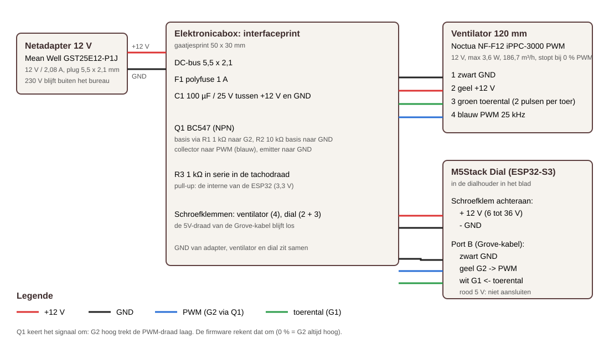

# Ingebouwde nagelstofafzuiging (Lush Beauty)

Een afzuiging die in het bureaublad zit, zoals de inbouwmodellen van ULKA en Vento, met het LB-monogram in het rooster.
De module zakt van bovenaf in een gefreesde uitsparing en klemt zich vast met vier klauwen, zoals een Niko-inbouwdoos.
Een M5Stack Dial (ESP32 met rond scherm en draaiknop) in het blad regelt de snelheid.


## Hoe het werkt

1. De lucht gaat door het RVS-rooster (lasergesneden, 1,5 mm).
2. Daarna gaat ze door een G4-filtermat in een lade die je vooraan onder het blad uittrekt.
3. Een ventilator van 120 mm onderaan blaast de gefilterde lucht naar beneden weg.
4. De vier klauwen draai je van bovenaf vast. Hun schroeven zitten onder het rooster en zijn dus niet te zien.

## Bestanden

| Bestand | Wat |
|---|---|
| `Afzuiging.kcad` | assemblage van de module, met lade-mates (schuift 0 tot 110 mm) |
| `../bureau/Bureau.kcad` | het bureau met de afzuiging en de uitsparingen in het blad |
| `laser/rooster.dxf` | snijcontouren voor de lasersnijder (mm, laag SNIJDEN) |
| `print/*.stl` | de PLA-delen in printstand |
| `aansluitschema.svg` | bedrading |
| `firmware/` | PlatformIO-project voor de M5Stack Dial |
| `maak-afzuiging.mjs`, `logo/*.py` | generators: alle maten staan bovenaan in `maak-afzuiging.mjs` |

## Stuklijst

| Onderdeel | Aantal | Opmerking |
|---|---|---|
| Rooster RVS 304, 1,5 mm | 1 | `laser/rooster.dxf`, 196 x 140 mm, geborsteld |
| PLA-prints | 1 set | inbouwmodule, filterlade, ventilatorplaat, 4 klauwen, dialhouder, elektronicabox, deksel |
| Noctua NF-F12 industrialPPC-3000 PWM | 1 | 12 V, 120 mm, stopt bij 0 % PWM |
| Vingerrooster 120 mm, metaal | 1 | onder de ventilator, tegen vingers en knieën |
| M5Stack Dial v1.1 (K130-V11) | 1 | met Grove-kabel (HY2.0-4P) |
| Netadapter 12 V 2 A | 1 | bv. Mean Well GST25E12-P1J |
| DC-inbouwbus 5,5 x 2,1 mm | 1 | in de elektronicabox |
| BC547, 2 x 1 kΩ, 10 kΩ, 100 µF/25 V, polyfuse 1 A | 1 | op een gaatjesprint 50 x 30 mm |
| Schroefklemmen 2,54 mm en ventilatorheader 4-pins | 1 set | |
| G4-filtermat 10 mm | rol | knippen op 179 x 121 mm |
| M4 x 50 cilinderkop (DIN 912) + M4-moer | 4 | klauwen |
| M4 x 35 + M4-moer | 4 | ventilator en vingerrooster aan de plaat |
| M3 x 10 zelftappend | 4 | ventilatorplaat aan de module |
| M2,5 x 8 zelftappend | 4 | deksel elektronicabox |
| Houtschroef 3,5 x 16 | 2 | elektronicabox onder het blad |

## Maken

**Frezen.** Frees met een frees van Ø10 mm twee uitsparingen door het blad. De hoeken worden dan R5, en de PLA-delen hebben R4 met 1 mm speling.

| Uitsparing | Maat | Plaats van het midden |
|---|---|---|
| Afzuiging | 196 x 140 mm | midden van het blad |
| Draaiknop | 59 x 59 mm | 250 mm rechts van het midden, 100 mm van de voorkant |

Het LAGKAPTEN-blad is van binnen een honingraat. De wanden van de module en van de dialhouder dekken de gezaagde rand volledig af.

**Lasersnijden.** Stuur `laser/rooster.dxf` naar een lasersnijdienst, in RVS 304 van 1,5 mm. Het rooster is gecontroleerd:
- het is één stuk, zonder losse eilanden;
- geen enkele steg of sleuf is smaller dan 1,5 mm;
- het open oppervlak is 96 cm², ongeveer het doorstroomoppervlak van de ventilator.

**Printen.** Gebruik PLA met een laagdikte van 0,2 mm, 4 wanden en 25 % gyroid. Support en brim zijn niet nodig. De STL's staan al in printstand:
- de module, de dialhouder en de doos liggen met de flens op het bed;
- de lade staat op haar achterkant;
- de rest ligt plat.

Alles past op een bed van 220 x 220 mm.

## Monteren

1. Druk een M4-moer van onderen in elke klauw.
2. Schuif de klauwen van onderen in hun kanalen. De arm ligt dan langs de binnenwand. Draai de M4 x 50 van bovenaf een paar slagen in.
3. Schroef de ventilator met het vingerrooster aan de ventilatorplaat, met de kant met de spaken naar beneden. Zo zuigt de ventilator door de module en blaast hij onderaan uit. Schroef de plaat met 4 x M3 aan de hoekbussen.
4. Leg de filtermat in de lade en schuif de lade in de module.
5. Laat de module in de uitsparing zakken en draai de vier schroeven rechtsom aan. Elke klauw zwaait door haar sleuf naar buiten en trekt zich tegen de onderkant van het blad. Draai stevig, maar niet te hard in PLA.
6. Leg het rooster in de flens. Je tilt het eruit met een magneetje of een vingernagel.
7. Zet de dialhouder in zijn uitsparing en de Dial erin. De kabels gaan door het gat in de bodem naar de elektronicabox. Die schroef je met twee schroeven onder het blad.

## Elektronica



- **Voeding:** de 12 V gaat via de polyfuse naar de ventilator en naar de schroefklem van de Dial. Die klem aanvaardt 6 tot 36 V.
- **Snelheid:** G2 stuurt via de BC547 de PWM-draad van de ventilator. Die transistor keert het signaal om, en de firmware rekent dat om.
- **Toerental:** de tachodraad gaat via 1 kΩ naar G1, met de interne pull-up van de ESP32.
- **5 V-draad:** de rode draad van de Grove-kabel blijft los.
- **Draadkleuren van de Grove-kabel:** zwart, rood, geel en wit, volgens de volgorde in de documentatie van M5Stack. Meet ze voor het solderen even na.

Bij het inschakelen draait de ventilator een halve seconde voluit, tot de firmware de PWM overneemt. Dat is normaal: zonder signaal draait een PWM-ventilator op volle kracht.

## Firmware

```bash
python -m pip install platformio
```

```bash
cd voorbeelden/afzuiging/firmware
python -m platformio run -t upload
```

Sluit de Dial met USB-C aan op de computer.

**Bediening:**
- **Draaien:** de snelheid gaat in stappen van 5 %, van 20 tot 100 %. Draai je terwijl de ventilator uit staat, dan gaat hij aan.
- **Drukken of op het scherm tikken:** aan of uit.
- **Lang drukken:** boost, 2 minuten op 100 %.
- **Scherm:** de ring en het percentage tonen de snelheid, met daaronder het gemeten toerental. Draait de ventilator niet terwijl hij zou moeten, dan kleurt de ring rood en piept de Dial.
- **Geheugen:** de laatste snelheid en de stand aan of uit blijven bewaard als de stroom wegvalt.

## Onderhoud en veiligheid

- Vervang of klop de filtermat regelmatig uit. Een volle mat halveert de luchtstroom.
- Gebruik de afzuiging nooit zonder filtermat. Nagelstof hoort niet in de ventilator.
- Er komt geen 230 V in het bureau: de adapter steekt in het stopcontact.
- Laat het vingerrooster onder de ventilator altijd zitten.
