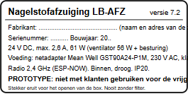

# Afzuiging: risicoanalyse en CE

Versie 7.2 (2026-11-12), op advies van Fable 5.2 (punt 4). Dit document zet op een rij welke regels gelden, welke
risico's er zijn en hoe het ontwerp ze aanpakt, en wat nog **ontbreekt** of **na te gaan** is. Het is geen keuring en
geen juridisch advies: de vrijgave vraagt een deskundige (elektricien voor E2, arbeidshygiënist of preventieadviseur
voor L4) en, voor de CE-vragen, iemand die de richtlijnen kent. Bronnen staan bij elke bewering; wat niet gevonden werd,
staat er eerlijk als "niet gevonden".

## 1. Wat is het, juridisch?

- **Een machine.** Een afzuiging met een ventilator is een samenstel met een aangedreven bewegend deel (de waaier).
  Richtlijn 2006/42/EG (Machinerichtlijn), art. 1(2)(k), sluit alleen bepaalde elektrische producten onder de
  laagspanningsrichtlijn uit (huishoudelijke toestellen, audio/video, IT, gewone kantoormachines, laagspanningsschakelmateriaal,
  elektromotoren); een afzuigtoestel voor een salon staat daar niet tussen. Bron: legislation.gov.uk, Directive 2006/42/EC,
  article 1. **Conclusie (geen letterlijke tekst uit de bron): de Machinerichtlijn is van toepassing.**
- **Machineverordening (EU) 2023/1230:** vervangt de Machinerichtlijn; van toepassing vanaf **20 januari 2027**
  (gecorrigeerde datum, corrigendum PB L 169 van 4-7-2023). Wordt de afzuiging na die datum in gebruik genomen, dan geldt
  de verordening. Bron: eur-lex.europa.eu (corrigendum) en de tekst van de verordening, art. 2(2)(p).
- **Laagspanningsrichtlijn 2014/35/EU (LVD):** geldt van 50 tot 1000 V AC en van 75 tot 1500 V DC (art. 1). De afzuiging
  zelf werkt op 24 V DC: **buiten de LVD**. De netadapter (230 V) valt er wel onder en draagt zelf de CE-markering van
  Mean Well. Bron: legislation.gov.uk, Directive 2014/35/EU, article 1.
- **Radioapparatuur 2014/53/EU (RED):** de knop en de box zenden op 2,4 GHz (ESP-NOW): het geheel is radioapparatuur. De
  RED dekt ook de EMC- en veiligheidseisen van zo'n toestel (de EMC-richtlijn 2014/30/EU apart is dan niet nodig voor
  het radiodeel). **Na te gaan:** of een toestel dat Ian voor zijn eigen zaak bouwt en zelf in gebruik neemt, onder de
  plicht tot CE-markering valt ("in gebruik nemen" door de fabrikant voor eigen gebruik). Ook bij eigen gebruik blijven
  de essentiële veiligheidseisen de maatstaf; dit document en het meetplan zijn daarop gebouwd.
- **Wie is de fabrikant?** Wie het toestel bouwt en in gebruik neemt: Ian (de zaak). Er is nog geen naam of
  ondernemingsnummer ingevuld: **ontbreekt** op het typeplaatje.

## 2. De bouwstenen en hun papieren

| Onderdeel | Wat er is | Bron | Stand |
|---|---|---|---|
| Netadapter Mean Well GST90A24-P1M | datasheet: C14-inlaat met aarde (klasse I), DC-uitgang zwevend ("−V not connected to AC FG"), overlast 110 tot 150 % hiccup, overspanning uit; CE en veiligheidskeuring volgens de datasheet | Mean Well GST90A, datasheet 2024-10-30 | aanwezig (DoC bij Mean Well op te vragen) |
| Ventilator San Ace C175 9TG24P0S01 | catalogus met curve, 0 % PWM = stil, open stuurdraad = vol toerental, 750 g | Sanyo Denki-catalogus C1111B002 (Farnell 2003019) | aanwezig; een DoC als onderdeel is niet nodig (geen machine op zich), wel bewaren |
| ESP32-C3 SuperMini (box) | generiek bordje met de kale ESP32-C3-chip en een printantenne | — | **CE-/RED-verklaring: niet gevonden.** Espressif geeft CE-certificaten voor modules (ESP32-C3-MINI-1, -MINI-1U, -WROOM-02, -WROOM-02U) en een EU-DoC voor eigen modules en ontwikkelborden, niet voor de chip op een bordje van derden (espressif.com/en/certificates) |
| VIEWE-knop UEDX46460015-MD50E | specificatie (maattekening, pinnen) | spotpear.com (SPEC V1.1) | **CE-/RED-verklaring: niet gevonden** |
| Pololu D24V10F5, Sensirion SDP810, C&K D502, Bel Fuse 0697W | datasheets | fabrikanten | aanwezig (onderdelen, geen eigen CE nodig) |

**Wat te doen met de ontbrekende verklaringen (keuze voor Ian, nog niet beslist):** (a) de ESP32-C3 SuperMini vervangen
door een bordje met een gecertificeerde module (bv. een ontwikkelbord van Espressif met ESP32-C3-MINI-1, waarvoor een EU-DoC
bestaat), dan past het in de box maar `M.box.c3` en de print moeten mee; (b) de VIEWE-knop vragen om een EU-DoC (RED), of
een andere knop met DoC kiezen; (c) beide laten zoals ze zijn en het radiodeel laten beoordelen. Tot dan staat in het
technisch dossier: "RED-conformiteit van de radiomodules niet aangetoond".

## 3. Risicoanalyse (werkwijze EN ISO 12100: gevaar, situatie, maatregel, rest, controle)

Ernst (E): 1 licht, 2 matig, 3 ernstig. Kans (K): 1 zelden, 2 soms, 3 vaak. Risico = E x K vóór en na de maatregelen.

| # | Gevaar | Situatie | Vóór | Maatregelen (ontwerp, firmware, handleiding) | Na | Controle |
|---|---|---|---|---|---|---|
| 1 | snijden, stoten aan de waaier | vinger door het rooster en het filter in het oog | 3 x 2 | vast vingerrooster in het oog volgens EN ISO 13857 tabel 4 (spleet ≤ 5,9 mm op 14 mm, nodig 10 mm); de plaat en het filter tellen niet als afscherming | 3 x 1 | 6b, W1 (testvinger) |
| 2 | idem | plaat en filter eruit terwijl de waaier draait (service, nieuwsgierigheid) | 3 x 2 | idem; zonder filter stopt de ventilator na 3 s op elke stand (firmware, getest); procedure: eerst knop uit en schakelaar uit, 10 s wachten | 3 x 1 | F1, onderhoud.mjs |
| 3 | idem | hand onder het blad aan de lamellen of ringsleuven van de kuip | 2 x 1 | openingen ≤ 4 mm (EN ISO 13857: 2 mm nodig, 7 mm aanwezig) | 2 x 1 | 6b, W1 |
| 4 | onverwacht starten | stroomterugkeer, herstart van de box, watchdog | 2 x 2 | na elke start UIT tot een nieuwe handeling (startId, getest); -Q2 open zonder besturing | 2 x 1 | F1, waarheidstabel |
| 5 | ventilator op vol toerental zonder vraag | PWM-draad los of gebroken (datasheet: open stuurdraad = 100 %) | 1 x 1 | bewaking "toerental wijkt af"; UIT op de knop of de schakelaar maakt hem spanningsloos (-Q2, -Q4) | 1 x 1 | F1 |
| 6 | elektrische schok | 230 V | 3 x 1 | 230 V alleen in de gekeurde adapter (klasse I, geaard netsnoer); geen eigen 230 V-bedrading | 3 x 1 | E2 |
| 7 | brand, oververhitting | kortsluiting of overlast na de adapter | 3 x 1 | adapter met hiccup, zekering -F1 (72 V DC), regelaar met stroombegrenzing; box in PETG met berekende warmte (5); geen vonken: borstelloze motor | 3 x 1 | E1, E2 |
| 8 | beschadiging van de print, warmte | DC-kabel verkeerd om op -X1 | 2 x 2 | -R13 (SB560) geleidt bij ompoling, de adapter gaat in hiccup of -F1 smelt; + en − nameten in de handleiding | 1 x 1 | E2 (labvoeding) |
| 9 | inademen van fijn stof | het filter laat het fijnste stof door; de lucht gaat terug in de salon (geen afvoer, keuze Ian) | 2 x 3 | vangst bij de bron op 10 cm (berekend, L2); filter met lip; ventilatie van de salon; FFP2 bij het vervangen | 2 x 2 | L3 (PM2,5), **L4 verplicht** |
| 10 | inademen van dampen (aceton, monomeer) | het filter vangt geen dampen | 2 x 3 | aparte ventilatie; koolfilter als optie (Castrol CC0356C, zelfde maat, niet doorgerekend) | 2 x 2 | L4 |
| 11 | brand of explosie van dampen | acetondamp in de luchtweg | 3 x 1 | lage concentratie bij de bron (verdunning door het debiet); de motor is borstelloos (geen open vonk); de elektronica zit in de box, buiten de luchtweg; geen open vlam boven het rooster (meetplan 2.6) | 3 x 1 | **na te gaan** door de deskundige van L4 |
| 12 | lawaai | lange werkdag naast de afzuiging | 1 x 3 | 70 tot 72 dB(A) op 0,5 m op de dagstand (model); rubberbuffers; uitblaas weg van het oor | 1 x 2 | G1 |
| 13 | knelpunt, ergonomie | knieën tegen de module; pols op de plaatrand | 1 x 2 | romp 36 mm onder het blad, kuip rond en bol; randen R6; de plaat schuift niet (persbouten) | 1 x 1 | W1 |
| 14 | aantasting door aceton | morsen op het rooster | 2 x 2 | RVS boven, lip in siliconen; procedure "Na morsen" met afkeurgrenzen | 2 x 1 | M3 (acetonproef) |
| 15 | vallen van de module of de box | klauwen of schroeven los in de honingraat | 2 x 1 | latten tussen de huiden; schroeven van de box in hout; klauwen met rubber | 2 x 1 | M1 |
| 16 | onbedoeld blijven draaien | radio weg, vergeten uit te zetten | 1 x 2 | stop na 10 min zonder knop en na 4 uur zonder bediening (getest) | 1 x 1 | F1 |
| 17 | misbruik van de radio | een vreemde knop neemt de afzuiging over | 1 x 1 | koppelen alleen na de handeling aan de box (60 s), sleutel via X25519, volgnummers; een actieve aanvaller in die 60 s is niet uitgesloten | 1 x 1 | F1 |

Resterende risico's die in de handleiding staan: de ventilator draait nog 10 s uit; fijn stof en dampen gaan terug in de
salon; een kleine kier langs het filter ziet de drukmeter niet; aceton tast het PETG aan.

## 4. Typeplaatje

(Bron: `docs/typeplaatje.svg`.)

Op een zelfklevend label (bv. polyester, 70 x 35 mm) op de voorkant van de voedingsbox, naast de schakelaar. De velden
volgen bijlage I, 1.7.3 van de Machinerichtlijn (naam en adres van de fabrikant, aanduiding, type, serie, bouwjaar) en de
elektrische gegevens. **Ontbreekt:** de naam en het adres van de zaak. **De CE-markering pas aanbrengen** als de
conformiteitsbeoordeling (technisch dossier, risicoanalyse, metingen, verklaring) rond is; tot dan "PROTOTYPE".

## 5. Verzekering en preventie

- **Verzekering:** meld de verzekeraar van de salon (brand en burgerlijke aansprakelijkheid uitbating) dat er een zelfgebouwd
  elektrisch toestel in het bureau zit, met de keuring E2 en dit dossier. **Na te gaan** bij de verzekeraar of dat
  gevolgen heeft voor de dekking.
- **Preventieadviseur:** met personeel moet de werkgever de risico's op het werk beoordelen (Belgische welzijnswet en de
  Codex over het welzijn op het werk); de externe dienst voor preventie en bescherming kan L4 doen of laten doen. Zonder
  personeel blijft L4 aanbevolen voor de eigen gezondheid en die van de klanten.
- **Keuring van de elektrische installatie** van de salon zelf (AREI) staat los van dit toestel, maar het stopcontact
  moet geaard zijn (klasse I).

## 6. Technisch dossier (wat er al is)

| Stuk | Waar |
|---|---|
| beschrijving, tekeningen, schema's | README, `tekeningen/`, `schema/` |
| berekeningen | `docs/Berekeningen.md` |
| risicoanalyse | dit document |
| meet- en vrijgaveplan, meetverslagen | `docs/Vrijgave-en-meetplan.md` (verslagen: nog te maken) |
| handleiding (bediening, onderhoud) | README, bouwschema, `onderhoud.mjs` |
| verklaringen van de onderdelen | Mean Well: op te vragen; ESP32-C3 SuperMini en VIEWE: **niet gevonden** |
| EU-conformiteitsverklaring van het geheel | **ontbreekt** (pas na de vrijgave) |
