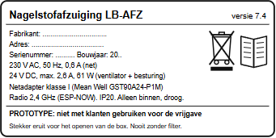

# Afzuiging: risicoanalyse en CE

Revisie: versie 7.4 (2026-11-17), zie `revisie.mjs`. Eerste versie 7.2 op advies van Fable 5.2 (punt 4); in 7.4 aangevuld
op advies van Fable 5.2 v1 (`docs/Advies-Fable-5.2-v1.md`, P2-12, P2-13 en P2-14). Dit document zet op een rij welke
regels gelden, wat de grenzen van de machine zijn, welke risico's er zijn en hoe het ontwerp ze aanpakt, en wat nog
**ontbreekt** of **na te gaan** is. Het is geen keuring en geen juridisch advies: de vrijgave vraagt een deskundige
(elektricien voor E2, arbeidshygiënist of preventieadviseur voor L4) en, voor de CE-vragen, iemand die de richtlijnen
kent. Bronnen staan bij elke bewering; wat niet gevonden werd, staat er eerlijk als "niet gevonden".

## 1. Wat is het, juridisch?

- **Een machine.** Een afzuiging met een ventilator is een samenstel met een aangedreven bewegend deel (de waaier).
  Richtlijn 2006/42/EG (Machinerichtlijn), art. 1(2)(k), sluit alleen bepaalde elektrische producten onder de
  laagspanningsrichtlijn uit (huishoudelijke toestellen, audio/video, IT, gewone kantoormachines, laagspanningsschakelmateriaal,
  elektromotoren); een afzuigtoestel voor een salon staat daar niet tussen. Bron: legislation.gov.uk, Directive 2006/42/EC,
  article 1. **Conclusie (geen letterlijke tekst uit de bron): de Machinerichtlijn is van toepassing.**
- **Machineverordening (EU) 2023/1230:** vervangt de Machinerichtlijn; van toepassing vanaf **20 januari 2027**
  (gecorrigeerde datum, corrigendum PB L 169 van 4-7-2023). Wordt de afzuiging na die datum in gebruik genomen, dan geldt
  de verordening. Bron: eur-lex.europa.eu (corrigendum) en de tekst van de verordening, art. 2(2)(p).
- **Eigen gebruik valt onder de plicht (7.4, advies v1 P2-14).** Artikel 2 i) van 2006/42/EG noemt als fabrikant ook
  wie een machine ontwerpt of bouwt "voor eigen gebruik"; de verordening 2023/1230 houdt dat aan. Wie de afzuiging bouwt
  en in de eigen zaak in gebruik neemt, is dus fabrikant en moet vóór de ingebruikname de conformiteitsbeoordeling
  doen: technisch dossier, EU-conformiteitsverklaring en CE-markering. In 7.2 stond dit hier nog als "na te gaan".
- **Laagspanningsrichtlijn 2014/35/EU (LVD):** geldt van 50 tot 1000 V AC en van 75 tot 1500 V DC (art. 1). De afzuiging
  zelf werkt op 24 V DC: **buiten de LVD**. De netadapter (230 V) valt er wel onder en draagt zelf de CE-markering van
  Mean Well. Bron: legislation.gov.uk, Directive 2014/35/EU, article 1.
- **Radioapparatuur 2014/53/EU (RED):** de knop en de box zenden op 2,4 GHz (ESP-NOW): het geheel is radioapparatuur. De
  RED dekt ook de EMC- en veiligheidseisen van zo'n toestel (de EMC-richtlijn 2014/30/EU apart is dan niet nodig voor
  het radiodeel).
- **RoHS 2011/65/EU:** de afzuiging is elektrische en elektronische apparatuur; de RoHS-richtlijn hoort bij de
  CE-markering. Nodig: voor elk elektronisch onderdeel een RoHS-verklaring of een bewijs van de leverancier (voor de
  ESP32-C3 SuperMini en de VIEWE-knop: **niet gevonden**).
- **AEEA/WEEE:** bij het afdanken gaat het toestel (elektronica, adapter, ventilator) naar het inzamelpunt voor
  elektrisch afval; het symbool hoort op het typeplaatje.
- **Wie is de fabrikant?** Wie het toestel bouwt en in gebruik neemt: Ian (de zaak). Er is nog geen naam of
  ondernemingsnummer ingevuld: **ontbreekt** op het typeplaatje.

## 2. De bouwstenen en hun papieren

| Onderdeel | Wat er is | Bron | Stand |
|---|---|---|---|
| Netadapter Mean Well GST90A24-P1M | datasheet: C14-inlaat met aarde (klasse I), DC-uitgang zwevend ("−V not connected to AC FG"), overlast 110 tot 150 % hiccup, overspanning uit; CE en veiligheidskeuring volgens de datasheet | Mean Well GST90A, datasheet 2024-10-30 | aanwezig (DoC bij Mean Well op te vragen) |
| Ventilator San Ace C175 9TG24P0S01 | catalogus met curve (gemeten met de inlaatnozzle 109-1073), 0 % PWM = stil, open stuurdraad = vol toerental, 750 g | Sanyo Denki-catalogus C1111B002 (Farnell 2003019) | aanwezig; een DoC als onderdeel is niet nodig (geen machine op zich), wel bewaren |
| ESP32-C3 SuperMini (box) | generiek bordje met de kale ESP32-C3-chip en een printantenne | — | **CE-/RED-verklaring: niet gevonden.** Espressif geeft CE-certificaten voor modules (ESP32-C3-MINI-1, -MINI-1U, -WROOM-02, -WROOM-02U) en een EU-DoC voor eigen modules en ontwikkelborden, niet voor de chip op een bordje van derden (espressif.com/en/certificates) |
| VIEWE-knop UEDX46460015-MD50E | specificatie (maattekening, pinnen) | spotpear.com (SPEC V1.1) | **CE-/RED-verklaring: niet gevonden** |
| Pololu D24V10F5, Sensirion SDP810, C&K D502, Bel Fuse 0697W | datasheets | fabrikanten | aanwezig (onderdelen, geen eigen CE nodig; RoHS-verklaringen bij het dossier leggen) |

**Wat te doen met de ontbrekende verklaringen (keuze voor Ian, nog niet beslist):** (a) de ESP32-C3 SuperMini vervangen
door een bordje met een gecertificeerde module (bv. een ontwikkelbord van Espressif met ESP32-C3-MINI-1, waarvoor een EU-DoC
bestaat), dan past het in de box maar `M.box.c3` en de print moeten mee; (b) de VIEWE-knop vragen om een EU-DoC (RED), of
een andere knop met DoC kiezen; (c) beide laten zoals ze zijn en het radiodeel laten beoordelen. Tot dan staat in het
technisch dossier: "RED-conformiteit van de radiomodules niet aangetoond".

## 3. Risicoanalyse (werkwijze EN ISO 12100: grenzen, gevaar, situatie, maatregel, rest, controle)

### 3.1 Grenzen van de machine (EN ISO 12100, 5.3; nieuw in 7.4)

- **Bedoeld gebruik:** nagelstof afzuigen bij de bron tijdens manicure en pedicure aan het eigen bureau van de salon
  (LAGKAPTEN 1400 x 600 op twee ALEX-kasten, of een massief blad), met een nagelfrees, vijl of polijstblok ongeveer
  5 cm boven het rooster. Binnen, droog, 10 tot 30 °C. Bediening met de knop; filterwissel en reinigen volgens
  `onderhoud.mjs`. Duur: een werkdag, tot 4 uur aan een stuk (daarna gaat hij vanzelf uit).
- **Voorzienbaar misbruik:** zonder filter of zonder RVS-plaat laten draaien; vingers, borstels of vijlen door het
  rooster; vloeistof (aceton, nagellakremover, monomeer, ontsmettingsmiddel) op het rooster morsen of het rooster
  ermee reinigen; de stand lager zetten dan de laagste beschermende stand voor minder geluid; het filter reinigen en
  hergebruiken in plaats van vervangen; een ander filter of een naamloos filter; spullen of een tas onder het blad
  tegen de kuip of de box; op het blad zitten of staan; het bureau verschuiven met de module erin; werken met de hand
  hoger dan 5 cm; brandend of heet gereedschap boven het rooster.
- **Gebruikers en andere personen:** de medewerker (geïnstrueerd, ook wie het filter vervangt), de klant (niet
  geïnstrueerd, zit aan de achterkant met de knieën onder het blad), en **kinderen** die met een klant meekomen
  (vanaf 3 jaar, op ooghoogte van het rooster en op kniehoogte van de kuip). Daarom EN ISO 13857 **tabel 5** (personen
  vanaf 3 jaar), niet tabel 4. Wie het toestel bouwt en onderhoudt (Ian of een technicus) is een aparte gebruiker.
- **Ruimte:** de module zit midden in het blad, de voedingsbox achteraan (aan de klantzijde), de knop rechts vooraan.
  Onder het blad: knieën van twee personen in een opening van 680 mm.
- **Tijd:** het filter is een verbruiksdeel (melding van de firmware); lip, foamband en celband jaarlijks nakijken;
  de geprinte delen verouderen door warmte (box) en door aceton (druppelzone).
- **Levensfasen:**
  1. *Transport en opslag:* de module en de box los verpakt; de RVS-plaat met beschermde randen.
  2. *Montage en ingebruikname:* **frezen van het blad** (fijn hout- en MDF-stof: afzuiging op de frees, FFP2,
     gehoorbescherming; **terugslag** van de bovenfrees: de mal vastklemmen, in de juiste richting frezen, in meerdere
     gangen); eerst B2 (proefgat) en B1 (kartonproef); lijmen met MMA (methacrylaat: huidcontact en dampen vermijden,
     nitrilhandschoenen, ventileren); inserts inpersen met een soldeerbout (brandwonden); de elektrische keuring E2.
  3. *Gebruik:* zie de tabel hieronder.
  4. *Onderhoud en reiniging:* filterwissel (stof, schimmelsporen), reinigen, de kuip los (aders, tussenstekker),
     werk aan de box (stekker eruit: de DC-schakelaar is geen netisolatie).
  5. *Buiten gebruik stellen en afdanken:* netstekker eruit; het filter met stof dicht in een zak bij het restafval;
     elektronica, adapter en ventilator naar het inzamelpunt voor elektrisch afval (WEEE); RVS en hout apart; de
     geprinte delen bij het restafval (PETG en PA12-CF worden zelden ingezameld).

### 3.2 Gevaren en maatregelen

Ernst (E): 1 licht, 2 matig, 3 ernstig of blijvend. Kans (K): 1 zelden, 2 soms, 3 vaak. Risico = E x K vóór en na de
maatregelen.

| # | Gevaar | Situatie | Vóór | Maatregelen (ontwerp, firmware, handleiding) | Na | Controle |
|---|---|---|---|---|---|---|
| 1 | snijden, stoten aan de waaier | vinger (ook van een kind) door het rooster en het filter in het oog | 3 x 2 | vast vingerrooster in het oog volgens EN ISO 13857 **tabel 5** (vanaf 3 jaar): spleet ≤ 5,9 mm, ribben tot 21 mm boven de waaier, in de losse tuit, 21 mm tot de waaier, nodig 20 mm (AANNAME: waarde uit het advies, na te kijken in de normtekst); de plaat en het filter tellen niet als afscherming | 3 x 1 | 6b, M2 (speling), W1 (testvinger) |
| 2 | idem | plaat en filter eruit terwijl de waaier draait (service, nieuwsgierigheid) | 3 x 2 | idem; zonder filter stopt de ventilator na 3 s op elke stand (firmware, getest); procedure: eerst knop uit en schakelaar uit, 10 s wachten | 3 x 1 | F1, onderhoud.mjs |
| 3 | idem; breuk van de afscherming | hand, knie of voet onder het blad aan de lamellen of ringsleuven van de kuip; een stoot breekt een lamel | 3 x 1 | openingen ≤ 4 mm (EN ISO 13857: 2 mm nodig volgens tabel 4, tabel 5 na te kijken; ongeveer 7 mm aanwezig); lamellen 2,5 mm dik (7.4) | 2 x 1 | 6b, W1 (testvinger, stootproef 2 J, IK07, EN 62262: geen breuk) |
| 4 | onverwacht starten | stroomterugkeer, herstart van de box, watchdog | 2 x 2 | na elke start UIT tot een nieuwe handeling (startId, getest); -Q2 open zonder besturing | 2 x 1 | F1, waarheidstabel |
| 5 | ventilator op vol toerental zonder vraag | PWM-draad los of gebroken (datasheet: open stuurdraad = 100 %) | 1 x 1 | bewaking "toerental wijkt af"; UIT op de knop of de schakelaar maakt hem spanningsloos (-Q2, -Q4); de aders lopen sinds 7.4 binnen de romp (rij 25) | 1 x 1 | F1 |
| 6 | elektrische schok | 230 V | 3 x 1 | 230 V alleen in de gekeurde adapter (klasse I, geaard netsnoer); geen eigen 230 V-bedrading; C13 met IEC-lock | 3 x 1 | E2 |
| 7 | brand, oververhitting van de elektronica | kortsluiting of overlast na de adapter | 3 x 1 | adapter met hiccup, zekering -F1 (72 V DC), regelaar met stroombegrenzing; berekende warmte in de box (5); geen vonken: borstelloze motor | 3 x 1 | E1, E2 |
| 8 | beschadiging van de print, warmte | DC-kabel verkeerd om op -X1 | 2 x 2 | -R13 (SB560) geleidt bij ompoling; de adapter gaat in hiccup en blijft daarin tot de stekker eruit is (we beweren niet dat -F1 smelt: de gemiddelde stroom in hiccup ligt onder de nominale stroom van de zekering); + en − nameten in de handleiding | 1 x 1 | E2 (labvoeding) |
| 9 | inademen van fijn stof | het filter laat het fijnste stof door; de lucht gaat terug in de salon (geen afvoer, keuze Ian) | 2 x 3 | vangst bij de bron op 5 cm met 1,0 m/s (berekend, L2); filter met lip; ventilatie van de salon; FFP2 bij het vervangen | 2 x 2 | L2 (deeltjesteller op ademhoogte), L3 (PM2,5), **L4 verplicht** |
| 10 | inademen van dampen (aceton, monomeer) | het filter vangt geen dampen | 2 x 3 | aparte ventilatie; koolfilter als optie (Castrol CC0356C, zelfde maat, niet doorgerekend) | 2 x 2 | L4 |
| 11 | brand of explosie van dampen | acetondamp in de luchtweg | 3 x 1 | lage concentratie bij de bron (verdunning door het debiet); de motor is borstelloos (geen open vonk); de elektronica zit in de box, buiten de luchtweg; geen open vlam boven het rooster (meetplan 2.6) | 3 x 1 | **na te gaan** door de deskundige van L4 |
| 12 | lawaai | lange werkdag naast de afzuiging | 2 x 3 | model 70 tot 72 dB(A) op 0,5 m op de dagstand, eerlijke band tot ongeveer 76 dB(A) (budget onzeker); de ventilator star op 4 geprinte bussen in een kuip met 8 ribben (rubberbuffers M4 hadden eigenfrequenties binnen het werkgebied); instroomtuit en 4 mm speling tegen tonen; uitblaas weg van het oor; de gemeten waarde in de handleiding (bijlage I, 1.7.4.2 u) | 2 x 2 | G1 (tertsbanden, oploop met versnellingsmeter) |
| 13 | knelpunt, stoten, ergonomie | knieën van medewerker en klant tegen de kuip (tot 598 mm boven de vloer, midden in de knieopening) of tegen de box (klantzijde, onderkant 664 mm) | 2 x 2 | romp 36 mm onder het blad, kuip rond en bol; box boven knie- en dijhoogte P95 (AANNAME); kartonnen proefmodel vóór het frezen | 1 x 1 (na B1) | B1, W1 |
| 14 | aantasting door aceton | morsen op het rooster | 2 x 2 | RVS boven, lip in siliconen; procedure "Na morsen" met afkeurgrenzen; PA12-CF of PET-CF overwogen voor bovenframe en instroomplaat | 2 x 1 | M3 (acetonproef) |
| 15 | vallen van de module of de box | klauwen of schroeven los in de honingraat; blad schuift van de kasten | 2 x 1 | latten tussen de huiden; schroeven van de box in hout; klauwen met rubber (9,4 tot 16,2 N na een halve slag); blad met 4 schroeven aan de ALEX-kasten (7.4); eerst B2 (proefgat) | 2 x 1 | B2, M1 |
| 16 | onbedoeld blijven draaien | radio weg, vergeten uit te zetten | 1 x 2 | stop na 10 min zonder knop en na 4 uur zonder bediening (getest) | 1 x 1 | F1 |
| 17 | misbruik van de radio | een vreemde knop neemt de afzuiging over | 1 x 1 | koppelen alleen na de handeling aan de box (60 s), sleutel via X25519, volgnummers; een actieve aanvaller in die 60 s is niet uitgesloten | 1 x 1 | F1 |
| 18 | brand van de geprinte behuizing (7.4) | PETG is niet vlamdovend; in de box zit de adapter, in de kuip de motor; nagelstof (acrylaat, gel) in het filter en in de kuip is brandbaar | 3 x 1 | adapter met hiccup (datasheet), zekering -F1, borstelloze motor (blokkeerbeveiliging na te kijken in de datasheet); de box staat buiten de luchtweg (geen stof op de adapter); stof niet laten ophopen: filter op tijd vervangen, kuip jaarlijks reinigen; geen open vlam boven het rooster. **Rest:** de geprinte delen houden een brand niet tegen; een vlamdovend materiaal (UL94 V-0) voor de box is niet gekozen | 3 x 1 | E1, O1; **na te gaan** door de deskundige of de verzekeraar |
| 19 | sensibilisatie (allergie) door (meth)acrylaatstof en schimmelsporen (7.4) | nagelstof van gel en acryl bevat (meth)acrylaten, en nagelstof kan schimmelsporen bevatten (ook in een gebruikt filter); een allergie is blijvend | 3 x 2 | vangst bij de bron (rij 9); filter dicht in een zak vervangen, niet uitkloppen; nitrilhandschoenen en FFP2 bij de wissel; huidcontact met stof vermijden | 3 x 1 (doel; L2 en L4 beslissen) | L2, L4, O1 |
| 20 | kinderen (7.4) | een kind steekt vingers of voorwerpen in het rooster of de kuip, kruipt onder het bureau, trekt aan kabels | 3 x 2 | vingerrooster volgens tabel 5 (rij 1); lamellen ≤ 4 mm en stootproef (rij 3); kabels binnen de romp of kort en geborgd (rij 25); handleiding: kinderen niet zonder toezicht bij het bureau; schakelaar en netstekker achteraan | 3 x 1 | W1 |
| 21 | snijden aan de rand van de plaat (7.4) | handen en polsen liggen op de RVS-plaat; een laserrand heeft een braam | 2 x 2 | alle randen braamvrij (ISO 13715), bovenzijde gebroken 0,2 tot 0,5 mm, braamzijde onder (tekening AFZ-03 en bestelling); de hoekradius in het vlak is geen randbewerking | 1 x 1 | W1 (hand en pols over de rand), ontvangstcontrole |
| 22 | haken van nagels en sieraden (7.4) | lange (kunst)nagels, ringen of armbanden in de sleuven van 5 mm van de plaat; een nagel breekt of scheurt | 2 x 2 | sleuven van 5 mm met stegen van 2 mm; handleiding: ringen en armbanden af; **P3-22:** in W1 proberen, en sleuven dwars op de vingerrichting vermijden als ze haken | 1 x 2 | W1 |
| 23 | bezwijken van het blad (7.4) | LAGKAPTEN (honingraat, huishoudelijk gebruik volgens IKEA) verzwakt door twee uitsparingen; leunen, zitten op het blad | 2 x 2 | latten tussen de huiden; doorbuigberekening 6d; eerst B2 (proefgat); multiplex 30 mm als eerste keuze voor een salon; handleiding: niet op het blad zitten | 2 x 1 | B2, M1 (doorbuiging, meetklok op de strook van 38 mm) |
| 24 | heet oppervlak van de adapter (7.4) | werk aan de box na lang gebruik; bij een fout boven 80 °C (advies v1, P2-7); klemmen kruipen | 2 x 1 | de box is dicht (deksel met 4 x M3), alleen voor onderhoud open; klemmen in PA12-CF; handleiding: stekker eruit en laten afkoelen | 1 x 1 | E1 (thermokoppel op adapter en klem) |
| 25 | losgetrokken aders (7.4) | een knie of tas trekt aan de aders van de ventilator; een gebroken PWM-ader geeft vol toerental | 2 x 2 | sinds 7.4 lopen de aders door de wand van de kuip achteraan in de dode ruimte van de romp, met kit en trekontlasting (tie-wrap) en een tussenstekker Molex Micro-Fit 3.0; de M8-kabel is haaks en kort (0,3 m) | 1 x 1 | M2, O1, F1 |
| 26 | tocht en opgewerveld stof (7.4) | de uitblaas van de kuip gaat opzij en naar onder, op de benen van de klant en naar de vloer, waar stof ligt | 1 x 2 | lamellen onder 45° naar onder, vooral naar de ladekasten; buitenste sectoren dicht als het tocht | 1 x 1 | W1 (hand op kniehoogte, rookproef) |
| 27 | struikelen, netstekker los | netsnoer onder het bureau; C13-stekker valt uit de adapter | 1 x 2 | netsnoer in een kabelgoot langs de zijwand van een ALEX-kast (het bureau heeft geen poten); C13 met IEC-lock | 1 x 1 | W1, E2 |
| 28 | stof, terugslag, lawaai bij de montage (7.4) | frezen van de uitsparingen in het blad met een bovenfrees | 2 x 2 | MDF-freesmal vastgeklemd, kopieerring, in meerdere gangen; afzuiging op de frees, FFP2, gehoor- en oogbescherming (bouwbeschrijving) | 2 x 1 | B2 vooraf |

**Waarom er geen noodstop is (bijlage I, 1.2.4.3).** Die bepaling vraagt een noodstop, behalve als die het risico niet
verkleint, omdat hij de stoptijd niet verkort of geen bijzondere maatregel mogelijk maakt. Hier: de waaier is in
bedrijf afgeschermd (rijen 1 tot 3) en niet bereikbaar; de ventilator heeft geen rem, dus een noodstop zou hem even lang
laten uitlopen (ongeveer 10 s) als de knop (UIT) of de schakelaar -Q4; er is geen ander bewegend deel. Een noodstop
voegt daarom niets toe. De knop UIT is altijd binnen bereik van de medewerker, de schakelaar -Q4 vanaf de achterrand.
Dit is een motivering, geen oordeel van een keuringsinstantie.

Resterende risico's die in de handleiding staan: de ventilator draait nog 10 s uit; fijn stof en dampen gaan terug in de
salon; een kleine kier langs het filter ziet de drukmeter niet; aceton tast het PETG aan; de geprinte delen zijn niet
vlamdovend; het geluid (de gemeten waarde uit G1); kinderen niet zonder toezicht bij het bureau.

## 4. Typeplaatje

(Bron: `docs/typeplaatje.svg`, gemaakt uit `revisie.mjs`.)

Op een zelfklevend label (bv. polyester, **90 x 45 mm**, 7.4) op de voedingsbox. Op de achterwand naast de schakelaar
is te weinig hoogte (de wand steekt 36 mm onder het blad uit): de plaats is de onderkant van de box (AANNAME, vast te
leggen bij het typeplaatje). De velden volgen bijlage I, 1.7.3 van de Machinerichtlijn (naam en adres van de fabrikant,
aanduiding, type, serie, bouwjaar) en de elektrische gegevens (230 V AC, 50 Hz, de netstroom, 24 V DC), met het
WEEE-symbool en "lees de handleiding". **Ontbreekt:** de naam en het adres van de zaak. **De CE-markering pas
aanbrengen** als de conformiteitsbeoordeling (technisch dossier, risicoanalyse, metingen, verklaring) rond is; tot dan
"PROTOTYPE".

## 5. Verzekering en preventie

- **Verzekering:** meld de verzekeraar van de salon (brand en burgerlijke aansprakelijkheid uitbating) dat er een zelfgebouwd
  elektrisch toestel in het bureau zit, met de keuring E2 en dit dossier. **Na te gaan** bij de verzekeraar of dat
  gevolgen heeft voor de dekking (ook rij 18: geprinte behuizing die niet vlamdovend is).
- **Preventieadviseur:** met personeel moet de werkgever de risico's op het werk beoordelen (Belgische welzijnswet en de
  Codex over het welzijn op het werk); de externe dienst voor preventie en bescherming kan L4 doen of laten doen. Zonder
  personeel blijft L4 aanbevolen voor de eigen gezondheid en die van de klanten.
- **Keuring van de elektrische installatie** van de salon zelf (AREI) staat los van dit toestel, maar het stopcontact
  moet geaard zijn (klasse I).

## 6. Technisch dossier (wat er is en wat ontbreekt)

| Stuk | Waar |
|---|---|
| beschrijving, tekeningen, schema's | README, `tekeningen/`, `schema/` (één revisie: `revisie.mjs`) |
| berekeningen | `docs/Berekeningen.md` |
| risicoanalyse, grenzen van de machine | dit document |
| meet- en vrijgaveplan, meetverslagen | `docs/Vrijgave-en-meetplan.md` (verslagen: nog te maken) |
| **handleiding** met de inhoud van bijlage I, 1.7.4 (bedoeld gebruik en voorzienbaar misbruik, installatie, bediening, onderhoud, resterende risico's, geluidsemissie) | **ontbreekt.** De README is een bouwbeschrijving, geen handleiding voor de gebruiker; `onderhoud.mjs` levert al de onderhoudsstappen |
| **geluidsverklaring** (bijlage I, 1.7.4.2 u: de gemeten A-gewogen emissiewaarde op de werkplek, of "niet meer dan 70 dB(A)") | **ontbreekt** (na G1) |
| verklaringen van de onderdelen | Mean Well: op te vragen; ESP32-C3 SuperMini en VIEWE: **RED-verklaring niet gevonden** (keuze voor Ian, hoofdstuk 2) |
| **RoHS** (2011/65/EU) | **ontbreekt**: verklaringen van de leveranciers verzamelen; voor de SuperMini en de VIEWE-knop niet gevonden |
| EU-conformiteitsverklaring van het geheel (Machinerichtlijn of vanaf 20 januari 2027 verordening 2023/1230, RED, RoHS) | **ontbreekt** (pas na de vrijgave) |
