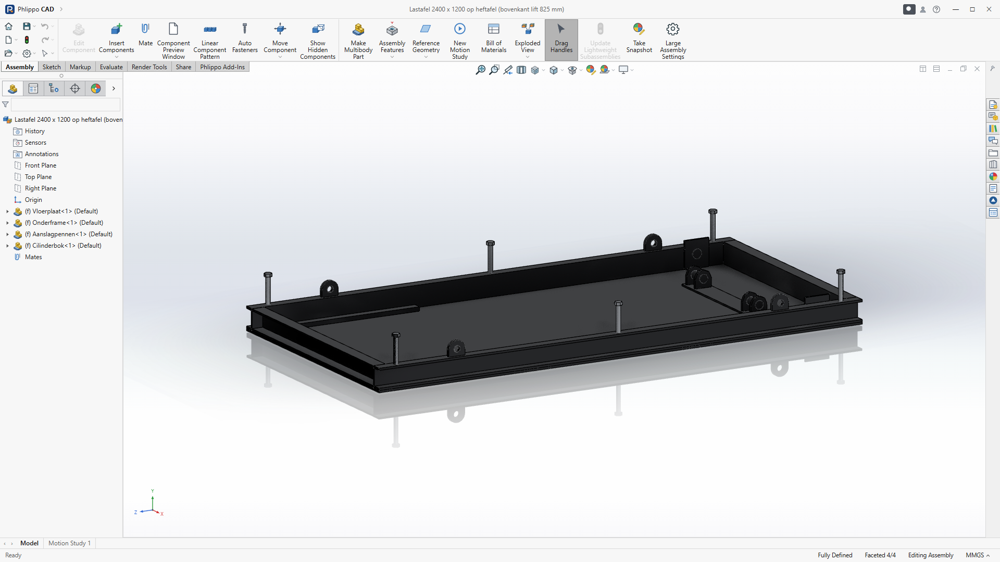
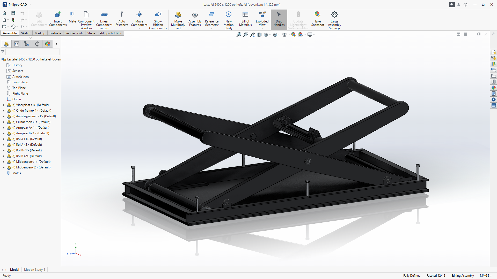
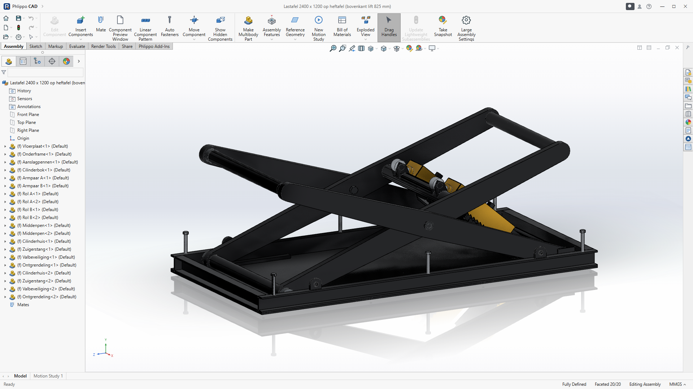
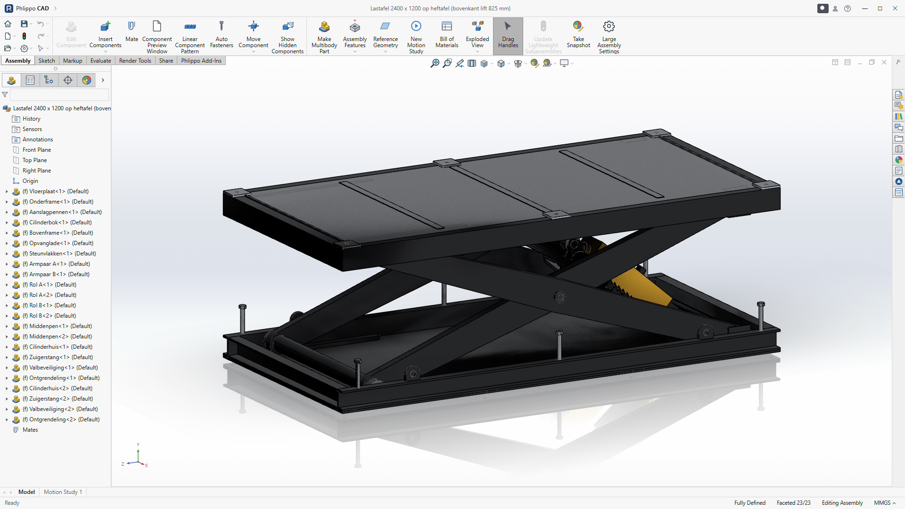
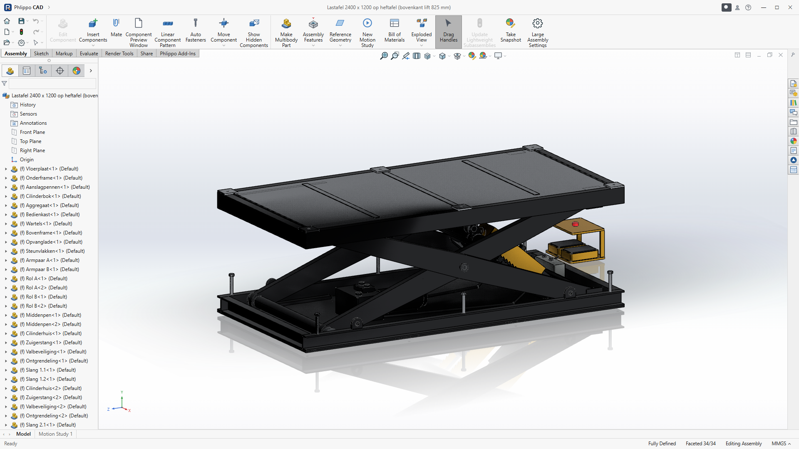
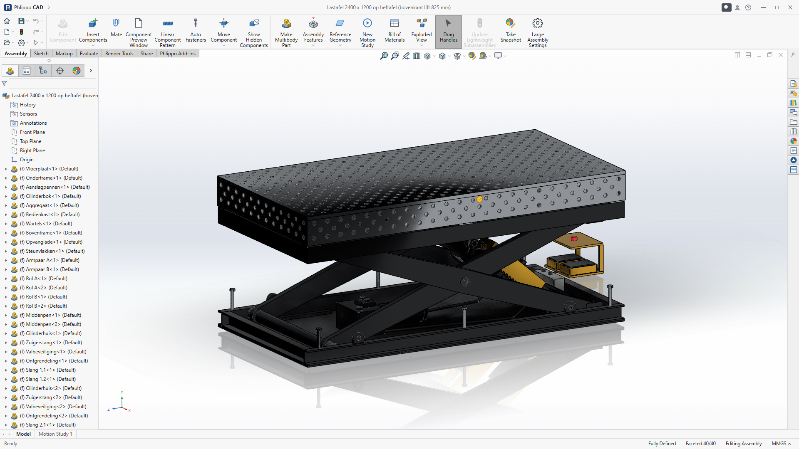

# Bouwplan lastafel op heftafel

De volgorde voor de bouw, van de bestelling tot de keuring. Posities en aantallen staan in
[Materiaallijst.md](Materiaallijst.md), de maten in de tekeningen LFT-00 tot LFT-08, de bedrading in de schemaset.
Reken op ± 9 werkdagen voor twee personen, zonder de levertijd van het laserwerk, de cilinders en het nitreren.

## Gereedschap en ruimte

- MAG-lasapparaat (≥ 250 A), haakse slijper, lintzaag of afkortzaag voor profielen.
- Kolomboor of magneetboor met ruimers Ø40 H8 en Ø31 H8. Voor de boringen van de armen en het vlakfrezen van de
  steunvlakken: een freesbank of een bewerkingsbedrijf.
- Een vlakke lastafel van minstens 2,5 x 1,3 m om op te lassen. De eerste tafel is dus best een gekochte of geleende.
- Een kraan of heftruck van minstens 1 t, 4 ringogen M20 (DIN 580) en hijsbanden.
- Een momentsleutel tot 300 Nm, een manometer 0-250 bar, een multimeter en een isolatiemeter (500 V).

**Veiligheid tijdens het bouwen:** werk nooit onder een opgeheven schaar zonder dat de pallen ingevallen zijn of een
steunbok onder het bovenframe staat.

## 1. Bestellen en snijden (dag 1, plus levertijd)

1. Vraag offertes op voor het laserwerk (plaatlijst §3), de 2 cilinders, het aggregaat en de tafel (of koop de tafel
   bij DCT). Geef de cilinderleverancier mee: enkelwerkend Ø100/56, slag 360, oog-oog 675, ogen Ø40, met
   leidingbreukventiel in het aansluitblok.
2. Bestel de staven (§1) en zaag ze volgens de zaaglijst (§2). Zet op elk stuk het positienummer met krijt of een
   stift.
3. Laat de plaatdelen lasersnijden. Gaten boven Ø20 snijdt de laser 1 mm kleiner, zodat je ze na het lassen op maat
   kan ruimen.
4. Of snij de niet-rechte delen zelf, met de mallen op ware grootte: `mallen/Mallen-lastafel-A3-1op1.pdf` (13 bladen
   A3, de armwang volledig) of `mallen/Mallen-lastafel-A4-1op1.pdf` (13 bladen A4).
   - Druk af op 100 % (werkelijke grootte) en meet de controlemaat van 100 mm na.
   - Plak de mal met spuitlijm op de plaat, snij langs de dikke lijn (plasma, slijper of lintzaag) en kern het hart
     van elke boring door het kruisje.
   - Lange delen (kapzijde, palplaat) lopen over 2 of 3 bladen: leg de liniaal en de rode kruisjes op elkaar.

## 2. Onderframe (dag 2)

1. Leg de vloerplaat vlak op de lastafel. Zet de langsliggers en de koppliggers erop, met de U open naar buiten.
2. Meet de diagonalen. Ze mogen ten hoogste 2 mm verschillen. Hecht en las dan beurtelings links en rechts.
3. Las de scharnierbokken A (z = -1000) tegen het lijf van de langsliggers. Steek een as Ø40 door beide bokken voor je
   last, zodat de boringen in lijn blijven.
4. Las de rolbanen onder op 486 tot 526 van het hart, evenwijdig en waterpas (± 0,5 mm).
5. Las de cilinderbok (dwarsplaat en 4 lipplaten) met een as Ø40 door de lippen. Het hart van de pen ligt op 60 mm
   boven de vloer en 850 mm van het midden.
6. Las de 4 hijsogen op de bovenflens en draai de 6 aanslagpennen in.

## 3. Armen (dag 3 en 4)

1. Teken elke wang af. Met de A3-mallen plak je de 6 stroken van de volledige wang aan elkaar. Met A4: trek een hartlijn over de hele plaat en zet de boorpunten op 0, 1040 en 2080 met een
   meetlint. Leg de kopmal (ARM-KOP) op beide koppen en de middenmal (ARM-MID) op het midden, en trek de rechte randen
   met een lat: ±58 aan de koppen, ±80 in het midden.
2. Bouw per arm een koker van 2 wangen en de omtrekband van 45 x 5. Hecht ze in een mal, en las dan beurtelings boven en
   onder, zodat de arm recht blijft.
3. Las armpaar A: 2 armen met de buizen Ø80 aan beide uiteinden, in een mal. Ze staan haaks, met 980 mm tussen de
   wangen (± 0,5 mm).
4. Las armpaar B op dezelfde manier: 880 mm tussen de wangen, met de cilinderbuis Ø90 en de 4 ogen.
5. Boor en ruim de boringen na het lassen in één opspanning per paar. De scharnierafstand is 2080 ± 0,2 mm. De boring
   voor de middenpen (Ø31 H8) zit precies in het midden. Beide armen van een paar moeten gelijk zijn.

## 4. Bovenframe (dag 4)

1. Las de kokers tot een kader van 1190 x 2390. Ook hier mogen de diagonalen ten hoogste 2 mm verschillen.
2. Las de scharnierblokken B (z = -1000), de rolbanen boven en hun ophanging.
3. Las de 6 steunvlakken op. Frees ze daarna in één opspanning vlak (± 0,1 mm), met een boring M16 die past op de
   bevestigingsgaten van de tafel.

## 5. Stralen en coaten (levertijd 3 tot 5 dagen)

1. Plak de boringen, de steunvlakken en de rolbanen af.
2. Laat het onderframe, de armen en het bovenframe stralen (SA 2½) en poedercoaten in zwart RAL 9005 mat, en de 2
   kappen van de valbeveiliging in geel RAL 1032. De opvanglade is sendzimir-verzinkt en wordt niet gecoat.

## 6. Schaar monteren (dag 5)

1. Pers de glijlagers in alle boringen en zet de smeernippels erin.
2. Zet armpaar A met de pennen Ø40 in de scharnierbokken. Leg armpaar B ertussen.
3. Steek de middenpennen M30 door. Draai ze aan tot de armen zonder speling draaien, en borg ze met de contramoer en
   Loctite 243.
4. Monteer de 4 rollen: 2 op de buis boven van paar A, en 2 op de astappen onder van paar B. Borg de pennen met de
   borgplaatjes.

## 7. Cilinders en valbeveiliging (dag 5)

1. Zet de cilinders met de pennen Ø40 in de cilinderbok. Monteer de stangogen op de ogen van paar B.
2. Monteer de palplaten met de scharnierbouten en de veren. Schuif de gele kap over de koker en klem hem met de
   klembus op de stang.
3. Monteer de ontgrendelmagneten. Een pal moet bij stroom 15 mm vrijkomen, en zonder stroom terugvallen in de tanden.

## 8. Bovenframe plaatsen (dag 6)

1. Hijs het bovenframe (± 210 kg) boven de schaar. Steek de pennen Ø40 door de scharnierblokken B. Laat de rollen van
   paar A in de rolbanen zakken.
2. Zet een steunbok onder het bovenframe, zolang er geen olie in het systeem zit.
3. Leg de opvanglade in.

## 9. Aggregaat, kast en bekabeling (dag 6 en 7)

1. Zet het aggregaat vast op de vloerplaat (trillingsdempers M8). Leg de slangen langs de vloer naar de cilinders.
2. Vul 15 l HLP 32.
3. Bouw de bedienkast volgens de schemaset: blad 3 voor de voeding 230 V, blad 4 voor de besturing 24 V en blad 6
   voor het klemmenplan. Sluit het voetpedaal, de eindschakelaar boven, het zakventiel en de 2 ontgrendelmagneten aan.
4. Meet volgens EN 60204-1 (18.2 en 18.3): de doorgaande aarding (< 0,1 Ω tot elk metalen deel) en de
   isolatieweerstand (> 1 MΩ bij 500 V).

## 10. In bedrijf stellen (dag 8)

1. Laat de lift onbelast een paar keer op en neer gaan, telkens over de hele slag, tot de cilinders ontlucht zijn.
2. Zet het overdrukventiel met de manometer op 140 bar.
3. Stel de smoorklep zo in dat de tafel met last met ± 30 mm/s zakt. EN 1570-1 laat hooguit 150 mm/s toe.
4. Stel de eindschakelaar boven af op 1425 mm, en de aanslagpennen op de laagste stand (370 mm).
5. Test de valbeveiliging. Laat bij stilstand het pedaal los: de pallen vallen in. Bij "neer" komen ze eerst vrij, en
   pas daarna opent het ventiel.
6. Test de noodstop in beide richtingen: de motor en het zakventiel moeten meteen stoppen.

## 11. De tafel plaatsen (dag 8)

1. Hijs de tafel (± 723 kg) met 4 ringogen M20 in de hoekgaten. Gebruik een kraan van minstens 1 t.
2. Zet de tafel op de 6 steunvlakken en bout hem vast met 6 bouten M16 (8.8, 210 Nm).

## 12. Keuren en documenteren (dag 9)

1. **Statische proef:** 1,25 x de nominale last, dus 5000 kg met het blad: 723 kg blad + 4277 kg proeflast. Laat
   die 15 minuten in de hoogste stand staan. De tafel mag niet merkbaar zakken.
2. **Dynamische proef:** 1,1 x de nominale last (4400 kg met het blad), 3 keer de volle slag op en neer. Alle functies
   moeten werken.
3. Controleer het leidingbreukventiel volgens de opgave van de cilinderleverancier.
4. Maak het technisch dossier volgens de Machineverordening (EU) 2023/1230 en EN 1570-1:
   - risicobeoordeling;
   - berekeningen;
   - tekeningen;
   - schema's;
   - proefverslagen;
   - EU-conformiteitsverklaring;
   - CE-plaat met de nominale last;
   - handleiding.
5. Plan elk jaar een keuring: pennen, lagers, slangen, de valbeveiliging en een proef met de nominale last.
