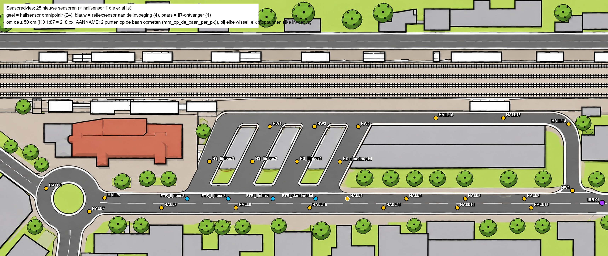

# Kabeldoos voor de verlichting van de modelbaan, versie 6 (2026-11-16)

Eén doos onder de baan brengt alle lampen samen. 16 lichtgroepen, één per Modelbouwled-bordje, gaan aan en uit of
krijgen een knippereffect (knipperen, overweg, lasvlam, tl-buis). 16 ingangen nemen knoppen en sensoren (contact, reed,
NPN, **hallsensoren**). Alles bedien je met de gsm of tablet: de doos maakt haar eigen wifi **Treinbaan** met een
dashboard, en meldt zich als je wilt ook aan op de wifi van het huis.

Alle maten en onderdelen komen uit `maak-kabeldoos.mjs` (maten in `maten.mjs`), de modules en hun bedrading uit
`opbouw.mjs`. De berekeningen staan in `docs/Berekeningen.md`, de maten van de gekochte onderdelen met hun bron in
`docs/Maten-en-bronnen.md`, de eisen van Ian in `EISEN.md`.

**Versie 5 (Ian, 2026-11-15: "Als je met 2 lagen werkt is het te moeilijk om de kabels aan te sluiten"):** alles op
**één laag** in één langwerpige doos van **440,9 x 229,8 x 52,6**, geprint in **2 helften die in elkaar klikken en
gelijmd kunnen worden** ("De doos moet in elkaar kunnen klikken en nog kunnen lijmen"), binnen geen tussenwand. Links de
16 bordjes, rechts alle modules op palen in de bodem; alles is van bovenaf bereikbaar. De moduleplaat valt weg en de
**kabelgoten ook** (Ian: "Kabel goten mogen weg"): de draden lopen rechtstreeks van de tule naar hun klem. Ook nieuw: **alleen aan/uit** (Ian: "Dimmers zijn niet nodig", firmware 1.3.0) en
**hallsensoren** op de ingangen (Ian: "Zorg ook dat er hallsensoren binnen gelezen kunnen worden"). De bordjes zijn
**vastgeschroefd** met 4 schroefjes op 4 paaltjes (Ian: "ik wil ze geschroefd hebben"). **Versie 4:**
kant-en-klare modules, enkel de DC-bus solderen. **Versie 3 (advies Fable 5.2):** klemlippen, DC-bus, polyfuse per
groep, waakhond, thuis-wifi, testmodus. **Versie 2:** kabelgoten van 28 hoog met klikdeksels.

## Opbouw

| Deel | Wat |
|---|---|
| Doos | PETG zwart, 440,9 x 229,8 x 52,6 mm (deksel inbegrepen), hangt met de bodem tegen de onderkant van de baan; het grijze deksel zit onderaan. Binnen 47 hoog: een MOSFET-module mag tot 39 mm hoog zijn (één verkoper noemt 39, getekend 15: AANNAME) |
| Linkerhelft (bordjes) | 224,9 x 229,8: 16 bordjes in 6 rijen (de plaatsen van versie 4), elk bordje op een steunrail en **vastgeschroefd met 4 schroeven 2,0 x 6** op 4 paaltjes Ø5 onder de gaten in zijn hoeken (hart 2 van de randen, TRN-07); tussen de rijen 9,2 vrij voor de draden en een schroevendraaier; per bordje een **draadsleuf** 40 x 4 in de bodem voor de leddraden; geen kabelgoten |
| Rechterhelft (modules) | 229,8 x 229,8 (met de klikhaken): elke module op palen Ø6 x 5 in de bodem, 2 klikhouders voor 6 WAGO-klemmen; aan de naad 11 vrij voor de draden van de bordjes |
| Naad | **2 klikhaken** (achter en voor, 14 lang, 1,6 dik, onderkant 45°) van de rechterhelft klikken met een nok van 0,6 in een kuiltje in de wand van de linkerhelft; **5 bodemlippen** lijnen uit; **lijmspleet 0,2** overal (2K-epoxy). Het deksel klikt met een **lip van 12** in 4 vingers onder de linkerhelft; de naad van het deksel ligt 2 mm naast die van de bak (de lip overlapt ze). Detail: TRN-06 |
| 16 bordjes | Modelbouwled "PCB met ingebouwde weerstand" (61,1 x 20,9, 14 hoog), in 5 rijen van 3 en één in rij 6 |
| MOSFET-modules (-Q1, -Q2) | 2 x 8 kanalen met optocouplers, 3,3 V-ingang: per groep een uitgang + en −, **de klemmen naar de bordjes** (groep 1 achteraan, zoals rij 1); de PCA9685 stuurt ze met dupontkabels |
| Uitgangsprint (-K2) | PCA9685: 16 uitgangen via I2C van de ESP, alleen volledig aan of uit (geen PWM) |
| Optocouplerprints (-K3, -K4) | 2 x 8 kanalen PC817 (3,6-24 V), **de ingangen naar de rechterwand**: de knoppen, sensoren en hallsensoren trekken IN naar 0 V |
| ESP (-K1 op -X6) | ESP32-S3-DevKitC-1 v1.1 (N16R8) in een **schroefklemadapter** met 44 klemmen; de 2 micro-USB-poorten achter een opening in de **voorwand** (flashen met de doos dicht) |
| Regelaar (-T2) | Joy-IT SBC-Buck02: 12 -> 5 V voor de ESP, met schroefklem (rechtsvoor) |
| Zekeringen | hoofdzekering 7,5 A (ATO in een houder met draden, -F1, achter de DC-bus); **per groep een polyfuse 0,5 A** (Bourns MF-R050, -F2..-F17) met één pootje in de klem n− van de MOSFET-module en het andere in een WAGO 221-2411 met de − van het bordje; de +12 V voor ingangen en sensoren een eigen polyfuse (-F18) |
| Ompoolbeveiliging | Schottkydiode SB560 (-R2) tussen L+ en 0 V, met haar pootjes in de verdeelklemmen |
| Verdeelklemmen | WAGO 221-415 achteraan in de rechterhelft, onder de DC-bus: -X1 (L+, 2 stuks), -X2 (0 V, 2 stuks), -X3 (+12 V sensoren), -X7 (3,3 V) |
| DC-bus | 5,5 x 2,5, 8 A (GlobTek JACK-L-PANEL-8A(R)) in de **achterwand van de rechterhelft**, boven de WAGO-klemmen |
| Netadapter | Mean Well GST90A12-P1M (12 V, 6,67 A, stekker 5,5 x 2,5 met + in het midden), gekeurd; 230 V komt niet in de doos |

- **Draden:** 18 kabelinvoeren Ø16,5 met een membraantule Wiska EMT 16: 5 in de linkerwand en 4 vooraan in de
  linkerhelft (leddraden), 3 vooraan en 2 achteraan in de rechterhelft, **4 in de rechterwand** (knoppen en sensoren,
  vlak bij de ingangen). De leddraden komen van boven (de baan) door de bodem: **per bordje een draadsleuf** van 40 x 4
  in de vrije strook voor of achter het bordje, links per rij een sleuf van 20 x 6. Geen kabelgoten: elke draad loopt rechtstreeks naar zijn klem; de + en − van elk
  bordje van zijn eindklem door de vrije strook voor de rij naar de naad en recht in hun klem van de MOSFET-module (die
  staat met haar klemmen naar de bordjes): geen draad kruist over een klem.
- **Kabels ordenen:** bundel de draden per rij met een kabelbinder in de vrije strook voor de rij; een draad tussen de
  bordjes trek je eruit met het **haakje** van de spatel en met haar **blad** duw je een draad in de sleuf.
- **Monteren:** de doos hangt aan 4 sleutelgaten in de bodem (2 per helft). Plak de boormal (TRN-00a en TRN-00b, 2 x A3
  op 100 %, de kruisen A en B over elkaar) onder de baan, draai 4 bolkopschroeven 4 x 20 half in, hang de doos met de
  grote gaten over de koppen en schuif ze 6 mm naar achteren.
- **Bedraden op werkhoogte:** schuif de doos 6 mm naar voren, hang de 2 geprinte **werkhaken** aan de 2 voorste
  schroeven en de doos met haar 2 voorste sleutelgaten aan de knoppen: ze hangt verticaal, 12 cm onder de baan. Laat
  elke bundel van de baan naar de doos een **kabellus van 50 cm**.
- **Geen verluchting nodig:** gewoon 1,7 W, hoogstens 5 W in de doos; binnen 2,1 K (hoogstens 5,8 K) warmer dan onder de
  baan (docs/Berekeningen.md, hoofdstuk 5).

## Aansluiten

| Wat | Waar |
|---|---|
| de netadapter | stekker in de DC-bus in de achterwand van de rechterhelft (+ in het midden) |
| een bordje (groep n) | de **+** aan de klem **n+** van zijn MOSFET-module, de **−** in de **WAGO 221-2411 van zijn polyfuse** (de polyfuse zit met haar andere pootje in de klem **n−**). Groep 1..8 = -Q1 kanaal 1..8 (achteraan), groep 9..16 = -Q2 kanaal 1..8. De + en − van de eindklemmen van een bordje nooit doorlussen naar een ander bordje |
| een led | aan een bordje: lange poot (+) aan de klemmenrij met de weerstanden, korte poot (−) aan de andere rij |
| een drukknop, schakelaar of reedcontact | print "vcc" (zoals getekend): tussen **IN n** en **0 V** (-X2); print "gnd": tussen **+12 V** (-X3) en IN n; print "apart": IN+ aan +12 V, het contact tussen IN− en 0 V. Welke print je hebt: **TRN-22 stap A** (meten), dan kiezen in het dashboard (Fable 5.2 E3) |
| een **hallsensor** (omnipolair, open collector: Honeywell SS451A; de unipolaire SS441A of een A3144 werken ook maar alleen met de zuidpool) | + (pin 1) aan **+12 V** (-X3), − (pin 2) aan **0 V** (-X2), de uitgang (pin 3) aan **IN n** (print "gnd": plus 2,2 kΩ van IN n naar +12 V); in het dashboard de ingang op "Hallsensor (korte puls)" zetten (hieronder) |
| een andere sensor met NPN-uitgang (IR, open collector) | + aan **+12 V** (-X3), − aan **0 V** (-X2), de uitgang aan **IN n** |
| een sensor die zelf 12 V geeft (PNP) | op een print "gnd" of "apart" rechtstreeks aan IN n ("apart": aan IN+, IN− aan 0 V) en de ingang op "pnp"; op een print "vcc" **niet** (12 V in sperrichting over de led): daar een klein relais 12 V waarvan het contact tussen IN n en 0 V hangt |
| een **reflexsensor** (TCRT5000-module, "FTR": ziet ook een bus die stilstaat) | **niet** op de 12 V-ingangen: + aan **3,3 V (-X12, B3V3)**, − aan 0 V (-X13), de uitgang via **1 kΩ** aan ingang **17..23** (GPB0..6 van de MCP23017 -K5), soort "contact" (Fable 5.2 E2) |
| een kant-en-klare hallmodule voor Arduino (KY-003 en gelijk, met lampje en pull-up naar zijn eigen VCC) | **niet gebruiken**: op 5 V gevoed blijft de ingang half aan (12 V tegen 5 V door de led van de PC817), op 12 V brandt het lampje van de module met een weerstand voor 5 V. Neem de losse sensor |

Ingang 1..8 = -K3 IN1..IN8, ingang 9..16 = -K4 IN1..IN8, ingang 17..23 = -K5 GPB0..GPB6 (reflexsensoren; GPB7 en GPA7 zijn geen ingang, Fable 5.2 E7). **Meer hallsensoren op één ingang** mag (parallel: de
uitgangen samen aan IN n, wired-OR): elke sensor zet de ingang aan. Elke sensor vraagt hoogstens 10 mA uit +12 V:
-F18 heeft plaats voor 19 sensoren samen (docs/Berekeningen.md, hoofdstuk 4). Met de magneet trekt de sensor 10,6 mA uit
de ingang (de SS441A mag 20 mA). Bordjes van 1K5 zijn gemaakt voor 20 V: op 12 V geven ze ongeveer 6 mA per led
(zwakker). Voor vol licht op 12 V: 1K.

## Draden labelen

Zet op elke draad een label aan beide uiteinden, met deze namen; ze komen overeen met het schema (`schema/`), de
groepen in het dashboard en het invulblad TRN-21 (om bij de baan te hangen):

| Draad | Label | Van | Naar |
|---|---|---|---|
| + van groep n | `G01+` … `G16+` | MOSFET-module, klem n+ | + van bordje n |
| − van groep n | `G01−` … `G16−` | WAGO 221-2411 van polyfuse -F(n+1) | − van bordje n |
| ingang n | `IN01` … `IN16` | optocouplerprint, klem IN | knop of sensor |
| leddraden | `G05 kerk` (groep en plaats) | bordje n | de lamp op de baan |

De 94 draden tussen de modules (met doorsnede, kleur en lengte) staan in de **interne draadlijst TRN-14** (W01..W61) en **TRN-15** (W62..W94, versie 6), hun plaats op
het **montageblad TRN-10**. Rij 1 = de 3 bordjes achteraan, rij 6 = bordje 16. Groep 1 is het linkse bordje van rij 1.

## Bouwen in deze volgorde

1. **Eerst de modules kopen en meten (AANNAME, Fable 5.2):** één stuk van elke module (± € 24 tot € 37, zie de
   bestellijst) en het meetblad **TRN-22**: welke schakeling de optocouplerprint heeft (vcc, gnd of apart), de polariteit
   van de MOSFET-modules, de XL4015, de IR-zelftest, en of de IR van de bussen gemoduleerd is. Meet ook de maten en gaten
   van alle modules (rechts: TRN-10; **ook links**: -Q4, -Q3 en -K5 op TRN-11; de AOD4184-modules verschillen sterk per
   verkoper) en de dikte van een bordje (onder 1,4 mm: schroef 2,0 x 5). Komen ze niet overeen: de maten in `opbouw.mjs`
   (MODULES) aanpassen, `node voorbeelden/treinverlichting/maak-kabeldoos.mjs`. Op het ESP-bord moet "v1.1" staan
   (GPIO48 is de leerontvanger, niet de led).
   **Dan het proefstuk** (`print/Proefstuk.stl`, TRN-08, ± 20 min): passen de 4 schroeven van een bordje en de lip en de
   klikhaak van de naad niet, compenseer de krimp in de slicer (PETG 0,3 tot 0,5 %), pas dan de helften van 10 uur.
2. **Printen:** bak links en rechts, deksel links en rechts, hulpstukken (hieronder).
3. **Helften passen:** op een vlakke tafel tegen elkaar schuiven, de 5 bodemlippen in hun uitsparingen, tot de 2
   klikhaken klikken (± 10 N per haak). Uit elkaar: de punt van elke haak met een kleine schroevendraaier van de wand weg
   trekken (van binnen, bovenaan bereikbaar).
4. **Modules in de rechterhelft** (montageblad TRN-10): elke module met plaatschroeven 3 x 8 op haar palen (de PCA9685
   met 2,5 x 6), de 6 WAGO-klemmen in hun klikhouders, de DC-bus in de achterwand.
5. **Bedraden volgens TRN-14 en TRN-15** (W01..W94): dupontkabels op de pinnen van de PCA9685 en de MOSFET-modules, gestripte
   draden in de schroef- en WAGO-klemmen. -R1, -R2 en -F18 met hun pootjes in de klemmen. **Niet solderen**, behalve de 2
   lippen van de DC-bus (pen = +, huls = −).
6. **Proefopstelling op tafel** (de rechterhelft alleen): één bordje op groep 1, één knop op IN01, eventueel een
   hallsensor op IN02. Firmware flashen (micro-USB "UART", `firmware/README.md`), meten met het **meetblad TRN-20**.
7. **Helften verbinden:** inklikken, eventueel eerst 2K-epoxy in de voeg (de lijmvlakken eerst opruwen met schuurpapier korrel 120 en ontvetten: PETG hecht matig op een gladde printwand) (stootvlakken, bodemlippen, buitenkant van de
   haken), 24 uur op de tafel laten uitharden (TRN-06).
8. **Bordjes:** elk bordje op zijn 4 paaltjes leggen, 4 schroeven 2,0 x 6 (PH1, met de hand tot de kop de print raakt,
   dan 1/8 slag; TRN-07). Dan de doos onder de baan, op de werkhaken, de draden van de bordjes rechtstreeks naar hun
   klemmen (per rij gebundeld), labelen, aansluiten, het meetblad afwerken.
9. **Deksel:** de rechterhelft met de lip onder de linkerhelft schuiven tot de 4 nokken klikken (eventueel lijm in de
   sponning), dan het deksel met 6 plaatschroeven 3 x 12 op de bak.

## Bediening

Verbind de gsm met wifi **Treinbaan** (wachtwoord **treinbaan**, te wijzigen bij Instellingen); het dashboard opent
vanzelf (anders `http://192.168.4.1` of `http://treinbaan.local`). De rode knop "Alles uit" staat altijd bovenaan.
Tabbladen: Groepen, Scènes, Functies, Ingangen, Instellingen.

Sinds firmware 1.3.0 is elke lichtgroep **alleen aan of uit** (geen dimmers). In het dashboard, tabblad Groepen, staat
per groep een schakelaar; het lampje ernaast brandt als de groep echt aan is (bij knipperen in het ritme mee). Een groep
kan ook een effect krijgen dat alleen aan/uit gebruikt: knipperen, om beurten (overweg), lasvlam of tl-buis. Een scène
kies je bij Scènes, "Scènes wijzigen of wissen", "Groepen kiezen": tik de groepen aan die moeten branden. In een functie
kies je per stap welke groepen aan, uit of "aan/uit wisselen".

**Hallsensor instellen:** een hallsensor onder het spoor (magneet onder de loc) sluit je aan zoals hierboven. In het
dashboard, tabblad Ingangen, bij die ingang "Instellen": kies "Hallsensor (korte puls)". "Na een puls actief houden"
staat op 0,3 s. Kies dan wat er moet gebeuren: Drukknop = elke magneet start een functie; Sensor = de eerste magneet
start functie A, pas als er een aantal seconden geen magneet meer kwam functie B (bv. een overweg die knippert zolang de
trein passeert). Bewaren. De doos ziet elke puls vanaf 1 ms, ook als de trein snel rijdt. Per ingang toont het
dashboard live de toestand en een teller (te wissen met "Teller op 0").

Bij Instellingen ook:

- **Thuis-wifi:** naam en wachtwoord van het thuisnet; de hotspot Treinbaan blijft. Op het thuisnet: `http://treinbaan.local`.
- **Testmodus:** "looplicht" (groep 1 tot 16 om de beurt aan) of één groep vast aan (om de stroom te meten).
- **Firmware bijwerken:** een nieuw `firmware.bin` kiezen; de oude blijft tot de nieuwe volledig en ongeschonden ontvangen is (2 app-slots; loopt de nieuwe vast, dan terug via USB door de opening in de voorwand). Op het thuisnet vraagt de doos het wifi-wachtwoord (Fable 5.2 F6).

Standaard is **ingang 1 een drukknop "alles aan/uit"**: hang er een knop aan bij de baan. **Wachtwoord vergeten:** de
knop BOOT op de ESP 5 s indrukken (het lampje wordt blauw): het wachtwoord is weer `treinbaan`. Het lampje op de ESP:
groen = wifi aan, rood = de uitgangsprint (PCA9685) antwoordt niet. De firmware herstart vanzelf als ze vastloopt
(waakhond, 8 s) en zet de hotspot opnieuw aan als hij wegvalt. Instellingen van firmware 1.2 laden zonder melding (een
helderheid wordt aan, vuur, tv en ademen worden aan zonder effect). Meer: `firmware/README.md`.

## Uitbreiden

Tot 32 groepen: een tweede PCA9685 op adres 0x41 (de brug A0 op die print dicht), SDA, SCL, OE, VCC en GND parallel aan
de eerste, met 2 MOSFET-modules en 16 polyfuses in een tweede doos ernaast; de firmware bouwen met `-DTREIN_GROEPEN=32`
(env `native32` toont dat alle logica werkt). GPIO 47, 48, 11, 39 en 42 gaan in versie 6 naar IR (zie hieronder).

## Versie 6: IR, servo's, NPN/PNP, geluidskastjes, tv

Ian (2026-11-15): "Treindoos moet IR leds, IR sensors, FTR sensoren moeten kunnen binnenlezen, uitsturen." "Wissels,
seinen of slagbomen moeten ook kunnen." "PNP moeten ook kunnen." "Geluiden: dit moeten kleine speakertjes zijn die ik
ergens kan plaatsen." Schema: bladen 7 (IR) en 8 (servo's, reflexsensoren, de 3 schakelingen van de ingangsprint) en de stuklijst van de uitbreiding (laatste blad)
in `schema/Aansluitschema-kabeldoos.pdf`; berekening: `docs/Berekeningen.md` §9.

**In de doos (fase B):** in de rechterhelft tussen de PCA9685 en de optocouplers de **servoprint -K7** (servostekkers naar
voren, de kabels door een 5de tule in de rechterwand), de **XL4015 -T3** (CC/CV) en de elco **-C5** (pootjes in de
schroefklem V+/GND van de servoprint), en 2 WAGO-klemmen **-X12** (3,3 V naar de baan, B3V3) en **-X13** (0 V) in een
klikhouder; in de linkerhelft naast bordje 16 de **IR-driver -Q4** (uitgangen naar de tules vooraan), de **AOD4184 -Q3**
en de **MCP23017 -K5** (plaats en palen voor een tweede, -K8). De **IR-leerontvanger -B1** staat in een houder achter een
**venstertje Ø6 in de voorwand** (rechts naast de USB-opening): Ian houdt zijn IR-zender ervoor, de doos blijft dicht
(een stukje doorzichtig plakband aan de binnenkant houdt stof en insecten buiten; IR gaat erdoor). De zekeringen **-F1**
(T 8 A) en **-F19** (T 3,15 A) zitten in houders 5 x 20 **in de achterwand** naast de DC-bus: van buiten te vervangen.
Bij elke tule en elke module met dupont een oogje voor een kabelbinder (trekontlasting). Montagebladen **TRN-10**
(rechts) en **TRN-11** (links), draadlijst **TRN-15**, meetblad **TRN-22**.

**Pinnen:** GPIO47 = IR zenden, GPIO48 = leerontvanger, GPIO11, 39 en 42 = 3 IR-ontvangers op de baan (gecodeerd IR; een
lang niveau geeft ook een melding "aanwezig"). Al het andere over de I2C-bus (100 kHz): MCP23017 op 0x20 (8
schakeluitgangen voor de IR-leds en de ingangen 17-23 voor reflexsensoren), servoprint PCA9685 op **0x42** (0x40 =
lichtgroepen 1-16, 0x41 blijft vrij voor 17-32), optioneel een tweede MCP23017 op 0x21 (ingangen 25-38).

**Bedraden** (Fable 5.2):
- **IR-leds** (aan de 4 stoppunten, tot 8): van de klem n+ van -Q4 (L+) door een weerstand van 120 Ω (**1 W**, in een
  WAGO 221-2411 -X9) naar de anode, de kathode terug in de klem n−. Elke led een **getwist paar**, door een andere tule
  dan de ontvangers (38 kHz-pulsen storen anders de ontvangers). -Q3 (AOD4184) schakelt met de draaggolf van GPIO47.
  Piek 89 mA per led. **Eerst meten** (TRN-22 F, G): kiest het dashboard IR-led 1, dan geleidt alleen kanaal 1; de
  IR-zelftest leest de code terug via -B1. De polariteit van -Q4 staat in het dashboard ("IR-led actief laag").
- **IR-ontvangers** op de baan: 3,3 V uit **-X12 (B3V3, achter de polyfuse -F20 0,1 A)**, 0 V uit -X13, de uitgang via
  **1 kΩ** (-R22..-R24 in een WAGO 221-2411) naar de ESP; bij de ontvanger 100 Ω en 4,7 µF; kabel hoogstens 3 m, getwist.
  Een sluiting op de baan laat de polyfuse springen, niet de ESP herstarten.
- **Reflexsensoren** (TCRT5000, aan de stoppunten: ze zien ook een bus die stilstaat): 3,3 V uit -X12, de uitgang met
  1 kΩ naar ingang 17..23 (-K5 GPB0..6). Niet op de 12 V-ingangen.
- **Servo's:** de XL4015 -T3 **eerst** zonder servo's en zonder -K7 op 5,5 V en de stroomgrens op 3 A zetten (TRN-22 E),
  een druppel lak op de potmeters, elco 1000 µF **25 V**. Bij het opstarten gaan de servo's één voor één naar hun stand;
  verlengkabels van minstens 0,25 mm². OE gedeeld met de lichtprint (bij reset staan de servo's stil). Geen GND-dupont
  tussen -K2 en -K7: de 0 V van de servo's loopt via -T3.
- **I2C** op 100 kHz: de 4 draden naar -K5 over de naad in **één dupontkabel van 50 cm** (geen 2 aan elkaar), SDA en
  SCL niet in de bundel van de IR-leds. Bij 100 kHz mag de stijgtijd 1000 ns zijn; de 2 x 10 kΩ op de PCA9685-printen
  geven ± 550 ns: extra pull-ups zijn niet nodig. Dupontbusjes per groep in een behuizing van 4, 6 of 8 (of een druppel
  smeltlijm na het meten): de doos hangt ondersteboven.
- **Ingangen NPN of PNP:** eerst meten welke schakeling de optocouplerprint heeft (TRN-22 stap A), dan in het dashboard
  per print "vcc", "gnd" of "apart" kiezen (zie Aansluiten). "vcc": alleen NPN en contacten. "gnd": contacten en PNP
  rechtstreeks, NPN met 2,2 kΩ naar +12 V (de firmware keert om). "apart": per ingang NPN of PNP. De firmware weigert PNP
  op een print "vcc" (12 V in sperrichting over de led). Een PNP-print of een print met PC814 is niet nodig.
- **Wifi:** de hotspot laat 10 toestellen toe (gsm, tablet, de laptop van de tv en kastjes); meer dan ± 6 kastjes:
  alles op het thuisnet (het kanaal van de hotspot volgt dan dat van de router).

**Wat getest is:** de logica (firmware 2.1.0, 159 tests op de pc, ook de drivers met een nagebootste I2C-bus en RMT) en
de doos in het 3D-model (passen, botsen, printbaar). **Op hardware is nog niets gemeten**: zie de kolommen "getest op de
pc" en "gemeten op hardware" in `firmware/README.md`, en vul TRN-22 in.

**Wat kopen:** zie [Bestellijst](#bestellijst): de uitbreiding staat er met haar aanduidingen in, en "eerst kopen en meten".

**Geluidskastjes:** `geluidskastje/` (ESP32-S3-Zero, MAX98357A, luidspreker 40 mm 4 Ω 3 W, MP1584 12 → 5 V, DC-bus;
kastje 97,4 x 51,0 x 26,4, 2 oogjes om vast te schroeven). Ze melden zich aan op het wifi "Treinbaan"; geluiden (WAV,
16-bit mono, tot 22 kHz) upload je via het dashboard; elk kastje speelt zijn eigen geluid, tegelijk met de andere.

**Tv:** een laptop met HDMI aan de tv opent `http://treinbaan.local/tv`: het getekende plan van Station Turnhout
(`situatieplan/`) met de bussen en auto's live (bij een melding van een hall-, IR- of FTR-sensor staat het voertuig
precies op dat punt; daartussen rijdt het met zijn gemeten snelheid verder), de lichtgroepen, wissels, servo's en
verkeerslichten. Zonder doos draait de simulatie.

**Sensoradvies** (Ian: "Ik moet hierop kunnen zien hoe de bussen of auto's aan het rijden zijn"), uitgewerkt op het plan
in `docs/Sensoradvies.png` (lijst met plaatsen in pixels van het plan: `docs/sensoradvies.json`, opnieuw maken met
`python docs/sensoradvies.py`):

| Waar | Sensor | Aantal | Waarom |
|---|---|---|---|
| vlak voor wissel 1 | IR-ontvanger (GPIO11) | 1 | herkent de bus aan zijn code, als de bussen een code zenden (navragen); anders de volgorde per strook |
| net na elke wissel, op de afbuigende tak | hallsensor | 4 | bevestigt welke kant de bus nam |
| aan elk stoppunt | hallsensor | 4 | de bus komt aan: de halte start (aankomstpunt) |
| vlak voor elke invoeging | reflexsensor (TCRT5000) | 4 | ziet ook een stilstaande auto: "verkeer vrij" en de bus is vertrokken (Fable 5.2 S2) |
| op de autolus en de busbaan, om de ± 50 cm | hallsensor | 12 + 3 | daartussen schat de tv met de gemeten snelheid |
| (er al) | hallsensor 1 | 1 | |

**Hallsensor:** een **omnipolaire** sensor met open collector (Honeywell SS451A, 3 tot 24 V; AANNAME: datablad nakijken):
dan maakt de pool van de magneet niet uit (Fable 5.2 S1). Probeer eerst met één sensor en één bus of de stuurmagneet
van het Car System-voertuig al volstaat; dan zijn extra magneten niet nodig.

**Stap voor stap** (Fable 5.2 S3): (1) één halte met één aankomstsensor en één IR-led, tot ze 50 keer na elkaar goed gaat;
(2) de 4 haltes; (3) de 4 invoegingen; (4) pas dan de 15 sensoren op de lange stukken, en alleen als het beeld op de tv
zonder hen stoort. **Tellingen** (S4): 16 ingangen op de optocouplerprints + 7 op de MCP23017 (17..23) = 23, waarvan
ingang 1 de knop: **22 voor sensoren**. Fase 1-3 (8 hall + hallsensor 1 op de prints, 4 reflex op 17..20) past; de 15 op de
lange stukken vragen de tweede MCP23017 (0x21, ingangen 25-38) met 2 optocouplerprints. **Schaal** (V3): de schaal van
het plan (1 m = 5 px) en H0 1:87 zijn AANNAMES en een modelbaan is bijna altijd ingekort: meet 2 punten op de echte baan
en zet `"mm_op_de_baan_per_px"` in `situatieplan/plan.json`; `docs/sensoradvies.py` rekent dan daarmee.

## Bestellijst

Richtprijzen, opgezocht op 2026-11-13 en 2026-11-15 (niet besteld); "nagekeken" = de prijs stond zo op de
productpagina, alle prijzen van de uitbreiding zijn AANNAME. Verzendkosten niet inbegrepen (4 tot 6 winkels). Elke rij
noemt de aanduiding (Ref) uit het schema.

**Eerst kopen en meten (Fable 5.2):** één stuk van -K3, -Q1, -Q3, -K5, -T3, -B1, een IR-led en een TCRT5000 (samen
± € 23,85 met de MOSFET-module van AliExpress, ± € 36,84 met die van Amazon). Ze tellen mee in de
lijsten hieronder (niets dubbel). Meet ze met TRN-22 (welke schakeling de optocouplerprint heeft, de polariteit van de
MOSFET-module, de XL4015, de IR-zelftest) en print en bedraad pas daarna.

**De doos (versie 5 en 6, zonder uitbreiding)**

| Ref | Onderdeel | Aantal | Type | Winkel | Prijs per stuk | Totaal |
|---|---|--:|---|---|--:|--:|
| -T1 | Netadapter 12 V, 6,67 A, C14, stekker 5,5 x 2,5 | 1 | Mean Well GST90A12-P1M | Reichelt, Conrad | € 32,00 | € 32,00 |
| — | Netsnoer C13 | 1 | gewoon pc-netsnoer |  | € 5,00 | € 5,00 |
| -X5 | DC-chassisbus 5,5 x 2,5, 8 A | 1 | GlobTek JACK-L-PANEL-8A(R) | Mouser | € 4,00 | € 4,00 |
| -F1 | Zekeringhouder 5 x 20 voor paneelmontage (gat Ø12,5, vlaksteker 4,8) + zekering T 8 A (Fable 5.2 D9) | 1 + 1 | bv. Schurter FEU of gelijk | Reichelt, Conrad | € 3,00 | € 3,00 |
| -R2 | Schottkydiode 10 A, 45 V (ompoolbeveiliging, Fable 5.2 E15) | 1 | 10SQ045 | Reichelt | € 0,60 | € 0,60 |
| -K1 | ESP32-S3-DevKitC-1-N16R8 (op het bord: v1.1, Fable 5.2 E18) | 1 | Espressif (origineel, v1.1) | Kiwi Electronics, Otronic | € 16,00 | € 16,00 |
| -X6 | Schroefklemadapter ESP32-S3 44-pin (23 en 25,5 mm) | 1 | ESP32-S3 Expansion Board 44P | Amazon.de, AliExpress | € 8,00 | € 8,00 |
| -K2 | Uitgangsprint 16 kanalen (PCA9685), pinnen gesoldeerd | 1 | AZ-Delivery PCA9685 | AZ-Delivery, Amazon.de | € 6,00 | € 6,00 |
| -Q1, -Q2 | MOSFET-module 8 kanalen, optocouplers, 3,3 V-versie | 2 | "8 Channel MOSFET PLC Amplifier" (versie B) | Amazon.de (± € 21), AliExpress (± € 8) | € 20,99 | € 41,98 |
| -K3, -K4 | Optocouplerprint PC817, 8 kanalen, 3,6-24 V (schakeling: eerst meten, TRN-22 stap A) | 2 | MakerMind RBS18122 | roboter-bausatz.de | € 3,95 | € 7,90 |
| -T2 | Regelaar 9-35 V -> 5 V, 5 A, schroefklem | 1 | Joy-IT SBC-Buck02 | Conrad | € 8,99 | € 8,99 |
| -F2..-F18 | Polyfuse 0,5 A, 60 V, radiaal | 17 | Bourns MF-R050 | Reichelt, Mouser | € 0,30 | € 5,10 |
| -X1, -X2, -X3, -X7 | Verbindingsklem 5-voudig | 6 | WAGO 221-415 | bouwmarkt, Conrad | € 0,90 | € 5,40 |
| -X8 | Doorverbinder 1 + 1 | 16 | WAGO 221-2411 | Conrad, Reichelt | € 0,90 | € 14,40 |
| -R1 | Weerstand 1 kΩ, 0,25 W, met draden | 1 |  |  | € 0,10 | € 0,10 |
| — | Dupontkabels 20 cm, 40 female-female en 40 female-male | 1 set |  | AZ-Delivery, Amazon.de | € 6,00 | € 6,00 |
| — | Plaatschroef 3 x 8 bolkop (24) en 2,5 x 6 bolkop (4): modules op de palen | 28 |  |  | € 0,05 | € 1,40 |
| — | Plaatschroef 3 x 12 verzonken: het deksel (2 links, 4 rechts) | 6 |  |  | € 0,08 | € 0,48 |
| — | Plaatschroef voor kunststof 2,0 x 6 bolkop, PH1 (bordjes: 64 + 6 reserve, TRN-07; print dunner dan 1,4: 2,0 x 5) | 70 | bv. per 100 |  | € 0,05 | € 3,50 |
| — | Membraantule M16 (18 + 1 voor de servokabels) | 19 | Wiska EMT 16 LG (10062559) |  | € 0,40 | € 7,60 |
| — | Bolkopschroef 4 x 20 (hout), sleutelgaten | 4 |  |  | € 0,05 | € 0,20 |
| — | 2-componentenlijm epoxy, 24 ml (de naad, eventueel; opruwen met korrel 120) | 1 | bv. UHU Plus Schnellfest | bouwmarkt | € 8,00 | € 8,00 |
| — | Montagedraad 0,14, 0,25, 0,5 en 0,75 mm² | 1 |  |  | € 6,00 | € 6,00 |
| — | Kabelbinders 2,5 x 100 mm (ook voor de oogjes in de bodem) | 1 zakje |  |  | € 3,00 | € 3,00 |
| — | Kabelmarkering (cijfers en letters) of vlaggetjes | 1 | de labels van Draden labelen |  | € 4,00 | € 4,00 |
| | **Totaal de doos** | | | | | **€ 198,65** |

**De uitbreiding van versie 6** (IR, servo's, MCP23017, reflexsensoren)

| Ref | Onderdeel | Aantal | Type | Winkel | Prijs per stuk | Totaal |
|---|---|--:|---|---|--:|--:|
| -K5 | I/O-uitbreiding MCP23017 (I2C 0x20), 26 x 21, geen gaten | 1 | CJMCU-2317 | AliExpress, Amazon.de | € 3,00 | € 3,00 |
| -Q3 | MOSFET-module zonder optocoupler (modulatie IR) | 1 | AOD4184-module ("D4184") | AliExpress, Amazon.de | € 1,50 | € 1,50 |
| -Q4 | MOSFET-module 8 kanalen met optocouplers (IR-led kiezen), zelfde als -Q1 | 1 | zoals -Q1 | zoals -Q1 | € 20,99 | € 20,99 |
| -E21..-E24 | IR-led 940 nm, 5 mm, 100 mA (4 stoppunten + 1 reserve; een vierde led: navragen bij Ian) | 5 | Vishay TSAL6200 | Reichelt, Mouser | € 0,40 | € 2,00 |
| -R10..-R17 | Weerstand 120 Ω, 1 W (Fable 5.2 E16) | 8 | metaalfilm |  | € 0,15 | € 1,20 |
| -X9 | Doorverbinder 1 + 1: weerstand aan de draad naar de IR-led | 8 | WAGO 221-2411 |  | € 0,90 | € 7,20 |
| -B1 | IR-leerontvanger 20-60 kHz (achter het venster) | 1 | Vishay TSMP58000 | Mouser, Farnell | € 2,50 | € 2,50 |
| -B2..-B4 | IR-ontvanger 38 kHz | 3 | Vishay TSOP38238 | Reichelt, Mouser | € 1,20 | € 3,60 |
| -R19..-R21, -C2..-C4 | Filter bij de ontvangers op de baan: 100 Ω en elco 4,7 µF | 3 + 3 |  |  | € 0,10 | € 0,60 |
| -R22..-R24, -X14 | Weerstand 1 kΩ in elke ontvangerlijn + WAGO 221-2411 (Fable 5.2 E11) | 3 + 3 | WAGO 221-2411 |  | € 0,50 | € 3,00 |
| -B5..-B8 | Reflexsensor-module (stoppunten, op ingang 17-20 van -K5, 3,3 V) | 4 | TCRT5000-module (LM393) | AliExpress, Amazon.de | € 1,00 | € 4,00 |
| -R28..-R31 | Weerstand 1 kΩ in de uitgang van de reflexsensor (dupontbusje op GPBn + WAGO 221-2411) | 4 + 4 | WAGO 221-2411 |  | € 0,50 | € 4,00 |
| -F20 | Polyfuse 0,1 A: de 3,3 V naar de baan (Fable 5.2 E11) | 1 | Bourns MF-R010 | Reichelt, Mouser | € 0,30 | € 0,30 |
| -X12, -X13 | Verbindingsklem 5-voudig: 3,3 V (na -F20) en 0 V van de uitbreiding | 2 | WAGO 221-415 |  | € 0,90 | € 1,80 |
| -K7 | Servoprint PCA9685 16 kanalen (A1 dichtsolderen = 0x42) | 1 | PCA9685-module | AZ-Delivery, Amazon.de | € 4,50 | € 4,50 |
| -T3 | Regelaar met stroomgrens (CC/CV), op 5,5 V en 3 A gezet (Fable 5.2 E9, E10) | 1 | XL4015-module 5 A met 2 potmeters | AliExpress, Amazon.de | € 3,50 | € 3,50 |
| -F19 | Zekeringhouder 5 x 20 paneel + zekering T 3,15 A (naast -F1 in de achterwand) | 1 + 1 | zoals -F1 |  | € 3,00 | € 3,00 |
| -C5 | Elco 1000 µF, 25 V of meer (Fable 5.2 E9) | 1 |  |  | € 0,40 | € 0,40 |
| — | Schroefjes: 3 x 8 bolkop (10), 2,5 x 6 bolkop (4), 2,5 x 8 met sluitring DIN 9021 Ø8 (4 + 4) | 22 |  |  | € 0,05 | € 1,10 |
| — | Dupontkabels 30 cm (40 female-female, 40 female-male) en 50 cm female-female (de I2C over de naad in één stuk, Fable 5.2 E6) | 2 sets |  | AZ-Delivery, Amazon.de | € 4,00 | € 8,00 |
| — | Dupontbehuizingen 4-, 6- en 8-polig (busjes per groep, Fable 5.2 D2) | 1 set |  | AliExpress | € 2,00 | € 2,00 |
| — | Krimpkous, assortiment | 1 |  |  | € 3,00 | € 3,00 |
| | **Totaal de uitbreiding (zonder servo's)** | | | | | **€ 81,19** |

**Sensoren op de baan, fase 1** (sensoradvies: begin met 1 halte, dan de 4 haltes, dan de invoegingen)

| Ref | Onderdeel | Aantal | Type | Winkel | Prijs per stuk | Totaal |
|---|---|--:|---|---|--:|--:|
| — | Hallsensor omnipolair, open collector, 3-24 V (Fable 5.2 S1): fase 1 = 4 na de wissels + 4 aan de invoegingen | 8 | Honeywell SS451A (AANNAME: datablad nakijken) | Mouser, Farnell | € 2,80 | € 22,40 |
| — | Sensorkabel 3-aderig 3 x 0,14 mm² (LiYY), ± 25 m voor fase 1 | 25 m |  |  | € 0,40 | € 10,00 |
| — | Getwiste 2-aderige kabel voor de IR-leds (Fable 5.2 E12) | 10 m |  |  | € 0,30 | € 3,00 |
| — | Neodymiummagneet Ø5 x 2, alleen als de stuurmagneet van het voertuig niet volstaat (eerst proberen) | per voertuig | N35 |  | € 0,20 |  |
| | **Totaal sensoren fase 1** | | | | | **€ 35,40** |

**Alles samen (doos, uitbreiding, sensoren fase 1, zonder servo's): € 315,24.** Niet in dit totaal:

| Ref | Onderdeel | Aantal | Type | Winkel | Prijs per stuk | Totaal |
|---|---|--:|---|---|--:|--:|
| -K8 + 2 printen | Fase 2 (de 15 sensoren op de lange stukken): tweede MCP23017 (0x21) + 2 optocouplerprints, ingangen 25-38 | 1 + 2 | zoals -K5 en -K3 |  | € 11,00 |  |
| — | Fase 2: 15 hallsensoren + ± 35 m sensorkabel | 15 | SS451A |  |  |  |
| -M1..-M16 | Servo (wissels, slagbomen, armseinen) + verlengkabel ≥ 0,25 mm² | per stuk | SG90 of MG90S |  |  |  |
| — | Geluidskastje (los, compleet) | per kastje | geluidskastje/README.md |  | € 25,25 |  |

De 16 Modelbouwled-bordjes heb je al; een extra kost € 9,75 (Modelbouwled.nl). Filament: ongeveer 500 g PETG zwart
(bak) en 420 g grijs (deksel, hulpstukken), samen ongeveer € 19, plus het proefstuk (14 g). Niet in PETG-CF printen:
koolstofvezel dempt de wifi van de ESP (Fable 5.2 D7).

## Printen (Elegoo Centauri Carbon, PETG, zonder support)

| Bestand | Stand | Maat (mm) | Ongeveer |
|---|---|---|---|
| `print/Kabeldoos-bak-links.stl` | de bodem op het bed | 224,9 x 229,8 x 49,4 | 255 g zwart, 10 uur |
| `print/Kabeldoos-bak-rechts.stl` | de bodem op het bed | 229,8 x 229,8 x 49,4 | 240 g zwart, 10 uur |
| `print/Kabeldoos-deksel-links.stl` | de **buitenkant** op het bed | 226,9 x 229,8 x 4,7 | 205 g grijs, 6 uur |
| `print/Kabeldoos-deksel-rechts.stl` | de **binnenkant** op het bed (de lip ligt op het bed) | 226,0 x 229,8 x 3,2 | 200 g grijs, 6 uur |
| `print/Hulpstukken.stl` | plat op het bed | 140,0 x 46,0 x 11,4 (2 werkhaken, spatel) | 15 g grijs, 1 uur |

Elk deel is hoogstens 230 x 230 en past op het bed van 256 x 256 naast de vrije hoek voor het filamentmes (rechtsvoor
10 x 20), met een skirt erbij: leg het deel in het midden van het bed. Instellingen zoals bij de afzuiging (0,2 mm,
4 wanden, 30 % gyroid). De schroefpaaltjes zijn Ø5 (wand 1,7) en de klikhaken 1,6 dik: print de bakhelften
wat trager (buitenwanden 40 mm/s) en zonder "ironing". De klikhaken steken 14 mm voorbij de naad met een onderkant van
45°: geen support nodig (in de slicer "support" uit laten). Het naadvlak van beide helften moet recht zijn: geen "brim"
aan de naad.

## Bestanden

| Bestand | Wat |
|---|---|
| `Kabeldoos.kcad` | de hele doos met de 2 helften, het deksel, alle modules, bordjes en schroeven |
| `Kabeldoos-bak-links.kcad`, `Kabeldoos-bak-rechts.kcad`, `Kabeldoos-deksel-links.kcad`, `Kabeldoos-deksel-rechts.kcad`, `Hulpstukken.kcad` | de geprinte delen apart |
| `maak-kabeldoos.mjs` | de generator: indeling, de 2 bakhelften, de naad (klikhaken, lippen, klikberekening), het deksel in 2 helften, assemblage; maten in `maten.mjs`, hulpstukken in `hulpstukken.mjs`, de gekochte onderdelen in `onderdelen.mjs`, de modules en hun bedrading in `opbouw.mjs` |
| `print/` | de STL's (uit de exacte vorm, dicht en manifold) |
| `tekeningen/Werktekeningen-kabeldoos.pdf` | boormal op ware grootte over 2 A3-bladen met uitlijnkruisen (TRN-00a, TRN-00b), bak links (TRN-01) en rechts (TRN-02), hulpstukken (TRN-03), deksel links (TRN-04) en rechts (TRN-05), de naad met klikhaken en lijmvoeg (TRN-06), de bevestiging van de bordjes met de schroefpaaltjes (TRN-07), montageblad van de rechterhelft (TRN-10) en van de linkerhelft met de IR-driver (TRN-11), interne draadlijst (TRN-14, TRN-15), meetblad (TRN-20, A4), invulblad (TRN-21, A4) |
| `tekeningen/Bouwschema-kabeldoos.pdf` | de stappen met beelden, van printen tot aanzetten |
| `Kabeldoos-alles-afdrukken.pdf` | alles samen om af te drukken (README, bouwschema, tekeningen, schema, dashboard, rekenblad) |
| `schema/` | aansluitschema (`Aansluitschema-kabeldoos.pdf` en per blad een SVG) in 19 bladen (versie 6: IR op blad 7, servo's en NPN/PNP op blad 8, `schema/uitbreiding.mjs`), opgemaakt zoals EPLAN Electric P8 en volgens IEC/EN 61082-1, 60617, 81346 en ISO 7200 |
| `firmware/` | PlatformIO-project met het dashboard en de tv-pagina (versie 2.0.0: IR, servo's, bussen, haltes, geluidskastjes, NPN/PNP), 129 tests (ook met 32 groepen) |
| `docs/` | rekenblad, maten met bronnen, de maattekening van de ESP, het sensoradvies op het plan (`sensoradvies.py`, `Sensoradvies.png`) |
| `geluidskastje/` | het losse geluidskastje (versie 6): firmware, behuizing, tekening GLD-01, bestellijst |
| `EISEN.md` | de eisen van Ian |

## Opnieuw maken (vanuit de map van de repo)

| Wat | Opdracht |
|---|---|
| de CAD-bestanden | `node voorbeelden/treinverlichting/maak-kabeldoos.mjs` |
| aansluitschema (SVG en html) | `node voorbeelden/treinverlichting/schema/maak-schema.mjs` |
| rekenblad | `python voorbeelden/treinverlichting/docs/berekeningen.py` |
| tests (onderdelen, rebuild per bakhelft, naad, schroefpaaltjes van de bordjes, assemblage, B-rep, modules en bedrading) | `VOORBEELDEN=1 npx vitest run src/qa/qaTrein.test.ts src/qa/tekeningenTrein.test.ts src/qa/schemaNorm.test.ts` |
| STL's | `VOORBEELDEN=1 TREIN_STL=1 npx vitest run src/qa/qaTrein.test.ts -t "B-rep"` |
| tekeningen (SVG) | `VOORBEELDEN=1 TREIN_TEKENINGEN=1 npx vitest run src/qa/tekeningenTrein.test.ts` |
| PDF's van schema en tekeningen | `node e2e/tools/trein-pdf.mjs` |
| bouwschema, beelden, alles-PDF (de app met test-hooks op E2E_URL) | `node e2e/tools/bouwschema-trein.mjs`, `node e2e/tools/look-trein.mjs`, `node e2e/tools/trein-v5-shots.mjs <map>`, `node e2e/tools/alles-trein-pdf.mjs` |
| de webpagina | `python voorbeelden/treinverlichting/app/maak-app.py` |
| firmware-tests | in `firmware/`: `python -m platformio test -e native` en `-e native32` |
